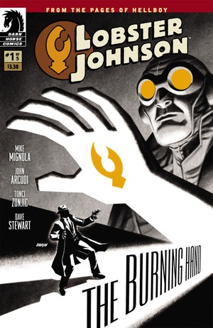
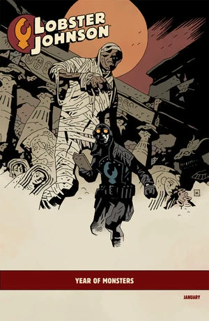
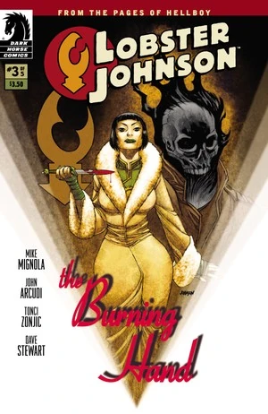
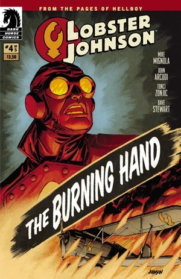
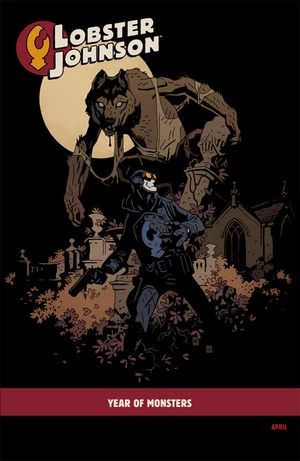
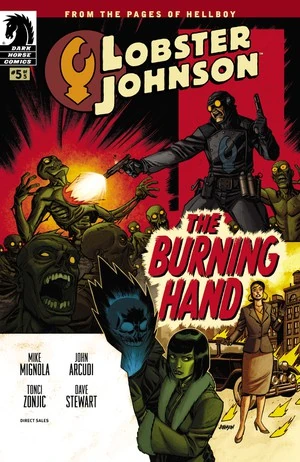

***The Burning Hand*** is a five-issue miniseries that takes place early in [the Lobster's](/entry/The_Lobster) career, in 1932.

## Publication History

The miniseries was published from January to May 2012. The series featured covers by Dave Johnson and "[Year of Monsters](/entry/Year_of_Monsters)" variant covers by [Mike Mignola](/entry/Mike_Mignola) for \#1 and \#4.

## Synopsis

### Part One

When a tribe of phantom Indians start scalping policemen, Hellboy's crime-fighting hero Lobster Johnson and his allies arrive to take on these foes and their gangster cronies!

### Part Two

With a city swamped in dead gangsters with claws branded into their foreheads, mob boss [Arnie Wald](/entry/Arnie_Wald) seeks the assistance of a deadly mystic and her strange partner to take down the vigilante known as [Lobster Johnson](/entry/Lobster_Johnson).

### Part Three

A fiery menace is turning the city into an inferno, and only Lobster Johnson and his league of crime fighters can put an end to these paranormal horrors.

### Part Four

As dead gangsters bloody the floor of his secret hideout, crime fighter Lobster Johnson goes head to head with a powerful German undead—[The Black Flame](/entry/the_Black_Flame_%28character%29).

### Part Five

Lobster Johnson blasts his way through an army of mad sewer cannibals in order to get to the greedy mob boss [Arnie Wald](/entry/Arnie_Wald).

## Gallery

Covers by [Dave Johnson](/entry/Dave_Johnson) unless otherwise stated.

 \#1

 \#1 "[Year of Monsters](/entry/Year_of_Monsters)" variant
by [Mike Mignola](/entry/Mike_Mignola)

 \#2

 \#3

 \#4

 \#4 "[Year of Monsters](/entry/Year_of_Monsters)" variant
by [Mike Mignola](/entry/Mike_Mignola)

 \#5
