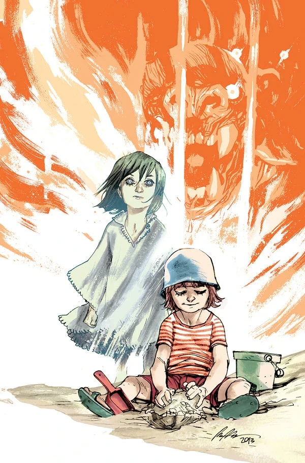
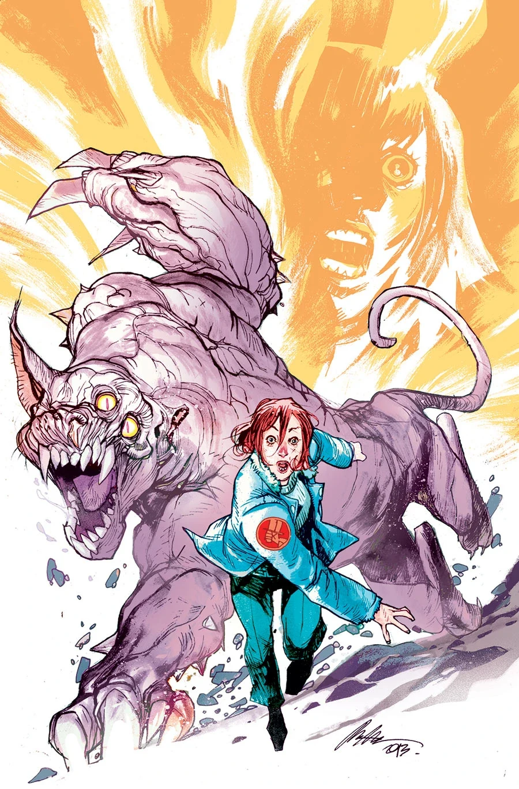
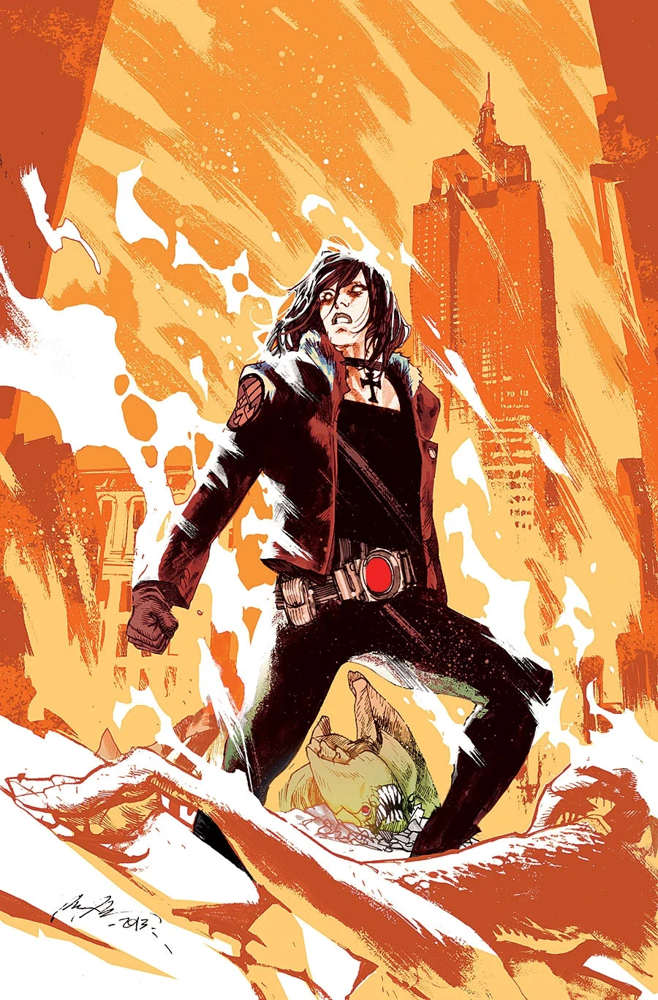
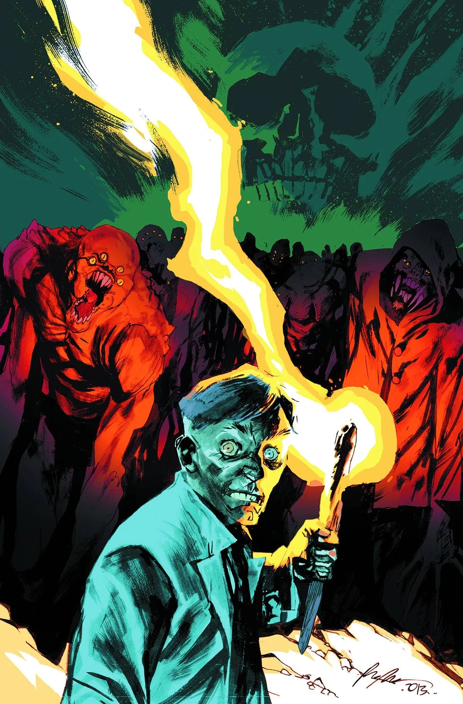

***Lake of Fire*** is a five-issue miniseries published from August 2013 with covers by [Rafael Albuquerque](/entry/Rafael_Albuquerque).

## Synopsis

### Part One

As Liz Sherman fights for her life in a Utah hospital, the B.P.R.D. sends a recon team into the no-man’s land that used to be New York City, and the young psychic Fenix encounters a monster-worshiping cult at the Salton Sea.

### Part Two

While the young psychic Fenix stumbles upon a monster-worshipping version of Burning Man, Liz Sherman finds herself stuck in a ruined hospital and pitted against a mad doctor and his monster–sized, mutated feline!

### Part Three

As Liz flees the monster-filled hospital, her conscience kicks in and she thinks of everyone she left behind at the mercy of the mad doctor. She has to return to save them, but what can she do when she remains powerless? Can she find the fire again?

### Part Four

As Liz and a police squad ambush the mad doctor and his Moreau-like experiments, Fenix takes on a group of cultists and by killing their god!

### Part Five

Liz Sherman brings a fiery assault to the mad doctor’s hospital and his army of mutant monsters, while the B.P.R.D. plans a sneak attack on Manhattan-now under the Black Flame’s control.

## Gallery

