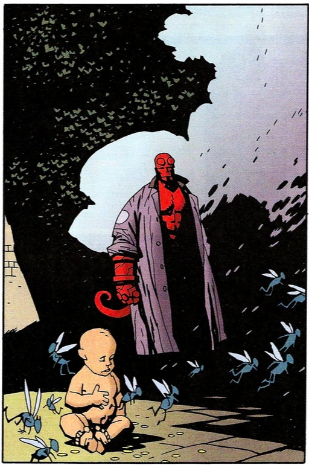
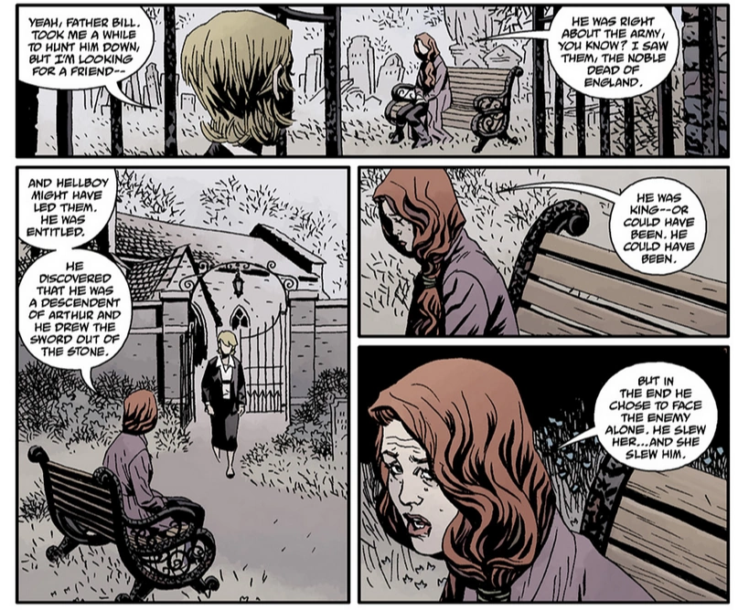
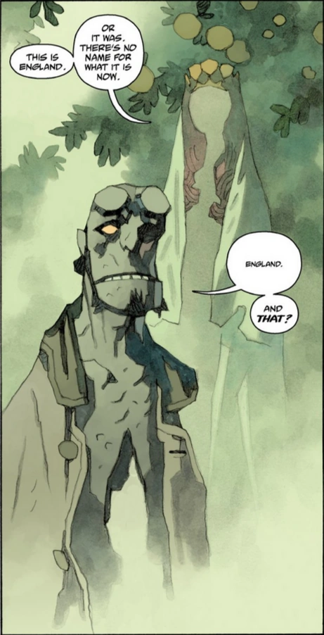
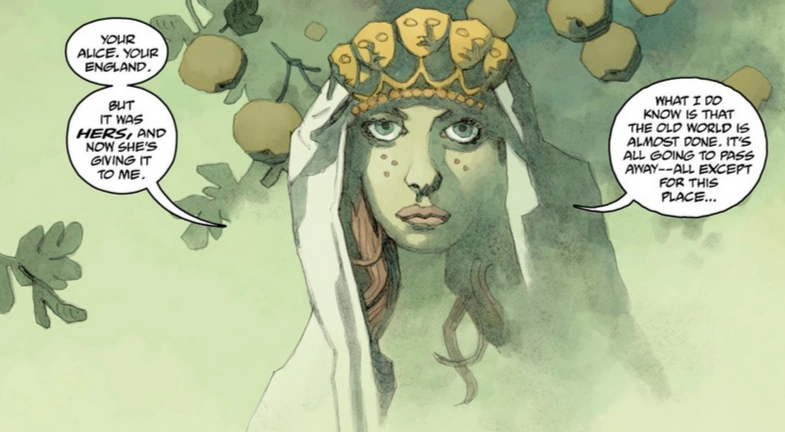
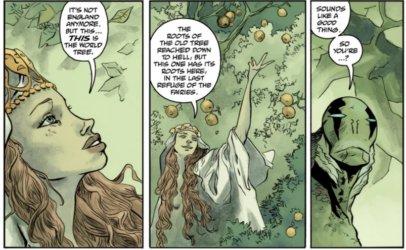
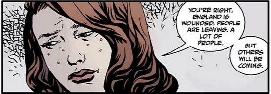
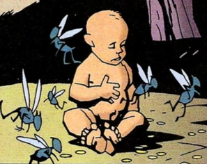

**Alice Monaghan** is a woman of Irish blood that Hellboy rescued as an infant.

## History

 When she was a baby, fairies switched Alice with a changeling so they could raise her as their own, because they could no longer have children, .[1] To rescue her, [Hellboy](/entry/Hellboy) had to take a corpse to an appropriate grave and dispatch with the last fomorian. Even after she was returned, however, she continued to see the fairies, whom she claims to never have tried to take her again like before. Upon discovering this, her mother sent her off to school out of worry for her protection. When both her parents passed away, she finally returned home and lived there mostly unbothered. Despite being in her early fifties, Alice looks remarkably young - a trait she attributes to spending so much time with the fairies.[2]

Years after her rescue by Hellboy, she is reunited with him when he returns to England, and is drawn into his struggle with Nimue. [3] After several adventures and mishaps, Alice helps Hellboy defeat Nimue and is with him when he dies.[4] After [Queen Mab's](/entry/Queen_Mab) murder by [Nimue](/entry/Nimue), the ghost of the old fairy queen passed her crown to Alice, the human born of the fae and humans.  [Kate](/entry/%E5%87%AF%E7%89%B9%C2%B7%E8%80%83%E7%91%9E%E6%A0%B9)) met Alice in England when she was tracking down [Father Bill](/entry/Father_Bill) after she found out some leads about Hellboy there. They talk for a while as Alice summarized what happened to Hellboy and how his blood had baptized England, by showing the lilies that grown in front of them while they were talking, Kate who was confused and grieving for her friend suddenly got a phone call from [Bruno](/entry/Bruno_Karhu), but when she looked back Alice was gone and the cemetery they were in was full of the lilies that Alice had shown her.[5] 

Alice appears before [Abe Sapien](/entry/Abraham_Sapien) in a beautiful fairy realm of England, explaining that she had taken the mantle as caretaker of the last refugee of fairies to escape the end of the world so that a piece of the Old World may live. Abe wished to remain to escape his destiny and pains, but Alice told him he could not stay and encouraging him to stop running, saying he must fulfill his destiny in the New World to come.[6]

She also speaks briefly with Hellboy, during his dream in [The Hounds of Pluto](/entry/The_Hounds_of_Pluto) in a watercolor panel sequence, portraying the same English fairy realm as background. The exchange between them is short and melancholic, Alice knew that Hellboy wished to stay with her in the beautiful dream and she wished that he could, but she knows that he can't.

Alice, alongside the last of the [Daoine Sidhe](/entry/Daoine_Sidhe), observing the outside world as well as the coming of the last battle for the spirit of mankind. Through all this, she still hold out for the return of Hellboy and his friends, sadly it was all too late and as commented by one of the fairy: "I don't think they're coming back".[7]Some time later, after Hellboy has passed away and Earth is overrun by the [Ogdru Hem](/entry/Ogdru_Hem), [Sir Edward Grey](/entry/Edward_Grey) after finishing all the works needed to be done in Hell and asked [Koschei](/entry/Koshchei_%28character%29) to take care of the new Hell that was remade by Hellboy, was ready to leave as [Acheron](/entry/Acheron_%28river%29) alongside the other Rivers of Hell, but was instead given a chance to returned to England once more by a talking snake whom brought him to England and was greeted by Alice. She asks Grey to serve as the protector of England, and offers him rest until he is needed, while also reuniting him with his [lost love](/entry/Mary_Wolf). [8]

## Appearances in other Media

### [*Hellboy* (2019 film)](/entry/%E5%9C%B0%E7%8B%B1%E7%94%B7%E7%88%B5%EF%BC%9A%E8%A1%80%E7%9A%87%E5%90%8E%E5%B4%9B%E8%B5%B7))

In the 2019 reboot, Alice is played by actress Sasha Lane.

## Gallery

 

 

## References

<references />

[1] [The Corpse](/entry/The_Corpse)

[2] [The Wild Hunt](/entry/The_Wild_Hunt)

[3]

[4] [The Fury](/entry/The_Fury)

[5] [An Unmarked Grave](/entry/An_Unmarked_Grave)

[6] [The Garden (III)](/entry/The_Garden_%28III%29)

[7] [Ragna Rok](/entry/Ragna_Rok_%28story_arc%29)

[8] [Koshchei in Hell](/entry/Koshchei_in_Hell)
