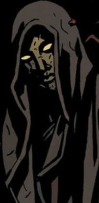

**Sir Edward Grey** was a nineteenth century paranormal investigator. After being dragged to Hell and cursed with eternal life, he survived into the modern era and gained occult powers and knowledge of events surrounding [Hellboy](/entry/Hellboy)'s destiny. He is often seen in the company of [Dagda](/entry/Dagda), and on occasion [the Baba Yaga](/entry/Baba_Yaga_%28character%29) or [Mohlomi](/entry/Mohlomi). He has shown many times to have faith in Hellboy and his rejection of his so-called "destiny."

## History

### Early life

Edward Grey was born in September 16th, 1856, in West Sussex, England. He spent his childhood on the estate of Lord Robert Hastings, where his father worked as a game warden. When Grey turned twelve in the spring of 1869, a number of cows from Lord Hasting's herd were found slaughtered in the woods. Three children soon disappeared after, and the local men formed search parties. Grey, who suspected the real nature of the killer, tracked the predator to its lair in the Hasting family vault. The creature was one of Hasting's sons, who had apparently contracted the werewolf curse while at school in Paris. He had been secretly devouring the corpses in his family vault before his uncontrollable urges led him to killing cattle and children. Grey fought and killed the werewolf with a bullet blessed by a local priest.

Lord Hastings never attempted to conceal what his son had done and had his son's body burned to ashes overseen by the local priest. Hastings repaid his debt to Grey by generously offering medical attention and having the local priest ensure the boy did not inherit the werewolf curse. A deep bond was developed between Grey and Hastings, as Grey was very impressed by the latter's kindness and nobility. Grey soon became a minor celebrity in West Sussex and was reported to have had numerous encounters with the supernatural.

### The Witchfinder

In 1876, Grey was recommended by Hastings in investigating the news of a haunting in the Tower of London. Grey traveled to London, where he confronted a bear-like creature believed to be the ghost of Lord Jeffreys. Although the details of Grey dealt with the creature remained uncertain, there hasn't been any further disturbance. Grey soon attracted fame and recognition from the public and inevitably the royal government. Queen Victoria herself wanted Grey to stay on as a special agent to the crown, dealing with occult matters. Grey accepted the queen's request.

In February 1879, Grey foiled a plot by a coven of witches to murder the queen. He had stopped them just in time, and the next month was knighted for "special services in the protection of Crown and Country." Later that year, he investigated the mysterious deaths of members of the Saunders Expedition at the hands of a strange [creature](/entry/Servants_of_the_Left_Hand). During the course of the investigation, he found allies in a man calling himself "[Captain](/entry/Captain)" and medium [Mary Wolf](/entry/Mary_Wolf). Mary in particular would leave an impression on Sir Edward, warning him of a destiny looming over him linked to the river [Acheron](/entry/Acheron). The investigation also marked his first encounter with the [Heliopic Brotherhood of Ra](/entry/Heliopic_Brotherhood_of_Ra), who were also interested in the expedition's findings. The Brotherhood killed both the Captain and Mary, which Sir Edward would hold against them for the rest of his life.[1]

In 1880, Sir Edward traveled to Utah on the trail of former H.B.R. member [Lord Adam Glaren](/entry/Adam_Glaren). While in Utah he befriended a local cowboy [Morgan Kaler](/entry/Morgan_Kaler) and his friend Isaac. Sir Edward and Kaler teamed up to stop [Eris](/entry/Eris), a witch who had formed a cult in the area.[2] In August 1882, Sir Edward uncovered a plot by the visiting nobleman vampire [Vladimir Giurescu](/entry/Vladimir_Giurescu) to establish a "secret empire" in England. Sir Edward wounded Giurescu and forced him to flee back to Romania. It is during this time that he first came into contact with [Mohlomi](/entry/Mohlomi), who had traveled to England to warn him about Giurescu.[3]

In 1884, Sir Edward investigated the a series of thefts related to ancient technology by [Aldous Middengard Sinclair](/entry/Aldous_Middengard_Sinclair). The investigation led to Grey being introduced to the [Foundry](/entry/Foundry_%28organization%29) by Queen Victoria and meeting members of the [British Paranormal Society](/entry/The_British_Paranormal_Society_%28organization%29) who had their own interest in the case. Sinclair's connection to the H.B.R. also brought Sir Edward into contact with [Panya](/entry/Panya_%28character%29), who was staying with Lord [Michael Glaren](/entry/Michael_Glaren). Sir Edward managed to stop Sinclair as he was about to open a portal to another world over Greenwich, killing him and destroying his machine in the process.[4] Later that same year, Sir Edward discovered the Dutch warlock [Epke Vrooman](/entry/Epke_Vrooman) and pursued him, finally killing him near the French island of Saint-Sebastian.[5]

From 1884 to 1889, Sir Edward Grey focused his attentions on the increasingly bizarre activities of the Heliopic Brotherhood of Ra and its chartered branches, the Knights of the Silver Star and the Knights of Abydos. In 1888, Sir Edward aided in the investigation of the Jack the Ripper killings, but his exact role in the case remains a mystery. A few months later, Sir Edward quit government service over Queen Victoria's decision to suppress the true identity of Jack the Ripper. Sir Edward established an independent "occult detective" practice in Whitechapel. He continued to work as an occult detective in London from February 1889 to July 1908. In 1892, Sir Edward turned in the notorious witch Abigail Wodehouse over to Scotland Yard. He monitored the Heliopic Brotherhood of Ra closely before the closing of the Universal Temple in September 1893, and tracked their activities as they continued as an underground society.

In the twentieth century, Sir Edward investigated the strange rumors of the H.B.R.'s activities in Europe. Upon learning of the Tunguska Explosion in June 30th, 1906, which he believed to be caused by an H.B.R. ceremony, Sir Edward closed his London office and left England for Europe. Sir Edward resurfaced in New York City on April 13th, 1914 and opened his practice as a private occult detective there. In late February 1916, Sir Edward heard rumors that the H.B.R.'s branch, the Knights of the Silver Star, were holding meetings in Chicago. Sir Edward left New York for Chicago and was never heard from again.

It was later revealed that the H.B.R. was involved in the summoning of the Duke of [Hell](/entry/Hell) [Amdusias](/entry/Amdusias). They had managed to partially conjure him when Sir Edward appeared and executed all of them. Sir Edward managed to stop Amdusias' summoning, but was dragged back into Hell by the demon. Amdusias cursed Sir Edward with eternal life, tore his body to pieces, and then cast him into the river Acheron.

Sir Edward was found by a multitude of unknown creatures native to Hell. While his appearance remained withered and corpse-like, the creatures stitched him back into his full form. He later came upon the house of the [Angus Weir](/entry/Angus_Weir) and took up residence in it, although he later became able to escape Hell as well. Grey was tutored in the magical arts by Weir's spirit, which resided in the house, and became an accomplished warlock himself. [6]

### Modern Day

 Nearly a century since his disappearance, Sir Edward Grey reappeared as a phantom-like being wearing an emotionless mask and attired in full body cloak, associating himself with the faerie king [Dagda](/entry/Dagda) and the witch [Baba Yaga](/entry/Baba_Yaga_%28character%29).

During the Giurescu Affair, Sir Edward, Dagda and the Baba Yaga were observing Hellboy's actions as he was seemingly killed by [Hecate](/entry/Hecate) and her "son," Vladimir Giurescu, somehow able to watch even as he was temporarily cast out of the normal world and into the realm of the [Ogdru Jahad](/entry/Ogdru_Jahad). Of the three observers, it was Sir Edward who seemed the least surprised and the most pleased by Hellboy's decision to reject his destiny as the bringer of Ragna Rok and break off his horns. Sir Edward proclaimed Hellboy's actions to be "a miracle" and that in doing so he had "given birth to himself."

Sir Edward later appeared once again alongside Dagda during a meeting of the fae folk. Dagda and Sir Edward were observing Hellboy via a statue carved in his likeness that rested in a shallow pool of water. Several members of the meeting, namely [Gruagach](/entry/Gruagach) (who already held a grudge against Hellboy) were skeptical of Hellboy's ability to reject destiny. Sir Edward, true to his character, remained optimistic, replying to claims that Hellboy's fate had already been written that he was "rewriting it." Alongside the others, Sir Edward watched Hellboy as he escaped from the clutches of the Bog Roosh. He met Mohlomi when he had just helped save Hellboy's life from [Urgo-Hem](/entry/Urgo-Hem) a short while afterwards. After discussing the implications of the event, Mohlomi told Sir Edward that he was ready to go with him.

Sir Edward later visited and inquired the recently depowered and imprisoned Hecate on her origins, which she freely gave. During this conversation Hecate referred to herself as Sir Edward's "queen," a claim he flatly rejected. Hecate also claimed that it was Sir Edward's fate to find Hellboy after he fell in battle during an upcoming war of magic. After Hacate told him that Hellboy would also be his savior and destroyer, she revealed that he would suffer like no man ever had and that he would need to "do evil to do good". She said that this was not her curse for him and it was simply something meant to happen. Afterward, she wished him farewell and hoped he would not take it too hard on himself for what was to come, and Sir Edward left her sanctum without saying a word.

After Hellboy's death at the end of the war against the [Queen of Blood](/entry/Queen_of_Blood), Sir Edward attempts to have Baba Yaga take him to Hellboy. She tries to persuade him to leave Hellboy to his fate, but relents and sends Sir Edward to the Abyss. There, Sir Edward defends Hellboy from a horde of abyssal creatures and the [Furies](/entry/Erinyes) before teleporting himself and Hellboy to when they are attacked by the revenge-driven [Eligos](/entry/Eligos). Here, he sets up a spell to trap and hopefully destroy Eligos, who quickly catches up to the two. Edward sends Hellboy away as he does battle with the demon.

After Hellboy is lost in the abyss, Edward recovers him through magic. He reveals the house they are in belonged to a warlock who had betrayed his masters, who then dragged his home into Hell. The warlock set up protection wards to keep any creature of Hell from entering the house; something Hellboy wonders what it makes him, to which Edward replies he was 'never a simple creature of Hell.' Edward then reveals his history to Hellboy and how he became as he was today. Edward then informs Hellboy that even though he still has the Right Hand of Doom, he'll find that there is nobody left alive who wants it, and that while he may have lost his old life, for the first time he was truly free.

Later, Edward converses with the spirit of Weir, who tells him that he lied to Hellboy, to which Edward denies, stating that 'none left have the kind of ambition to use it.' The warlock chastizes him on letting Hellboy believe he is free when he is destined to do more horrible things; the first of which Edward says he agreed to bear the burden of in Hellboy's place when he pulled him from the abyss, and that Hellboy deserved to at least feel free for a short while.

Some time later, Sir Edward sought out the spirit of [Grigori Rasputin](/entry/Grigori_Rasputin), whom he sensed would become a vessel for the darkness of the Ogdru Jahad. Too focused to find him that he didn't realize he was being hunted until it was too late, he was swallowed up by a beast in the depths of Hell. In the beast's belly he met a number of people who had also tried to find Rasputin, including Mohlomi. In order to escape, they agreed to have Sir Edward absorb their power, killing them in the process. Once free, Rasputin appeared before him and demanded his service. Sir Edward attacked Rasputin but was overwhelmed by his power.[7]

He later appears to Hellboy, recounting the events that transpired since they last met and explaining that he had been destined to face Rasputin. Sir Edward also explained that mankind needed to go underground to survive, providing a number of coordinates from where they could descend to do so.

After Hellboy kills Rasputin, Sir Edward appears to his ghost. When Hellboy asked if that was the end, he shows him what was to come, including the inevitable victory of the Ogdru Hem, the end of their brief rule and the dead corpse of the Ogdru Jahad. Sir Edward accompanied Hellboy's ghost to the location of the [Osiris Club](/entry/Osiris_Club), explaining that the members had used the Right Hand to absorb the power of the Dragon and now sought to turn themselves into the gods of the New World. Hellboy refuses to allow that to come to pass and calls forth the Right Hand to him. In the ensuing confusion, the reunion of his spirit and the Hand destroys the Osiris Club and their stronghold.[8]

### Acheron

Sir Edward survives the explosion and returns to Hell, where he visits Eligos, still imprisoned by his magic. He informs Eligos of Rasputin's defeat, but is told in turn that [Pluto](/entry/Pluto) would soon arise, Grey's spells broken in display of the power the Watcher had given him. Despite his please that serving Pluto wouldn't benefit him, the two engage in battle until Grey uses his power to transport them to the banks of the Acheron. There Eligos stays his hand and asks for the rest of Grey's story before he kills him. Grey obliges and tells the story of his choices, adamant that he would not allow Pluto to undo the miracle of Hellboy changing Hell. Now empowered by the river Acheron, Grey overwhelms Eligos and finally accepts that he is no longer a man but a creature of Hell.

He is soon greeted by a quartet of four beings who personified the Rivers of Hell: [Phlegethon](/entry/Phlegethon), [Cocytus](/entry/Cocytus), [Styx](/entry/Styx) and [Lethe](/entry/Lethe). They greeted him as Acheron, their brother, and offered to wash away his remaining humanity and join them in the "Land Unknown" created by changes made in Hell by Hellboy. While initially reluctant, Angus Weir's spirit urges Grey to accept the invitation rather than become the last demon of Hell. Sir Edward agrees to accept the invitation, but not before one last thing to be done.[9]

This final task proves to be attempting to convince [Koshchei](/entry/Koshchei_%28character%29) to leave his solitude and defend Hell from [Pluto](/entry/Pluto). He then returns to the Rivers of Hell, but is convinced by a serpent to go to England, which still exists in an alternate plane of reality, despite the destruction of the rest of Earth. Once there, he's greeted by [Alice](/entry/Alice_Monaghan) who offered the chance to rest, while also being asked to serve as the protector of England should trouble arise in the future. Grey accepts both offers, and is reunited with [Mary Wolf](/entry/Mary_Wolf).[10]

## Powers and Abilities

Sir Edward Grey has been shown to be on good speaking terms with many of the magical creatures and citizens of the world, indicating that he himself has gained a few magical properties, if not more. This was confirmed in Hellboy in Hell, where he managed to deflect a de-powered Eligos with an invocation. He is apparently a very skilled magic user; his powers include the ability to teleport, levitation, telekinesis, flame conjuration, and demon binding. He also seems to have the ability to pull others from remote locations through mirrors.

Being active in the eighteen hundreds and surviving well past the new millennium, Sir Edward Grey seems to possess an extraordinary lifespan, well beyond standard human years. This is the result of the demon prince Amdusias' curse on him.

Being a well renown paranormal investigator, or at least a well renown former paranormal investigator, it is reasonable to believe that Sir Edward possesses a large amount of knowledge on the nature of the supernatural.

## Trivia

- Sir Edward Grey shares the same birthday as his creator, [Mike Mignola](/entry/Mike_Mignola).

## References

<references/>

[1] *[In the Service of Angels](/entry/In_the_Service_of_Angels)*

[2] *[Lost and Gone Forever](/entry/Lost_and_Gone_Forever)*

[3] *[City of the Dead](/entry/City_of_the_Dead)*

[4] *[The Gates of Heaven](/entry/The_Gates_of_Heaven)*

[5] *[The Drowning](/entry/The_Drowning)*

[6] *[Acheron](/entry/Acheron_%28story%29)*

[7]

[8] *[The Devil You Know](/entry/The_Devil_You_Know_%28story_cycle%29)*

[9] *[Acheron](/entry/Acheron_%28story%29)*

[10] [Koshchei in Hell](/entry/Koshchei_in_Hell)
