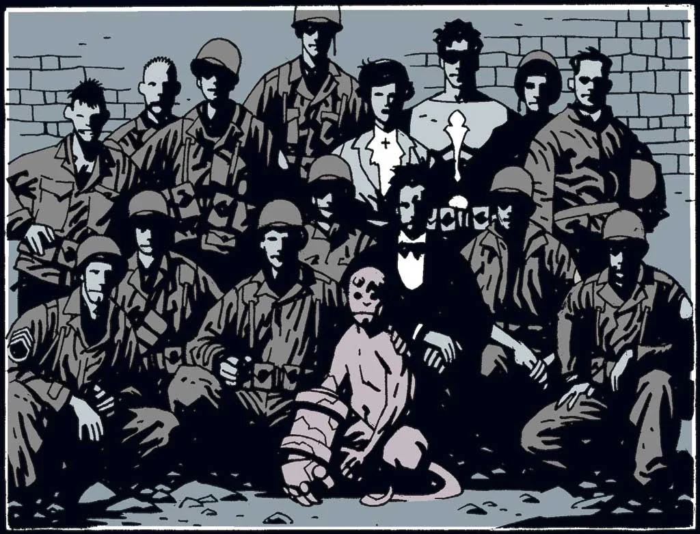
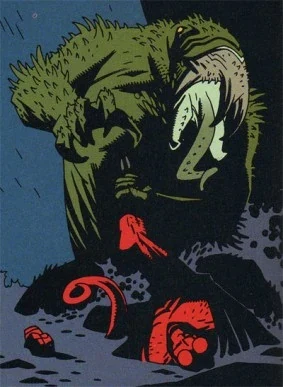
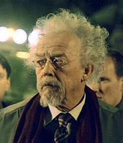
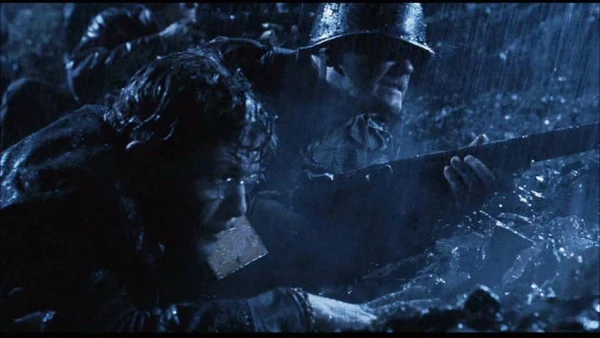

Professor **Trevor Bruttenholm** (pronounced /ˈbruːm/ **"Broom"**, often informally called such) was an expert of the occult and the first director of the [Bureau for Paranormal Research and Defense](/entry/Bureau_for_Paranormal_Research_and_Defense).

Present during "The Hellboy Incident" on December 23, 1944, he inadvertently gave [Hellboy](/entry/Hellboy_%28character%29) his name upon first seeing him. In the following years, he served as the parental guardian of Hellboy.

## History

Trevor Bruttenholm was born March 5, 1918 in Essex, England.[1] He attended Eton as a young man, joining the school's Ghost Club and befriending [Harry Middleton](/entry/Harry_Middleton).[2] Having become well-versed in the supernatural, Bruttenholm joined [The British Paranormal Society](/entry/The_British_Paranormal_Society_%28organization%29) in July of 1938.[3] He graduated from Oxford University in 1943.

### Wartime Service

Bruttenholm became an adviser to U.S. President Franklin D. Roosevelt when the Allies realized that Nazi leader Adolf Hitler was racing to use the occult to turn the tide of World War II. He spent the war serving as clandestine British intelligence analyst, listening and archiving German transmissions for any potential leads to their operations. Upon following up a seemingly mundane ghost sighting, Bruttenholm and his friend [Harry Middleton](/entry/Harry_Middleton) were beset upon by a zombie at a pub. Bruttenholm's uncle Simon called upon his friends to conduct a seance with the spirit of the zombie, only to learn that he spoke German and mentioned an associate of Simon's friends- Albert Mayhew. Mayhew's spirit was unearthed and given the body of the German soldier to be used as a guide by the Nazis to find the tomb of Eugene Remy, the illustrious founder of Mayhew's order, the [Heliopic Brotherhood of Ra](/entry/Heliopic_Brotherhood_of_Ra). Bruttenholm was then parachute dropped into Paris behind enemy lines and was guided by A.N. Sandhu to Remy's tomb in the Paris Catacombs. There he and Sandhu caught the Nazis in the middle of Mayhew's ritual to revive Remy. Sandhu was killed, and they ultimately failed in stopping the Nazis from their goal of acquiring Remy's secret tablets.

### "The Hellboy Incident"

 In 1944, Bruttenholm was alerted by [Lady Cynthia Eden-Jones](/entry/Lady_Cynthia_Eden-Jones), whom she learned from her spirit guides, about a cataclysmic event that would soon take place at the ruins of a church in East Bromwich. Bruttenholm, in turn, informed the war department, and eventually a patrol of U.S. troops, led by Sergeant [George Whitman](/entry/George_Whitman), joined Lady Cynthia, Bruttenholm, and noted occult scholar [Malcolm Frost](/entry/Malcolm_Frost) at East Bromwich. The group arrived at the ruins on December 21, 1944, two days before the date when Lady Cynthia's guide had predicted that the event was to occur. At the same time, the Russian mystic [Grigori Rasputin](/entry/Grigori_Rasputin) and a branch of the Nazi occult division were preparing to initiate [Project Ragna Rok](/entry/Project_Ragna_Rok). On December 23, at exactly the moment Rasputin had called upon the [Ogdru Jahad](/entry/Ogdru_Jahad), a little demon-like creature appeared before Bruttenholm and his group in a brilliant fireball. As Eden-Jones remarked that the creature looked "like a little boy", Broom remarked "Hellboy" – inadvertently naming him.[4]

### The B.P.R.D.

After the U.S. apprehended Hellboy, Bruttenholm, along with a group of American occultists with the support of the U.S. government, founded the [Bureau for Paranormal Research and Defense](/entry/Bureau_for_Paranormal_Research_and_Defense) and served as the Bureau's first director. At the same time, Bruttenholm continued to work closely with Hellboy. Instead of treating him as a monster or a dangerous experiment, Bruttenholm began to treat Hellboy like a human child, and, in March 1946, officially adopted Hellboy.[5]

From 1946 to 1952, Bruttenholm divided his time between leading field operations (including the discovery and neutralization of the remains of the Nazi doomsday project [Vampir Sturm](/entry/Project_Vampir_Sturm), and his encounter with the demon [Varvara](/entry/Varvara)) and tending to the growing Hellboy. He frequently traveled to Washington, D.C. to lobby for funding and government support for the B.P.R.D. Partly because of Bruttenholm's efforts, the United Nations granted Hellboy honorary human status on August 6, 1952. A week later, Bruttenholm promoted Hellboy to B.P.R.D. field agent.

![34-year-old Broom (right) in 1953.[6]](Hellboy1953.jpg "34-year-old Broom (right) in 1953.") Bruttenholm's tenure as director has been extremely resourceful and had resulted in the growth of the B.P.R.D. and the official recognition of its works by the United Nations. In September 1958, Bruttenholm resigned his directorship, remaining with the B.P.R.D. as an advisor and sometime field agent, which also enable him to have the opportunity to spending more time with Hellboy.

As Bruttenholm aged, he became increasingly engaged in private research involving the ancient Lemurian language.

As far back as 1982, Bruttenholm conducted a number of private hypnotism sessions with recently-inducted agent [Abe Sapien](/entry/Abe_Sapien) to uncover the mystery of his identity. He succeeded in bringing out the personality of Abe's past life, Langdon Everett Caul, and over the course of multiple sessions learned of Caul's past as a member of the [Oannes Society](/entry/Oannes_Society) and the circumstances that led to his transformation. He was even able to manifest a third spirit within the fishman, presumably the entity responsible for his change. It was through these sessions that Bruttenholm learned of the Cavendish family.

#### Cavendish Expedition

In November of 1992, Bruttenholm bid Hellboy farewell and traveled with the three Cavendish brothers to the Arctic Circle to search for ruins of the Hyperborean civilization, hoping to learn more clues to Abe's origins. The expendition disappeared in January of 1993, and was considered lost by July.[8]

On December 23,[9] Bruttenholm and the expedition discovered the ruins of the Hyperborean temple in Gorinium where [Grigori Rasputin](/entry/Grigori_Rasputin) sat in stasis next to the unmoving figure of the creature [Sadu-Hem](/entry/Sadu-Hem). Bruttenholm touched Rasputin, and the moment of contact not only awakened Rasputin and Sadu-Hem, but allowed Rasputin to see through Bruttenholm's mind, letting him learn of the life and history of Hellboy. Rasputin concluded that Hellboy was the key in freeing the [Ogdru Jahad](/entry/Ogdru_Jahad) from their prisons. Sadu-Hem transformed the Cavendish brothers into [frog creatures](/entry/frog_monster),[10] the first of thousands of such beasts the Bureau would eventually face, while Bruttenholm was allowed to live, being used as a bait by Rasputin to trap Hellboy.

### Death

 On May 9, 1994,[11] Bruttenholm suddenly resurfaced and summoned Hellboy to his Brooklyn Park home. Bruttenholm struggled to recollect what had happened in the Arctic, and could not explain how he had returned to civilization. His attempts to inform Hellboy about what had taken place were interrupted by the appearance of several frogs; fleeing in a panic from the small amphibians, Broom was murdered by a man-sized frog monster in the other room.[12] Hellboy would eventually avenge his father's death by stopping Rasputin's plans to free the Ogdru Jahad and saw the mystic burn alive for his crime.[13]

Broom was 76 years old at the time of his death. His funeral was held on May 13, 1994.[14]

## Other media

### 2004-2008 film series

Professor Trevor Bruttenholm, as portrayed by John Hurt

[John Hurt](/entry/John_Hurt) portrays Broom in the 2004 film *[Hellboy](/entry/Hellboy_%282004_film%29)* and its sequel *[The Golden Army](/entry/Hellboy_II__The_Golden_Army)*. [Kevin Trainor](/entry/Kevin_Trainor) portrays the young Broom in the film's opening scene.

Comic creator [Mike Mignola](/entry/Mike_Mignola) was struck by how strongly Hurt resembled his original illustrations of Broom.[15]

#### *[Hellboy](/entry/Hellboy_%282004_film%29)* (2004)

 In the film, Bruttenholm accompanies the team of American commandos to stop Rasputin from initiating Project Ragna Rok. He receives a bullet in the leg from [Karl Ruprect Kroenen](/entry/Karl_Ruprect_Kroenen) that causes him to limp for the rest of his life, but throws a hand grenade under the portal machine that both destroys the machine and maims Kroenen as he is attempting to retrieve it. When the infant [Hellboy](/entry/Hellboy_%282004%E2%80%932008_film_character%29) appears, Bruttenholm adopts him and dedicates himself to raising Hellboy as a human, despite his demonic origins. The film makes the father–son relationship between the two characters more explicit, with Hellboy always calling Bruttenholm "Father."

As the movie begins in the present, Bruttenholm discovers that he is dying of cancer, and selects the young agent [John Myers](/entry/John_Myers) to serve as Hellboy's new liaison. He is killed by Kroenen as part of a plot to lure Hellboy to Rasputin's grave, where he can fulfill the purpose he was summoned to Earth for. Before he is killed, Rasputin taunts him, saying that Bruttenholm has effectively nurtured a creature with the power, and the destiny, to bring about the Apocalypse, and also shows him a vision of the post-apocalyptic remains of New York City, with the Ogdru Jahad looming overhead and Hellboy, with regenerated horns, standing in the center. Bruttenholm returns that he will always see Hellboy as his son, and respectfully accepts his fate and allows Kroenen to kill him.

When Hellboy is about to unlock the key that will release the Ogdru Jahad from their prison as Anung un Rama, Myers stops him by throwing him a rosary that belonged to Bruttenholm, a reminder that Bruttenholm raised him to choose his own path—upon which Hellboy tears away his re-grown horns and kills Rasputin rather than turn the final key.

#### *[Hellboy II: The Golden Army](/entry/Hellboy_II__The_Golden_Army)*

A middle-aged Bruttenholm also makes a brief appearance in the sequel film, played again by Hurt. During the film's prologue, taking place in 1955, the middle-aged Broom is raising the young Hellboy in secret on a U.S. Air Force base in New Mexico. On Christmas Eve, Bruttenholm reads his "son" a story about the creation of the [Golden Army](/entry/Golden_Army).

In the present, Hellboy wears his father's rosary beads on his wrist, like a bracelet.

### *[Hellboy Animated](/entry/Hellboy_Animated)*

Trevor Bruttenholm also appeared in the straight-to-DVD animated film *[Hellboy: Blood and Iron](/entry/Hellboy__Blood_and_Iron)*, voiced as a young man by James Arnold Taylor, and as an elderly man by Hurt again.

In the film, a series of flashbacks show the young Bruttenholm traveling to Eastern Europe to combat Erzebet Andrushko, an evil vampiress who has been terrorizing Transylvania. He emerges victorious, though the only survivor of his team.

Sixty years later, he is still a member of the Bureau, though no longer Director of Field Operations. Experiencing recurring nightmares of Erzebet's resurrection, he suggests that the entire team be sent on an apparently trivial mission in the Hamptons, where Erzebet's disciples are indeed working to bring her back. Despite the dangerous creatures fought by the other members of the team, it is Bruttenholm who confronts Erzebet, alone, and manages, despite his age, to outwit and destroy her again.

### 2019 film

 Trevor Bruttenholm also appeared in the 2019 film *[Hellboy](/entry/%E5%9C%B0%E7%8B%B1%E7%94%B7%E7%88%B5%EF%BC%9A%E8%A1%80%E7%9A%87%E5%90%8E%E5%B4%9B%E8%B5%B7))*, portrayed by [Ian McShane](/entry/Ian_McShane).

This depiction of Broom is much harder-edged than other portrayals, leading to a more contentious relationship with his adopted son.[16] Bruttenholm speaks with a more foul-mouthed, flippant, and casual English tone. He was born to a father that he described as “an unrepentant asshole”, though the latter did teach him the value of shaving. Years later, In the 1940s, Bruttenholm was part of a daring raid against Nazi Germany, led by Lobster Johnson. After the Nazis were killed, Bruttenholm spotted a demonic being which spawned from a portal. He slowly approached it and chose not to kill it, in spite of having killed numerous monsters in the past. He would raise the demon, which he called Hellboy, as if he were his own son. As such, Hellboy called him “dad”. He also gave Hellboy a gun on his 10th birthday and sent him hunting. In 2019, Bruttenholm sent Hellboy to Mexico to retrieve Esteban Ruiz, who had been sent there some time ago.

## References

<references />

[1]

[2] *[Hellboy and the B.P.R.D.](/entry/Hellboy_and_the_B.P.R.D.): 1953* – "[The Kelpie](/entry/The_Kelpie)"

[3]

[4] *[Hellboy](/entry/Hellboy_%28series%29): [Seed of Destruction](/entry/Seed_of_Destruction)* \#1

[5]

[6]

[7]

[8]

[9]

[10]

[11]

[12]

[13] ''[Seed of Destruction](/entry/Seed_of_Destruction) \#4

[14]

[15] *Hellboy: The Seeds of Creation*. MIGNOLA: "My first day on the set was John Hurt's first day of working, and he looked *so much* like the character in the comic, to the point that even *I* was thinking for a second 'When I drew this character, was I thinking of John Hurt? Was I looking at a photo of John Hurt...?' I wasn't, I just drew this guy." Event occurs at 23:07.

[16] ["Hellboy: Exclusive Trailer Breakdown with David Harbour"](https://www.youtube.com/watch?v=knd_S_POYRQ), *IGN*. ([HARBOUR](/entry/David_Harbour): "This is a very different characterization of Broom. In our film, Broom is a much harder man \[...\] One of the big conflicts of the movie is Hellboy questioning his place in human society, and his dad is not very sympathetic to that questioning.")
