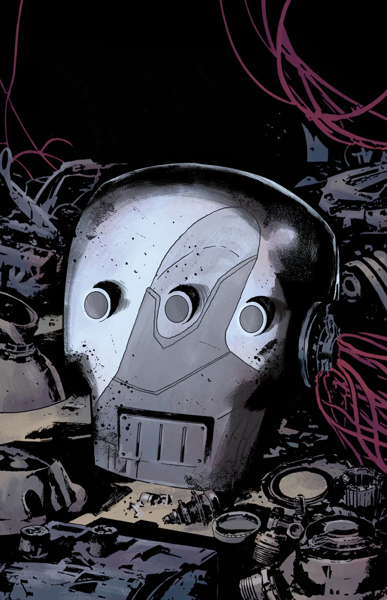
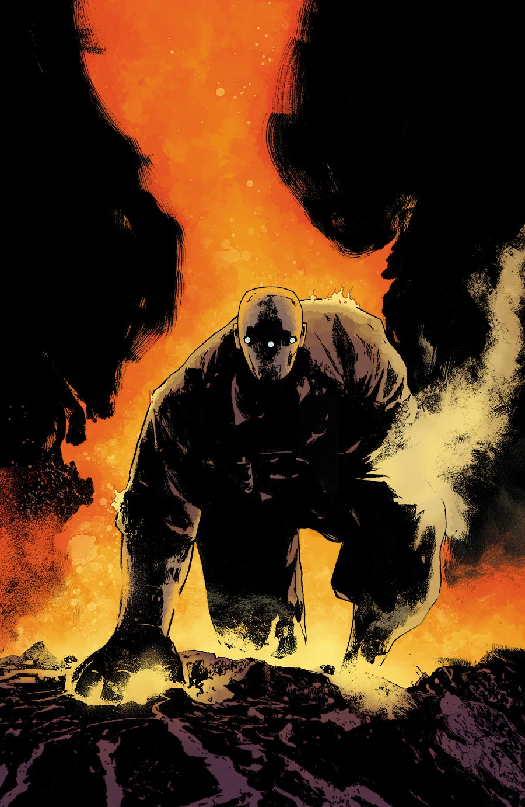

***Modern Prometheus*** is a two-issue arc drawn by Julián Totino Tedesco.

## Synopsis

### Part One

[Johann's](/entry/Johann_Kraus) fascination with the [Sledgehammer armor](/entry/Vril_Energy_Suit) leads to a strange journey into the past and the origin of "Project Epimetheus."

### Part Two

Johann is lost in the memories of the Project Sledgehammer… Can he regain himself and control of the suit in time to save the [BPRD](/entry/Bureau_for_Paranormal_Research_and_Defense)?

## Gallery

