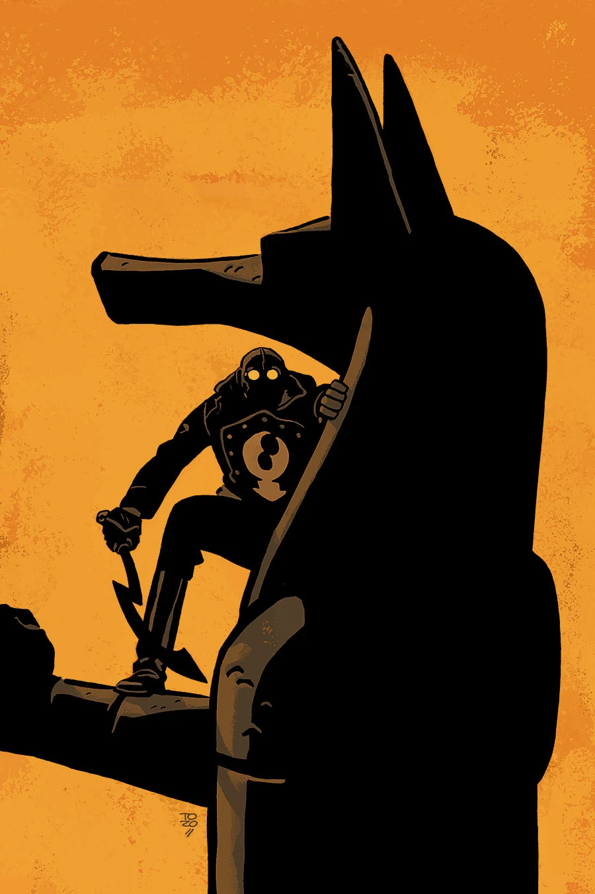

***The Glass Mantis*** is a story takes place in the middle of [the Lobster's](/entry/The_Lobster) career as a crime fighter in the 1930s.

## Publication History

This one-shot was published in December 2015, featuring a cover by [Tonči Zonjić](/entry/Ton%C4%8Di_Zonji%C4%87).

## Synopsis

Murder interrupts the opening of a new exhibit at the Metropolitan Museum. Lobster Johnson investigates to find out what makes a blown-glass sculpture worth killing for.

## Gallery

