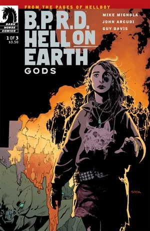
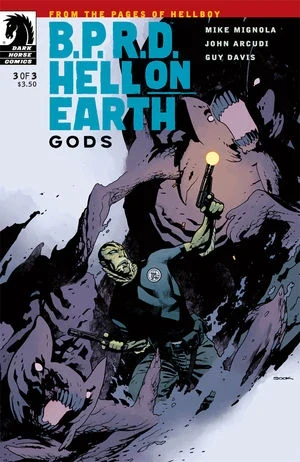
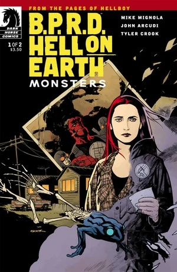
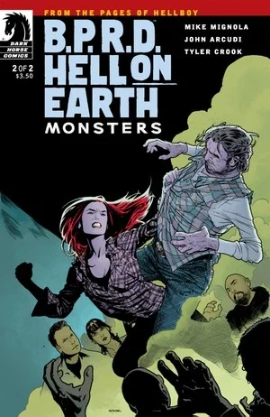
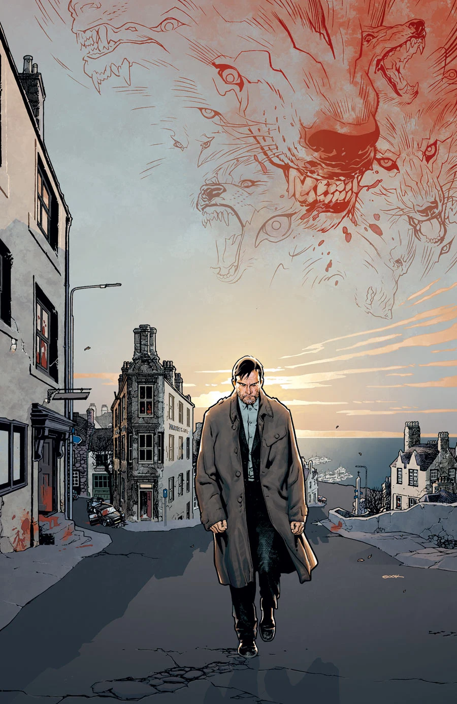
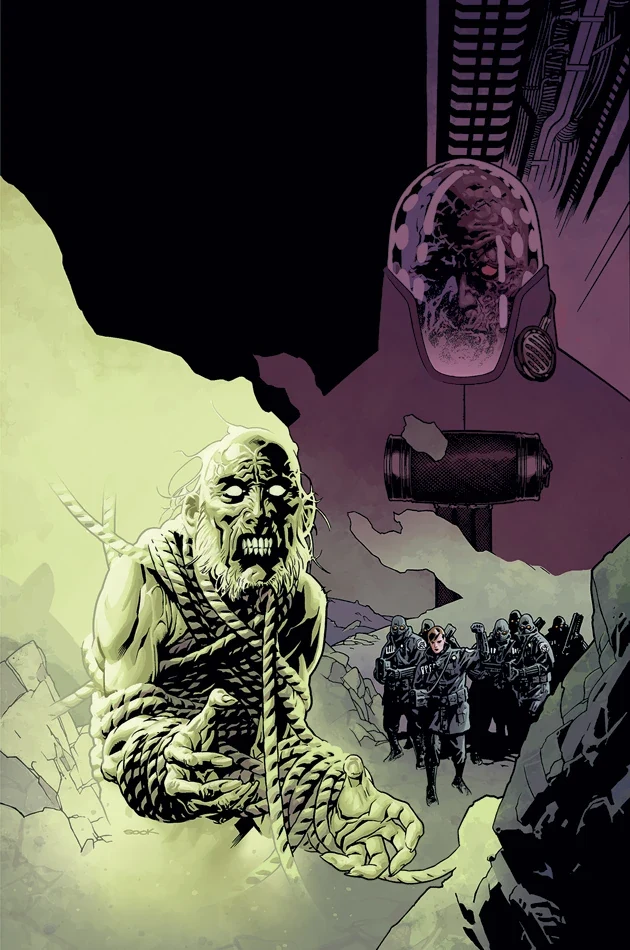
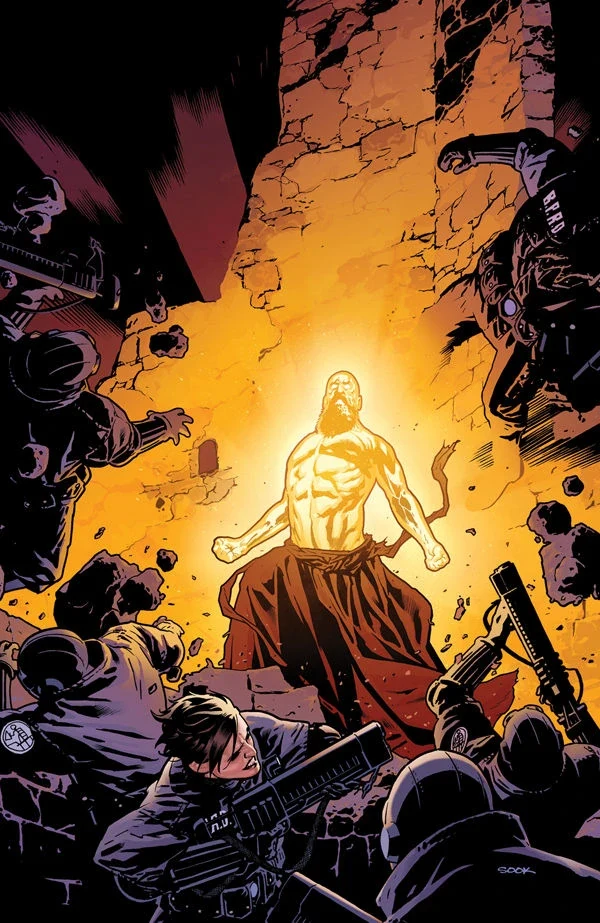
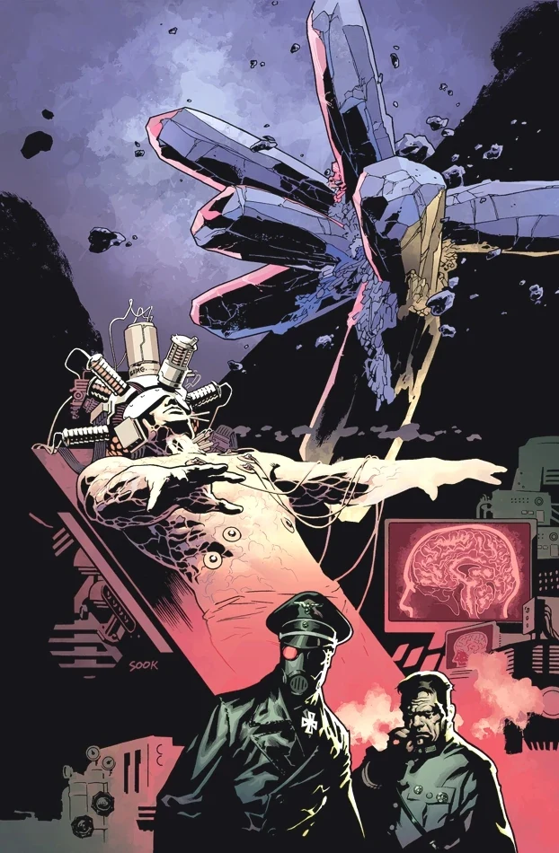
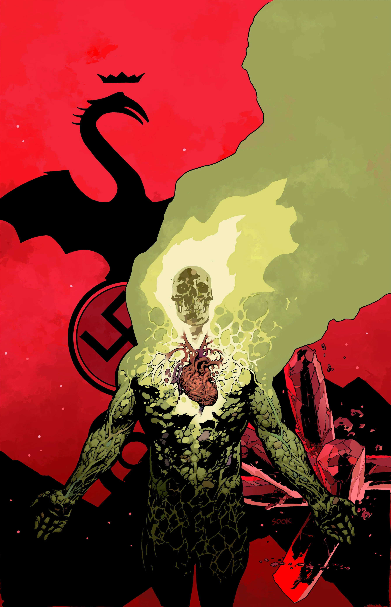
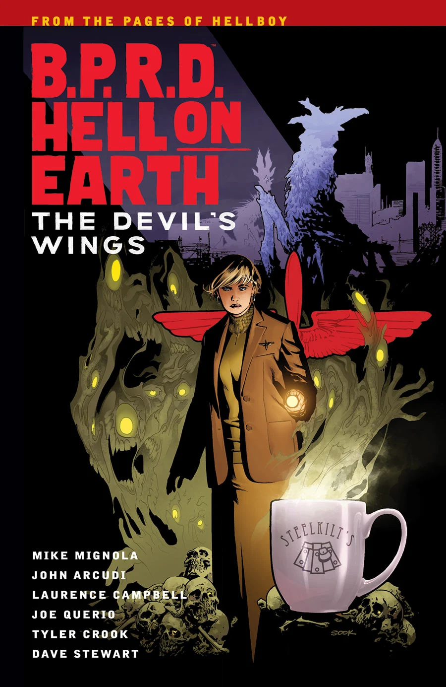

**Ryan Sook** is an American comic book artist from San Jose, California. He has worked on *Arkham Asylum: Living Hell*, *The Spectre*, *Hawkman*, *Seven Soldiers: Zatanna*, *Buffy the Vampire Slayer* and *Angel*. He also illustrated *X-Factor*, written by Peter David at Marvel Comics. His style bears a strong resemblance to [Mike Mignola](/entry/Mike_Mignola) and Adam Hughes.

## Interior Art

- [*Lobster Johnson: The Killer in My Skull*](/entry/The_Killer_in_My_Skull) (inks)
- [*B.P.R.D.: Hollow Earth*](/entry/Hollow_Earth) (pencils, inks with [Curtis Arnold](/entry/Curtis_Arnold))

## Cover Art

|*B.P.R.D. Hell on Earth: Gods* \#1

|*B.P.R.D. Hell on Earth: Gods* \#2

|*B.P.R.D. Hell on Earth: Gods* \#3

|*B.P.R.D. Hell on Earth: Monsters* \#1

|*B.P.R.D. Hell on Earth: Monsters* \#2

|*B.P.R.D. Hell on Earth: The Return of the Master* \#1

|*B.P.R.D. Hell on Earth: The Return of the Master* \#2

|*B.P.R.D. Hell on Earth: The Return of the Master* \#3

|*B.P.R.D. Hell on Earth: The Return of the Master* \#4

|*B.P.R.D. Hell on Earth: The Return of the Master* \#5

|*B.P.R.D. Hell on Earth – Volume 10: The Devil's Wings*

## External Links

- [**Wikipedia:** Ryan Sook](https://en.wikipedia.org/wiki/Ryan_Sook)
- [**Comic Book DB:** Ryan Sook](http://www.comicbookdb.com/creator.php?ID=195)
- [Official Website](http://www.ryansook.com/)
