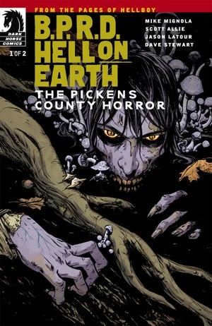
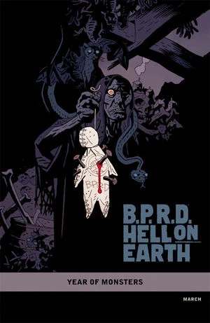

***The Pickens County Horror*** is a two-issue miniseries published from March to April 2012.

## Publication History

This is the sixth arc of the [*Hell on Earth* cycle](/entry/BPRD%3F%E4%BA%BA%E9%97%B4%E5%9C%B0%E7%8B%B1)), but it is a side story not following on from *[The Long Death](/entry/The_Long_Death)*. The issues were released with covers by [Becky Cloonan](/entry/Becky_Cloonan) with a "[Year of Monsters](/entry/Year_of_Monsters)" variant for the first issue by [Mike Mignola](/entry/Mike_Mignola).

## Synopsis

### Part One

As the world goes to hell, a backwoods vampire clan shelters themselves in their Gothic southern home, covered in fog and fungal horror, ready to create havoc for a trespassing B.P.R.D. crew.

### Part Two

A reclusive vampire clan and a deadly mist create one of the most disastrous missions our heroes have ever faced.

## Gallery

 \#1

 \#1 variant

 \#2
