**Guy Davis** is an American comic book artist primarily known for his work on *Sandman Mystery Theatre* and *[B.P.R.D.](/entry/B.P.R.D._%28series%29)*. He made his debut in the Hellboy Universe with [*B.P.R.D.: Dark Waters*](/entry/Dark_Waters) in July 2003. He was the regular artist for *B.P.R.D.* from March 2004 to March 2011.

## Interior Art

- [*B.P.R.D.: Dark Waters*](/entry/Dark_Waters)
- [*B.P.R.D.: Born Again*](/entry/Born_Again)
- [*B.P.R.D.: Plague of Frogs*](/entry/Plague_of_Frogs_%28story%29)
- [*B.P.R.D.: The Dead*](/entry/The_Dead)
- [*B.P.R.D.: The Black Flame*](/entry/The_Black_Flame_%28story%29)
- [*B.P.R.D.: The Universal Machine*](/entry/The_Universal_Machine)
- [*B.P.R.D.: Garden of Souls*](/entry/Garden_of_Souls)
- [*B.P.R.D.: Killing Ground*](/entry/Killing_Ground)
- [*B.P.R.D.: Revival*](/entry/Revival)
- [*B.P.R.D.: Out of Reach*](/entry/Out_of_Reach)
- [*B.P.R.D.: War on Frogs* \#1](/entry/War_on_Frogs) (Inks only)
- [*B.P.R.D.: The Warning*](/entry/The_Warning)
- [*How Koshchei Became Deathless*](/entry/How_Koshchei_Became_Deathless)
- [*B.P.R.D.: The Black Goddess*](/entry/The_Black_Goddess)
- [*Baba Yaga's Feast*](/entry/Baba_Yaga%27s_Feast)
- [*B.P.R.D.: King of Fear*](/entry/King_of_Fear_%28story%29)
- [*B.P.R.D.: Hell on Earth—New World*](/entry/New_World_%28B.P.R.D._story_arc%29)
- [*B.P.R.D.: Hell on Earth—Seattle*](/entry/Seattle)
- [*B.P.R.D.: Hell on Earth—Gods*](/entry/Gods)
- [*B.P.R.D.: Casualties*](/entry/Casualties)

## Cover Art

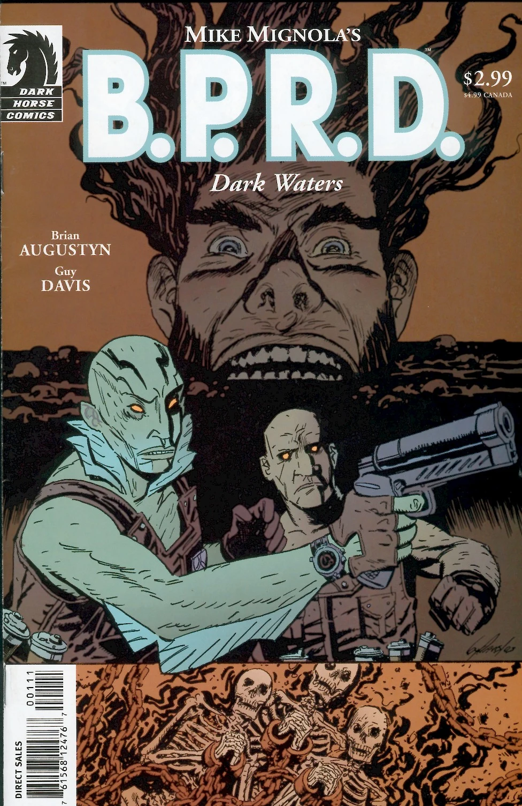

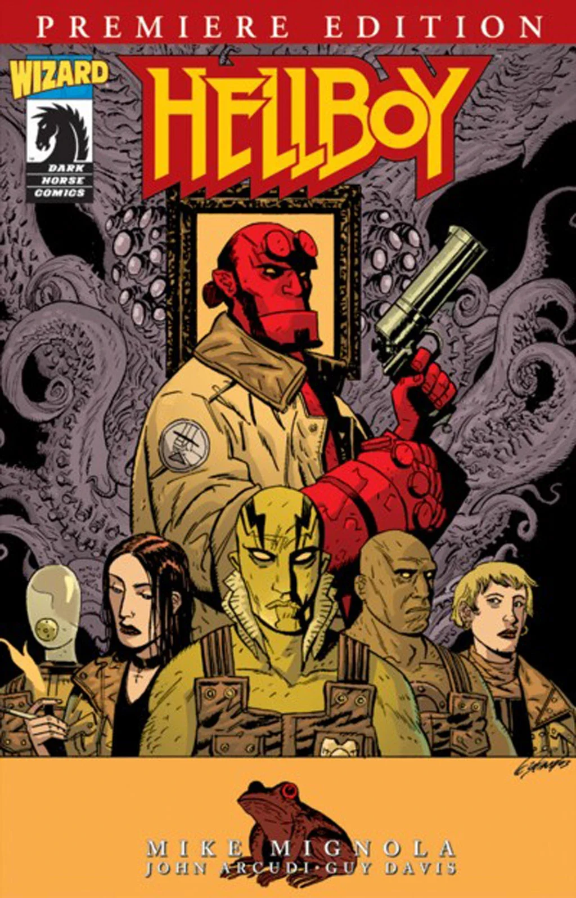

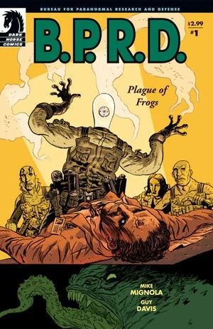

|*B.P.R.D.: Plague of Frogs* \#1

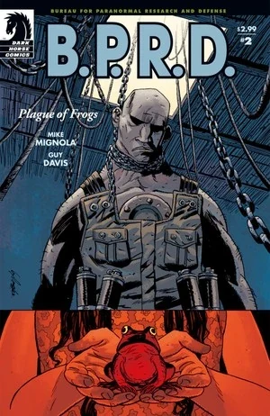

|*B.P.R.D.: Plague of Frogs* \#2

|*B.P.R.D.: Plague of Frogs* \#3

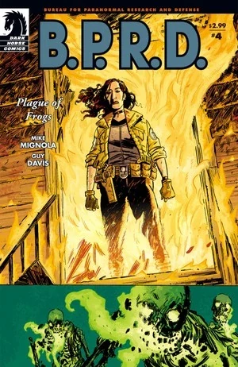

|*B.P.R.D.: Plague of Frogs* \#4

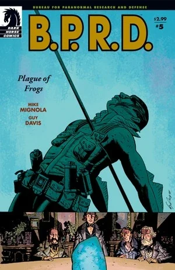

|*B.P.R.D.: Plague of Frogs* \#5

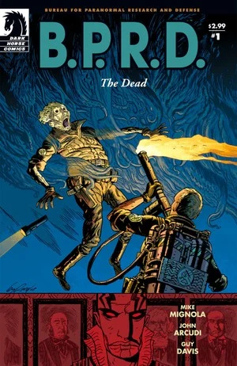

|*B.P.R.D.: The Dead* \#1

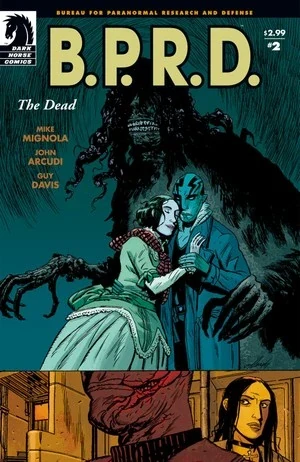

|*B.P.R.D.: The Dead* \#2

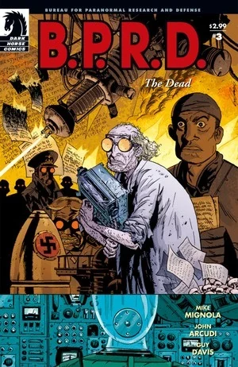

|*B.P.R.D.: The Dead* \#3

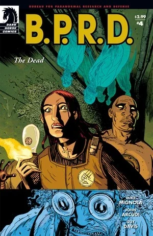

|*B.P.R.D.: The Dead* \#4

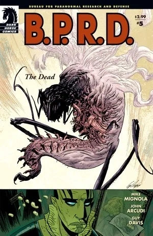

|*B.P.R.D.: The Dead* \#5

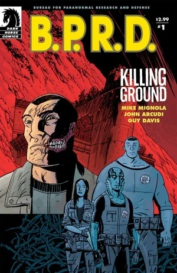

|*B.P.R.D.: Killing Ground* \#1

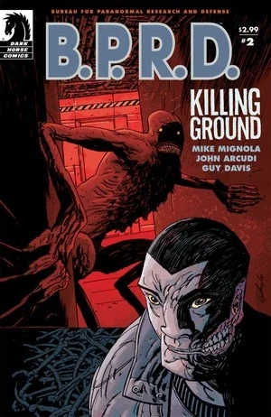

|*B.P.R.D.: Killing Ground* \#2

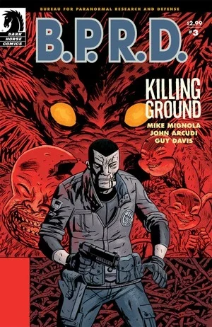

|*B.P.R.D.: Killing Ground* \#3

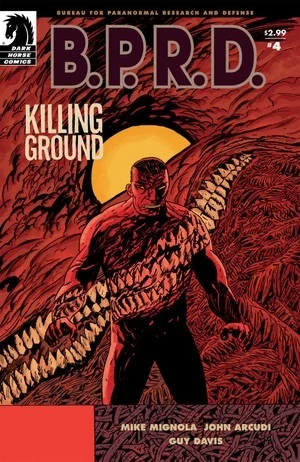

|*B.P.R.D.: Killing Ground* \#4

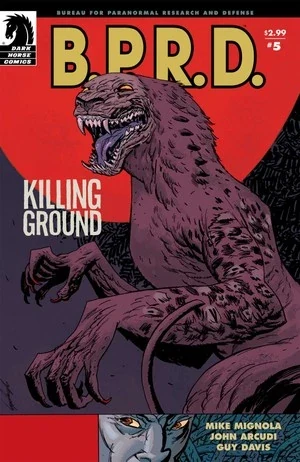

|*B.P.R.D.: Killing Ground* \#5

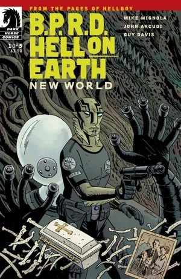

|*B.P.R.D.: Hell on Earth—New World* \#1

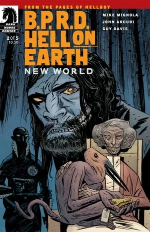

|*B.P.R.D.: Hell on Earth—New World* \#2

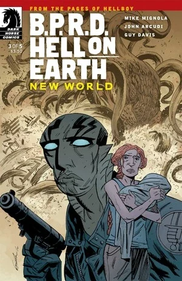

|*B.P.R.D.: Hell on Earth—New World* \#3

|*B.P.R.D.: Hell on Earth—New World* \#4

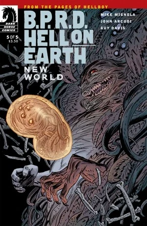

|*B.P.R.D.: Hell on Earth—New World* \#5

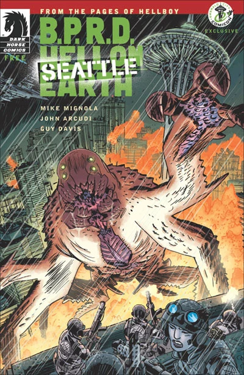

|*B.P.R.D.: Hell on Earth—Seattle*

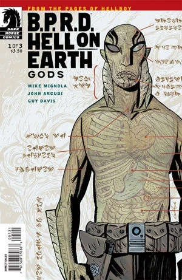

## External Links

- [**Wikipedia:** Guy Davis](http://en.wikipedia.org/wiki/Guy_Davis_(comics))
- [**Comic Book DB:** Guy Davis](http://www.comicbookdb.com/creator.php?ID=27)
- [Guy Davis Artworks](http://www.guydavisartworks.com/)
