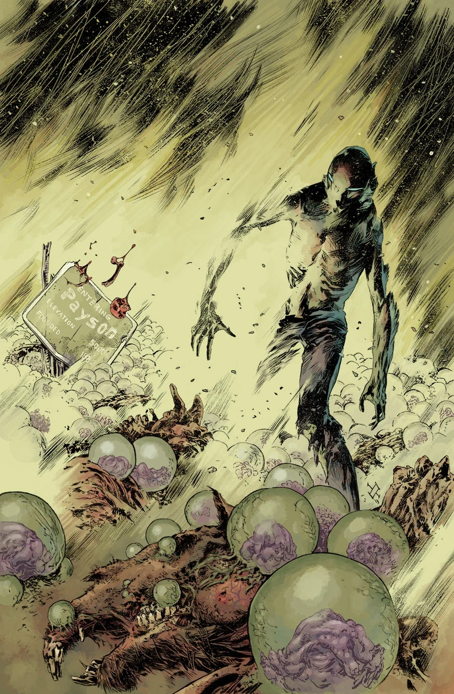
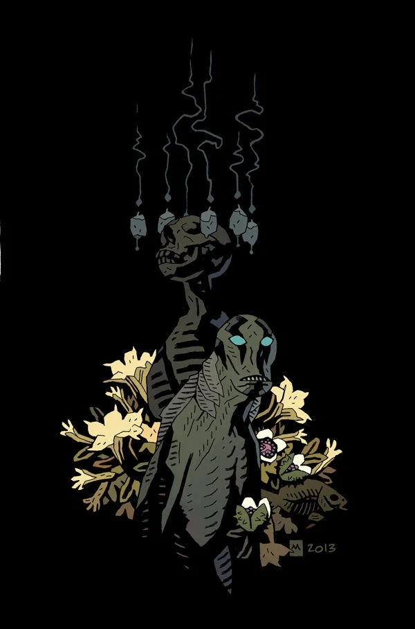
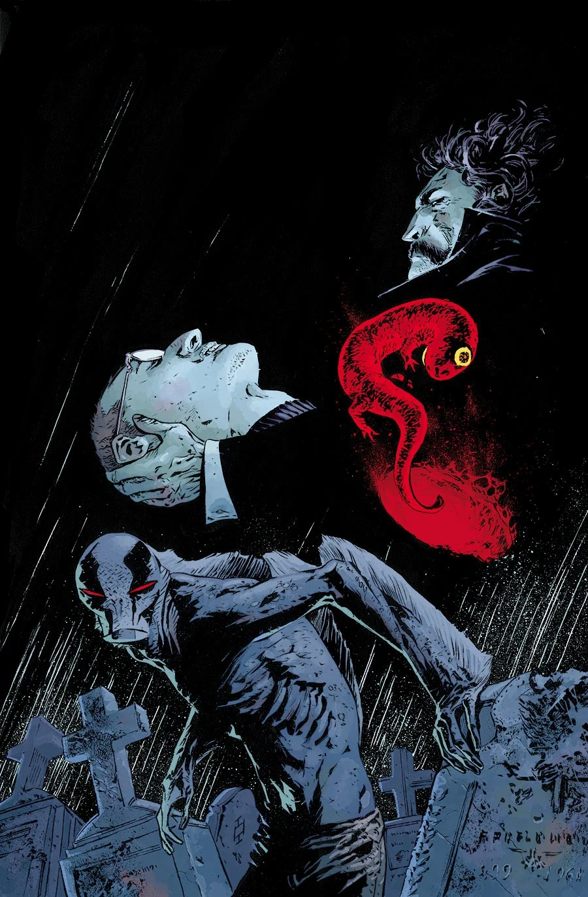
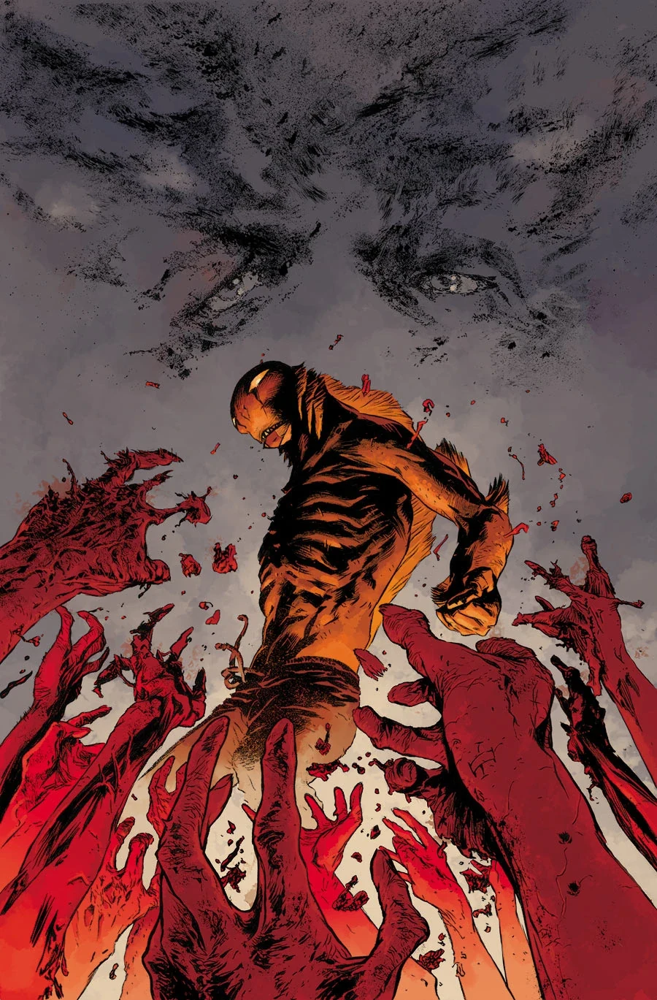

***To the Last Man*** is a three-issue arc that ran from January to March 2014 with art by Max Fiumara.

## Synopsis

### Part One

[Abe](/entry/Abraham_Sapien) seeks shelter from the apocalypse in a small Arizona town that’s been invaded by a familiar group of punks—but the more immediate problem is a field full of strange monsters sprouting out of the dead like wheat!

### Part Two

Abe saved a small Arizona town from one Lovecraftian menace, but a new killer threatens to devour the last survivors!

### Part Three

As a zombie swarm threatens a small Arizona town, a mad necromancer rises over the monster-infested ruins of Seattle.

## Gallery

Mike Mignola variant

