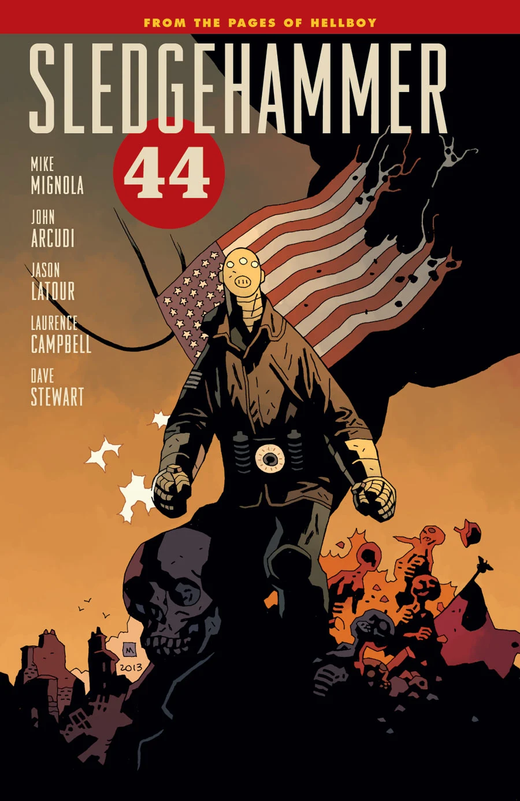

 ***Sledgehammer 44*** is a line of comic books about the second [Vril Energy Suit](/entry/Vril_Energy_Suit), Epimetheus (nicknamed *Sledgehammer*).

## Publication History

A full list of *Sledgehammer 44* stories can be found at *[List of **Sledgehammer 44** stories](/entry/%3ACategory%3ASledgehammer_44_story)*

When [John Severin](/entry/John_Severin) finished his work on *[Witchfinder: Lost and Gone Forever](/entry/Lost_and_Gone_Forever)*, [Mike Mignola](/entry/Mike_Mignola) asked him what he would like to work on next. Severin requested a story set in World War II, however Mignola didn't have many characters active in that era; [Hellboy](/entry/Hellboy_%28character%29) didn't arrive until near the close of the war, and [The Lobster](/entry/The_Lobster) died just as it began.

There was, however, the prototype Vril Energy Suit, Prometheus, was introduced and destroyed in [*Lobster Johnson: The Iron Prometheus*](/entry/The_Iron_Prometheus), a story set in 1937. Mignola had long planned to introduce, Epimetheus, the second V.E.S. ever since a teasing image of it appeared in *[B.P.R.D.: The Dead](/entry/The_Dead)*. Severin began work on the book, but unfortunately died before it could be completed. The story was shelved until a suitable artist was found.

### *Sledgehammer 44*

*Sledgehammer 44* was finally released as a two-issue miniseries in March 2013 with art by [Jason Latour](/entry/Jason_Latour).

### *Lightning War*

In April, [John Arcudi announced a second miniseries](http://www.darkhorse.com/Blog/1353/sledgehammer-44-interview-mike-mignola-and-john-ar), three issues with art by Laurence Campbell. It was later confirmed in [Hellmail](/entry/Hellmail) along with the title, *[Lightning War](/entry/Lightning_War)*.

### Future

As of 2017 it is unknown whether or not any further issues will be released under this title. The events of the first two series tied in with the ongoing *[Hell on Earth](/entry/BPRD%3F%E4%BA%BA%E9%97%B4%E5%9C%B0%E7%8B%B1))* story during "[Modern Prometheus](/entry/Modern_Prometheus)".

## Numbering

 Although *Sledgehammer 44* has been released as a series of miniseries, in addition to numbers within a given miniseries, it also has an ongoing numbering system on the inside cover for the series overall.

1.  [*Sledgehammer 44* \#1](/entry/Sledgehammer_44_%28story%29)
2.  *Sledgehammer 44* \#2
3.  [*Lightning War* \#1](/entry/Lightning_War)
4.  *Lightning War* \#2
5.  *Lightning War* \#3

## Collections

### Trade Paperbacks

*See also [Sledgehammer 44 Trade Paperback Collections](/entry/Trade_Collections)*

The first trade was released May 28, 2014.
