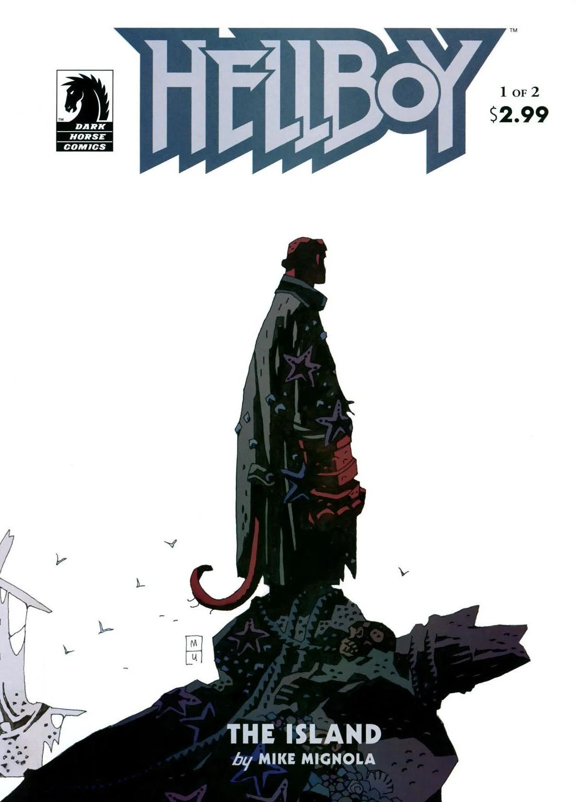
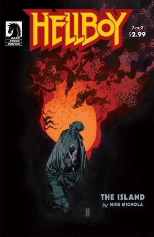

In ***The Island***, Hellboy washes up on an island where he confronts a long dead man and learns the true history of the world.

## Publication History

*The Island* was first published as a two issue mini-series from June to July 2005. The story was republished together with *[The Third Wish](/entry/The_Third_Wish)* and a new six page epilogue in *[*Hellboy – Volume 6: Strange Places*](/entry/Trade_Collections)* in August 2006.

## Synopsis

### Part One

In the aftermath of *[The Third Wish](/entry/The_Third_Wish)*, [Hellboy](/entry/Hellboy) washes up on a shore covered in beached ships. Hellboy enters one of the ships and drinks with a group of sailors. He hears a loud noise and looks out of the window. When he looks back Hellboy sees that the sailors have been long dead. Hellboy steps outside and is confronted by [Hecate](/entry/Hecate). She is glad the [Bog Roosh](/entry/Bog_Roosh) did not kill him, and again asks Hellboy to join her and end the world. Hellboy again refuses.

Hellboy finds a castle on the island and decides, against his better judgment, to explore.

The action shifts to a priest and a group of knights as they denounce and execute an old man. They impale the old man with many spears. His yellow blood flows out of the castle. As Hellboy steps into the yellow blood, a giant creature rises out of it. Hellboy attacks the monster, but in the end he is impaled by one of the creature's giant claws.

The old dying man tells the priest that he will die, only to rise again in 500 years. Hellboy, thrown by the monster, falls lifeless next to the long dead body of the old man. The man begins to return to life, revived by Hellboy's blood.

### Part Two

Hellboy stands in a nondescript plain next to [Mohlomi](/entry/Mohlomi). Hellboy asks Mohlomi if he is dead. Hellboy says he is not ready to be dead, Mohlomi responds, “Then you should live.”

Hellboy wakes up at the feet of the old man. The old man tells Hellboy that he was been reborn from all of Hellboy's blood. The man tells Hellboy his story. In the 1500's the man was a young priest in the New World. Under the city of Tenochtitlan, he learned the secret history of the world, as inscribed on three golden tablets. The tablets were destroyed, and the man turned over to the Inquisition. Eventually he escaped and was brought to the Island as a human repository of the beginning of all things.

The man recites the true history to Hellboy. One of [the Watchers](/entry/The_Watchers) took fire out of the air, and created the [Ogdru Jahad](/entry/Ogdru_Jahad) with it. From the Ogdru Jahad came forth the 369 [Ogdru Hem](/entry/Ogdru_Hem). The Watchers went to war with the Ogdru Hem, until only the Ogdru Jahad remained. The Watcher who had created them imprisoned them in the abyss. The other Watchers killed him out of fear at what he had done, and destroyed his body, except for his right hand. Later the first men, the golden people, built cities in [Hyperborea](/entry/Hyperborea), and made the hand their sacred object. King Thoth had a statue built and put the hand into it. When Hyperborea fell through the actions of [The Black Goddess](/entry/Hecate) the statue was destroyed, but the hand remained.

The man tells Hellboy that the Ogdru Hem were defeated, but still live. One day they will awaken and reclaim the earth. The [frog monsters](/entry/Frog_monster) are the final race of man, and they will raise the Ogdru Hem out of the earth. The man reveals that the monster Hellboy fought was [Urgo-Hem](/entry/Urgo-Hem) born out of his blood.

The man transforms into a demonic creature fights Hellboy. Hellboy is thrown outside, and Urgo-Hem lunges for him. The Monster is impaled on broken ship mast, and dies. The ghost of the Priest condemns the long dead man to Hell.

Mohlomi stands with [the masked hooded man](/entry/Sir_Edward_Grey) on an empty plain. The man asks Mohlomi if he knows what he has done. Mohlomi responds “what is life without risk.” Mohlomi says he is ready to go with the man.

Hellboy gets on a small boat and sets sail, as Hecate looks on from shore.

### Epilogue

An [old woman](/entry/Mab) and [Gruagach](/entry/Gruagach) discuss Hellboy. Gruagach asks if Hellboy has died, the woman replies that he lives and is sailing for England. Gruagach says Hellboy must be stopped, but the witches wait for their Queen [Hecate](/entry/Hecate). Gruagach asks about his nature, and the woman says his father was a “Prince of Sheol” and his mother a witch. Hellboy has tried to live as a man, but now with his death he knows he cannot. He knows what he was meant to be.

She tells Gruagach that he cannot beat Hellboy. Gruagach replies that he will have revenge for all Hellboy did to him. Even if it means 'the end' Gruagach wants war.

## Connections to Other Stories

The transformation of the man into a demon is similar to the transformation of the chimpanzee in [Dr. Carp's Experiment](/entry/Dr._Carp%27s_Experiment). In both stories [Hellboy](/entry/Hellboy)'s blood is the catalyst of the transformation.

## Story Chronology

The exact date of this story is unknown. It takes place sometime after *[The Third Wish](/entry/The_Third_Wish)* and before *[Darkness Calls](/entry/Darkness_Calls)*.

*The Third Wish* takes place sometime after *[Conqueror Worm](/entry/Conqueror_Worm_%28story%29)* in 2001. The events of *The Island* take place “over two years” after *The Third Wish*. *The Island* then takes place no earlier than 2003.

*[Darkness Calls](/entry/Darkness_Calls)* takes place sometime in 2006.

So *The Island* then takes place sometime between 2002 and 2006.

## Content

### Characters

#### General

- [Hellboy](/entry/Hellboy_%28character%29)
- Saliors
- Old Spaniard (Former Priest)
- [Ogdru Hem](/entry/Ogdru_Hem)
  - [Urgo-Hem](/entry/Urgo-Hem)
- [Mohlomi](/entry/Mohlomi)
- [Frog Monsters](/entry/Frog_monster) (Mentioned)
- [Edward Grey](/entry/Edward_Grey)

#### [Witches](/entry/Witches)

- [Hecate](/entry/Hecate)
- [Bog Roosh](/entry/Bog_Roosh)

#### Old Spaniard's History

- Spanish Inquisition
  - Priest (Flashback)
  - Soldiers (Flashback)
- Aztec People (Flashback)

#### [Right Hand of Doom](/entry/Right_Hand_of_Doom) History

- [God](/entry/God) (Flashback)
- [Watchers](/entry/Watchers)
  - [Anum](/entry/Anum) (Flashback)
- [Ogdru Jahad](/entry/Ogdru_Jahad) (Flashback)
- Various [Ogdru Hem](/entry/Ogdru_Hem) (Flashback)
- [Thoth](/entry/Thoth) (Statue, Flashback)

#### Epilogue

- [Daoine Sidhe](/entry/Daoine_Sidhe)
  - [Gruagach](/entry/Gruagach)
  - [Queen Mab](/entry/Queen_Mab)
- [Demons](/entry/Demon)
  - [Azzael](/entry/Azzael) (Flashback)
- [Witches](/entry/Witches)
  - [Sarah Hughes](/entry/Sarah_Hughes) (Flashback)

### Locations

- Island off the coast of Portugal
  - Beached Ship
  - Castle
- Tenochtitlan (Moden day Mexico) (Flashback)
- Spain (Flashback)
- [Hell](/entry/Hell) (Mentioned)
  - [The Abyss](/entry/Abyss) (Flashback)
- [Hyperborea](/entry/Hyperboreans) (Flashback)
  - [Gorinium](/entry/Gorinium) (Flashback)

### Noteworthy artifacts

- [Mohlomi's](/entry/Mohlomi) Bell
- [Hecate's](/entry/Hecate) Iron Maiden
- [Right Hand of Doom](/entry/Right_Hand_of_Doom) (Detached from Hellboy) (Flashback)

## Gallery

Covers by [Mike Mignola](/entry/Mike_Mignola).

 \#1

 \#2
