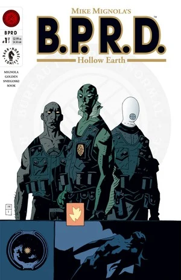
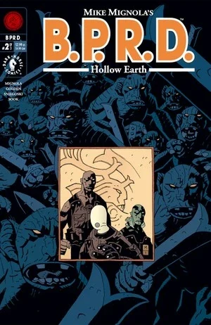
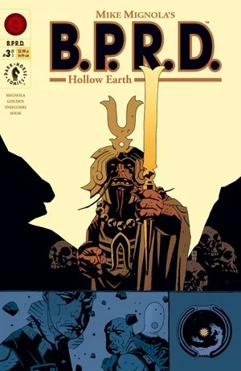

In ***Hollow Earth***, [Elizabeth Sherman](/entry/Elizabeth_Sherman) leaves the [B.P.R.D.](/entry/B.P.R.D.) to find peace only to be captured. [Abe Sapien](/entry/Abe_Sapien), [Kate Corrigan](/entry/Kate_Corrigan), [Roger](/entry/Roger) and new recruit [Johann Kraus](/entry/Johann_Kraus) travel to the arctic to rescue her.

## Publication History

Following [Hellboy](/entry/Hellboy)'s departure from the [B.P.R.D.](/entry/B.P.R.D.) at the end of [*Conqueror Worm*](/entry/Conqueror_Worm_%28story%29), [Mike Mignola](/entry/Mike_Mignola) decided to continue the story of the bureau in its own comic series.

This story was published as a three-issue miniseries in January, April and July 2002. The story was later collected in the trade paperback *[B.P.R.D.: Hollow Earth & Other Stories](/entry/Trade_Collections)* in January 2003.

## Synopsis

### Part 1

[Elizabeth Sherman](/entry/Elizabeth_Sherman) leaves the [B.P.R.D.](/entry/B.P.R.D.) and travels to Agartha, a temple located in the Ural Mountains above the Arctic Circle, looking for help in controlling her fire.

Back at B.P.R.D. headquarters in Connecticut, [Kate Corrigan](/entry/Kate_Corrigan) meets with new recruit [Johann Kraus](/entry/Johann_Kraus). He says he would like to meet [Hellboy](/entry/Hellboy), but is told that Hellboy has taken a leave of absence (as seen in *[Conqueror Worm](/entry/Conqueror_Worm_%28story%29)*). [Thomas Manning](/entry/Thomas_Manning) speaks to Kate and expresses his worry that other team members will leave as well.

Back in Agartha, Liz finds a large crack in the floor and goes to tell the monks. They say that it is being taken care of.

Kate visits [Abe Sapien](/entry/Abe_Sapien) and tells him Johann's story, how he was a physical medium when a disaster destroyed his body leaving him as an ectoplasmic projection. That night a vision of Liz appears to Abe and a asks him to save her.

Kate, Abe, [Roger](/entry/Roger) and Johann travel to Agartha to find Liz. They enter to find all the monks killed. They find Liz but she is not breathing. Johann says that she is not dead, but somehow empty. Abe finds the body of [a small red creature](/entry/Servants_of_the_Left_Hand) among the destruction.

### Part 2

Roger absorbs some of the creature's energy and learns that the creatures have Liz and where they are located. Abe, Roger and Johann go down a large crack in the floor in hopes of finding Liz's spirit.

As they walk, Johann asks how it has been since Hellboy left. Both say it has been hard, and Abe tells about his first days at the B.P.R.D., when Hellboy befriended him.

They pause to rest and a bunch a creatures drop from the ceiling and attack. Johann manages to scare them away, and they continue walking. They pass the ruins of ancient machines and see that some of them look like they are being repaired. They are stopped by yet more creatures and a giant toad like beast.

### Part 3

Liz's spirit, trapped by the subterranean creatures, has a flashback to her first day at the B.P.R.D. as a child, when Hellboy helped her to cope with the loss of her family.

The trio run from the creatures, and Abe throws a grenade to stop them from following. The three hurry on and come to the device holding Liz's spirit. Johann and Roger decide they should be able to free her, when a [leader](/entry/King_of_Fear_%28character%29) of the creatures attacks them. The leader tells his subjects that they will use their creators' machines to take over the surface world. Abe shoots the leader and Roger breaks the machine and rescues Liz. The cavern collapses, as the four run to escape. The wounded leader, and some of his machines, falls deeper into the earth.

The four come to the surface in Scotland and are picked up by Kate Corrigan. Liz decides to rejoin the B.P.R.D.

## Story Chronology

The story itself never states when it occurs, however other stories provide some clues.

In *[King of Fear](/entry/King_of_Fear_%28story%29)* \#1 it is shown that the creatures attacked [Elizabeth Sherman](/entry/Elizabeth_Sherman) and Agartha in 2001. However this seems to contradict other information. (This was changed in the trade paperback to 2002)

The story strongly implies that the team went to Agartha very shortly after the attack. However according to *[The Ectoplasmic Man](/entry/The_Ectoplasmic_Man)*, [Johann Kraus](/entry/Johann_Kraus) would not become an ectoplasmic projection until February of 2002. Furthermore, assuming the events in the [B.P.R.D. (teaser)](/entry/B.P.R.D._%28teaser%29) takes place before the main events of *Hollow Earth*, Johann did not join the [B.P.R.D.](/entry/B.P.R.D.) until at least seven months after his accident, so September 2002 at the earliest.

*Hollow Earth* therefore takes place either in 2001, as stated in *King of Fear* \#1, or in 2002 as implied by *The Ectoplasmic Man*.

Either way the relative chronology is clear;

- Elizabeth Sherman is last seen during the *[Almost Colossus](/entry/Almost_Colossus)* story in 1997
- Elizabeth Sherman leaves the B.P.R.D. and travels to Agartha two years before the main story, so 1999 or 2000
- [Hellboy](/entry/Hellboy) leaves the B.P.R.D. in 2000 following the events of [*Conqueror Worm*](/entry/Conqueror_Worm_%28story%29) (that this happens after Liz leaves is stated in *Hollow Earth* \#1 when [Abe Sapien](/entry/Abe_Sapien) talks to [Kate Corrigan](/entry/Kate_Corrigan))
- Agartha is attacked and the B.P.R.D. goes to rescue Elizabeth Sherman in 2001 or 2002

## Content

### Characters

#### [B.P.R.D.](/entry/Bureau_for_Paranormal_Research_and_Defense)

- [Elizabeth Sherman](/entry/Elizabeth_Sherman)
- [Katherine Corrigan](/entry/%E5%87%AF%E7%89%B9%C2%B7%E8%80%83%E7%91%9E%E6%A0%B9))
- [Johann Kraus](/entry/Johann_Kraus)
- [Hellboy](/entry/Hellboy_%28character%29) (Flashbacks)
- [Thomas Manning](/entry/Thomas_Manning)
- [Abraham Sapien](/entry/Abraham_Sapien)
- [Roger](/entry/Roger)
- Doctor Cobb (Flashback)
- Doctor Roddel (Flashback)
- [Trevor Bruttenholm](/entry/Trevor_Bruttenholm) (Flashback)
- Other employees

#### Other

- Agartha Residents
  - Master Gheghen
  - Other Monks
- Various [Servants of the Left Hand](/entry/Servants_of_the_Left_Hand)
- [King of Fear](/entry/King_of_Fear_%28character%29)
- [Witches](/entry/Witches)
  - [Hecate](/entry/Hecate) (Mentioned, as "Heca-Emem-Ra" and "The Black Goddess")
- [Hyperboreans](/entry/Hyperboreans)
  - [Thoth](/entry/Thoth) (Mentioned)
- [Ogdru Jahad](/entry/Ogdru_Jahad) (Mentioned)
- [Ogdru Hem](/entry/Ogdru_Hem) (Referenced)
- Chengdow incident victims (Flashback)

### Locations

- [Russia](/entry/Russia)
  - Agartha (Ural Mountains, Above the Arctic Circle)
- U.S.A.
  - [B.P.R.D.](/entry/Bureau_for_Paranormal_Research_and_Defense) Headquarters (Farfield, CT)
- Austria (Flashback)
- Germany (Flashback)
  - Krauss Residence (Heidelberg) (Flashback)
  - [B.P.R.D.](/entry/Bureau_for_Paranormal_Research_and_Defense) Facility (Flashback)
- Cave system under the Earth
- Scottish Highlands

### Noteworthy Artifacts

- Various [Hyperborean](/entry/Hyperboreans) Artifacts
  - Swords
  - War Machines
  - Production Machines
  - Power-harnessing contraption
- [Nazi](/entry/%3ACategory%3ANazi) Submarine

## Gallery

Covers by [Mike Mignola](/entry/Mike_Mignola).

