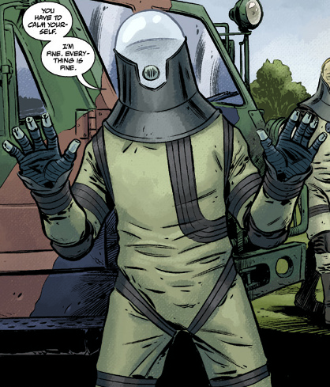

## History

**Johann Kraus** was born in Stuttgart, Germany, in 1946. He began to be aware of his psychic abilities when he was ten years old, when he started to see people that others could not and slowly realized that these were ghosts. Johann was frustrated that he could not communicate with the ghosts and this frustration eventually led to him studying spiritualism under an elderly German woman named Anneliese Stiener. Through Stiener, Kraus met many other spiritualists and was exposed to a variety of occult studies. Ultimately he did not like the direction of the group and severed his ties with his mentor. He then taught himself to communicate with the dead, and eventually mastered the ability to send his own ectoplasmic form out of his body and into the etheric plane. In 1971, Kraus opened a small office in Munich, where he established himself as a well-respected medium before relocating to the town of Heidelberg. At one point, he fell in love with the deceased wife of one of his clients, growing desperate to invite him back just so he could manipulate the two into opening up their hearts and deepen the grief of loss to get them to move on from one another, all so he could just swoop in to confess to the woman. She promptly rejected Kraus, disgusted that he as a living man would seek love among the dead.

### The Chengdou disaster

In February 2002, in Chengdou, China, a warehouse containing occult artifacts seized by the Chinese government was broken into. The thief unwittingly opened a small Jade figurine, releasing a massive burst of psychic energy, killing everyone within a hundred miles, and sending a shockwave across the etheric plane. At that time Kraus was hosting a séance in Heidelberg for the family of the late Heinrich Wagner. The spirit of a recently deceased Chinese boy reached through the etheric plane, asking Johann for help from the Chengdou disaster. The shockwave conducted through the boy, then through Krauss, killing the entire Wagner family and destroying Johann Kraus's body. Kate Corrigan had said of Kraus that, "He's not dead. He just doesn't have a body anymore."

### [B.P.R.D.](/entry/Bureau_for_Paranormal_Research_and_Defense)

Johann's ectoplasmic form having survived his body's incineration, and knowing he would soon dissipate without a physical body, Kraus sought the best paranormal minds on the planet for help: the B.P.R.D. At first, Johann was conflicted, unsure whether to stay as a ghost or move on to the afterlife. He changed his mind after failing to rescue a wayward soul from being devoured by a demon. It taunted him by leaving a loaded gun on the table, challenging the ghost to shoot it. Realizing how ineffectual he was a spirit, he allowed the B.P.R.D. to put him into a containment suit. The first thing he did with his new suit was to come over to the demon's house to shoot him dead.

### Joining the Bureau

After the loss of Hellboy, Kraus was tasked to replenish the Bureau's pool of 'enhanced talents'. His psychic abilities were greater than ever, due to his non-corporeal condition (similar to a musician's hearing improving after the loss of his eyesight). Where once he could speak with the dead, now he can grant them temporary physical form. He joined just in time to join the B.P.R.D.'s mission to rescue [Elizabeth Sherman](/entry/Elizabeth_Sherman), who had quit the Bureau two years before. Kraus quickly earned his stripes, using his unique abilities in the fight against the strange troglodytes that had kidnapped her.

Despite his new powers, Johann still was vulnerable to being taken over by powerful spirits, such as those of a living fossil they ran into in Chicago. However since he no longer required rest, he had become a bit of a workaholic, and became an accomplished scholar of occult lore. He soon ingratiated himself with the rest of the Bureau's Enhanced Talents as they worked together over the next few years.

### The Plague of Frogs

When the plague of frogs began in 2004, the B.P.R.D. moved to the Bureau's new base in the Colorado mountains to keep ahead of the spreading frogs as they headed west. He dedicated his time to studying the mountains of files culled from the sub-basements, most of which related to its past as a research and development facility during World War II. Initially he became possessed by the ghosts of the facility's former inhabitants, a group of German scientists who failed to stop their cohort [Gunter Eiss](/entry/Gunter_Eiss) from conducting an occult experiment to open the gates to Heaven. Under their guidance he was made to construct a machine that stopped Eiss's portal and closing it for good.

During the War on Frogs, Johann once encountered a group of frog spirits, a novel phenomenon that came about when they killed a group of frog monsters that were fresh in their transformation that they retained some humanity in their souls. The ghosts followed him all the way back to base, as he was uncertain how to help them pass on. After they attempted to possess one of the soldiers in the infirmary and organic material inside a refridgerator, Johann took them up into the sky and held a seance to help them leave this world. He was greeted by a horrific sight- a gate to their so-called paradise where insectoid angels lifted the spirits away. Although he was glad to help the frogs move on, the tentacled portal attempted to take him too and he swiftly returned to Earth.

When Roger was killed by [the Black Flame](/entry/The_Black_Flame_%28character%29) and all hope of restoring him to life was lost, Johann went to meet with Roger's spirit - as an artificial homunculus, there was neither a Heaven or Hell for him to go to, and so his spirit remained with his body. But due to Roger's heroism in saving the goddess [Cloacina](/entry/Cloacina) in one of their old cases, he was given a small slice of paradise, and thus Johann found him within an afterlife resembling an Etruscan shrine. The homunculus told him that he was at peace and asked for his remains to be buried like a man, a last request that he and his comrades gladly obliged.

### A Taste of Life, A Vengeful Death

While Ben and Abe were on a mission in Indonesia, he discovered Ben's secret relations to the infamous WWII assassin [The Crimson Lotus](/entry/Yumiko_Daimio) among the old files. Such information was concerning at first, but they reserved judgment until Ben returned to explain himself. However Ben and Abe returned with a number of artificial superhuman bodies. Johann took the most complete one for himself and relished in experiencing the pleasures of life once again like food and women. This led him to shirk his responsibilities at work, at one point even absconding a jeep to spend a night in town debauching with women. Johann returned to headquarters to find it in crisis, discovering that Ben had been possessed and transformed into a savage werejaguar. Despite the strength of his superhuman body, the jaguar monster still mauled him to death. To everyone's surprise, it was not Johann's spirit to emerge from the corpse, but that of [Lobster Johnson](/entry/Lobster_Johnson), who rushed over to Liz in bed to free her from the mental clutches of his old enemy [Memnan Saa](/entry/Martin_Gilfryd). Although the Lobster left soon after, Johann was rendered a spirit once more. He interviewed the two strangers that perished in the facility - one was the Chinaman who was trying to help Ben suppress his curse, the other was a former comrade who infiltrated the base to kill Ben because he knew of the jaguar curse. Johann took the assassin's mystic dagger for himself while Daimio escaped the B.P.R.D. alongside the wendigo.

Johann tried to have the last superhuman body completed, but the B.P.R.D. were unable to finish it, and although he was eager to participate in the search for Ben, Abe shot him down. Johann also approached the recently-inducted mummy [Panya](/entry/Panya_%28character%29) to help track down Ben, but she slyly turned him down, easily seeing his vendetta through his words.

Afterwards they conducted a seance to contact Lobster Johnson again and glean information about Memnan Saa. He responded by pointing out the name 'Gilfryd', a name which Panya recognized from her past. She then tracked down his hideout in the jungle, and Kraus was part of the team sent to confront him. They were all helpless when Saa swiped Liz right under their noses and barely escaped with their lives.

### The Fall of Munich

Before they could go look for clues to where Liz was taken, the B.P.R.D. went to Johann's own hometown of Munich to follow a lead regarding the possible appearance of frog monsters in Europe. They were horrified to discover that deep underground lurked the subterranean creatures they encountered in Agartha, building ancient war machines and sending them to the surface. Despite the military's best efforts, the giant robots devastated Munich before they were felled. Johann took a car and discovered that his old home and community did not survive. He had the driver move slowly and leaned a hand out of the window to lend his ectoplasm to the spirits of his massacred old friends and neighbors, for he had a whole city to lay to rest.

### Locating Liz

Johann, Abe and Devon investigated the old hideout of Lobster Johnson to find any leads to Saa's whereabouts, but ultimately it was Kate's side of the investigation that produced a probable location. He was then part of the joint military operation to rescue Liz in the ancient, refurbished city of Thadrethes at the borders of Russia and China. However, Johann was among those told to stay behind while Abe, Kate and Devon were allowed inside the walls. A battle erupted outside the city as the frogs and their subterranean allies emerged. Kraus used the chaos to slip into the city to help Liz, feeling like he wasn't needed as the battle seemed to turn in their favor. He even slit the throat of a monk who tried to stop him from joining his friends. Pulling out a pistol, he attempted to shoot Saa from behind, only to have his suit shatter as he was telekinetically tossed to the wall. Once more, the ghost of Lobster Johnson emerged from the suit to continue the attack, but he was set ablaze and tossed out of the sorcerer's tower. Lobster Johnson remained in control of Kraus' ectoplasm even after Liz finally killed Memnan Saa.

With Liz back, Kate Corrigan and her new boyfriend Bruno drove to Austria with the Lobster's ghost. They hiked up the mountain back to his site of death, Hunte Castle. There amid the desolation, the Lobster finally let the medium go. Kraus revealed that he was still fully aware while the vigilante had control, and noted to his companions that the Lobster was happy to spend his afterlife fighting the ghosts of Nazis and undead experiments still haunting the castle.

Johann accompanied Kate and Director Tom Manning at a United Nations hearing that gathered to dress down the B.P.R.D. after recent events, namely Liz's world-shaking explosion in the Hollow Earth, caused a new wave of global disasters. They walked out of the building surprised to hear that the agency had been promoted and that they will have the UN's full support in dealing with the current crises.

### Hell on Earth

Johann continued to nursed his grudge against Ben Daimio and spent much of his available time shirking his base duties again to work on the last of the superhuman bodies recovered from Indonesia, hoping to become a flesh-and-blood human again. Panya was aware of this and played pranks on Johann by having one of her hybrid animals steal the keys to the room. Johann and Panya took their grievances to an overworked Liz, who was fed up with their shenanigans and ordered them to return to their stations. Aside from this, Johann had planted a spyware node in Abe's laptop to monitor his internet usage in case Abe had ever tried to track down Ben's whereabouts. Although he found a possible lead in Abe's recent mission to British Columbia, Abe discovered the implant and he blamed fellow agent [Andrew Devon](/entry/Andrew_Devon) due to their recent strife. Johann remained silent on the matter, unwilling to calm the sparking unease between the two and keeping his knowledge of the spyware silent. Later he joined in the mission to locate a nomadic psychic named [Fenix Espejo](/entry/Fenix_Espejo) who has built a following due to her ability to predict disasters. Although Fenix slipped away, she shot Abe in the face and he returned to headquarters with Abe to help the latter recover from the mortal injury. Kraus at least confirmed that Abe's soul was still in his body, but it had gone dormant.

### Russia

With Abe out of commission and Devon on an assignment, Kate brought Johann with her to meet with the Russian [Special Sciences Service](/entry/Special_Sciences_Service) to begin collaborations in the escalating global crisis. There, the SSS zombified director [Iosif Nichayko](/entry/Iosif_Nichayko) met them warmly and was looking forward to meeting Kraus, one undead man to another. Iosif brought Johann with him for help regarding an Ogdru spirit possessing one of his psychics, as his own personnel had reached their limits trying to deal with the matter. Johann was concerned at exposing himself to an Ogdru spirit, but he discovered that because he was bodiless, the Ogdru Hem could not manipulate him as it relied on a person's biology to take control. Dispelling the entity, he then went with Iosif to deal with the creature as it dwelt underground, assembling an army of zombies to build a nest for it to grow. He asked Iosif to keep his participation secret from Kate, who he knew would object. Down below, Johann was aided by Spetsnaz forces, and their willingness to die for the mission allowed Johann to use their bodies to progress further than they could. Upon reaching the Ogdru Hem, the abomination attempted to regenerate the corpse he was using to establish control over him, but he detonated a nuclear device to obliterate it. His spirit then rendezvoused with the SSS, where he surprised Kate by moving into a new containment suit. Unlike his old suit, this one was derived from one of Iosif's suits and it made a whole world of difference for him. Whereas his original suit made him feel like he was in a bag, the specifics of the Russian design allowed him to feel like he had a body once again, like the sensation of having knuckles and knees, and refused to return to his original containment suit. He would live in this one from now on, and relegate his old suits as backups.

### Tracking Daimio

In his new suit, Johann began to experience dreams once again, as if the new suit was letting him experience sensations of life again. When he received word of a follow-up investigation to Abe's case in British Columbia, Kraus jumped at the opportunity and led a team of agents up north, hoping to find Ben Daimio. His grudge led him to act against the team's best interests, abandoning them at the cabin to search through the woods on his own. Because of his negligence, his team was viciously attacked by the werejaguar, and it was only through the efforts of [Carla Giarocco](/entry/Carla_Giarocco) that they were able to drive the monster away. When Johann revealed his intention of tracking Ben to Carla at the hospital, she harshly told him to leave, infuriated that they suffered losses because of his need for vengeance. Johann took what few available agents they had left to hunt for Daimio in the woods, only succeeding in locating [Daryl the Wendigo](/entry/Daryl_Tynon), who was traveling with Ben. Stumbling upon the latest massacre at a camp site, Johann interviewed the victims and searched for Daimio using a corpse, the mystic dagger in hand- the only weapon that would penetrate through the jaguar-god curse. He located Ben at a fresh moose kill and brushed away his reasons for leaving, angry that he didn't try to stay at the Bureau to let them figure out a solution together. The two clashed, with Johann managing to embed the dagger into the jaguar before possessing the dead moose and trying to finish off Ben. However, the jaguar succeeded and ran off. The next day, he and his agents found the blood-drenched corpse of Ben out on a frozen lake, the wendigo nowhere in sight, and he declared the mission was over.

Johann was promptly suspended from field operations for a time due to his actions costing the team, In a conversation with Devon, he noted that it was a punishment better than he deserved. However, he received a piece of bright news regarding the superhuman body. He was told by one of the staff studying the body that the Zinco Corporation was developing a new drug which might help in the development and completion of the body. Kate met with the Zinco representative Evelyn to convince her to take the body for testing with their drugs, to which Kate was practically begging for them to take it. Evelyn agreed to take the body with her. Kate was begrudging in her decision, acknowledging that Johann saved a couple of lives with his prior body and how she felt okay with this now that Ben was dead. But she made Johann keep no promises, well aware of how irresponsible he can and might be again with it. With this, she also planned to lift Johann's suspension by assigning him to a search-and-rescue at Chicago.

Unbeknownst to both of them, Zinco planned to use the body in their operation to recover the soul of their former CEO [Landis Pope](/entry/Landis_Pope), and they succeeded. Johann's would-be third body was now the vessel of the revived [Black Flame](/entry/The_Black_Flame_%28character%29), now more powerful than ever.

### Team Leader

Johann's team was flying to Chicago when a great earthquake struck and an Ogdru Hem emerged from the Earth, one of dozens across the globe awakened by the return of the Black Flame. The horror breathed out a mutagenic gas, and while most of the team put on their gas masks, the pilots succumbed and they crashed their helicopter. The team survived the crash landing and now had to travel to Chicago on foot, only to be hounded by [Hammerheads](/entry/Hammerheads). Although Johann kept a cool head leading the situation, he continued to rub against the abrasive agent Enos who was slowly despairing at their chances of making it out alive. They eventually made their way to Chicago on horseback, discovering that the same creature that downed their helicopter had now taken root over the city. Regardless of the looming threat he pushed his team on to find the agents they were searching for, and were led by locals down into the secret chamber formerly belonging to the [Heliopic Brotherhood of Ra](/entry/Heliopic_Brotherhood_of_Ra). Just as they discovered the massacre inside, they were beset upon by a horde of mutant zombies. The comatose [Ted Howards](/entry/Ted_Howards), one of the agents they came to rescue, awoke in a berserker fury and sliced his way through the horde blocking their way out using the [Hyperborean Sword](/entry/Hyperborean_Sword) in his hands, all while seemingly immune to the mutagenic gas that kept the other agents' masks on. Having confirmed that Howards was the only survivor of the team they came to rescue, they returned to headquarters with him, unaware of just how changed their comrade was.

### Boundaries Crossed

### Epimetheus Unbound

## Powers and Abilities

Even before the destruction of his body, Johann Kraus was a gifted and experienced medium, possessing the ability to both communicate with spirits, and project his own ectoplasmic form out from the confines of his flesh. Being reduced to a soul within a containment suit has not lessened either of these abilities; in many ways Kraus has become even more effective at what he does thanks to his condition.

In his current state Kraus can grant ghosts temporary physical forms to allow them to talk with non-mediums. His lack of a body means that he does not need to eat, drink, sleep, or breathe. He also has greater resistance to adverse conditions, such as weather, thanks to his containment suit.

Like the film, Johann in the comics has shown signs of body possession powers, where he was able to take possession of any form lacking a soul. When Kraus's suit was damaged, he temporarily inhabited the body of a dead dog and at a latter date he possessed agent [Enos](/entry/Enos) only seconds after he died, with enough control to talk and use a grenade launcher through the corpse.

Kraus has also demonstrated many useful non-supernatural talents, including good interpersonal, organizational skills and his ability to speak fluent German and 'rusty' Japanese has proved useful in the past. Kraus is well liked by those around him, and is considered very reliable.

Kraus's primary weakness is his dependence on his containment suit. Without it his ectoplasmic form would dissipate; left without a host body or a containment suit for too long, Kraus's ectoplasm runs the risk of dissipating itself entirely. This situation can occur even with minor damage to the suit.

## Allies and Enemies

### Allies:

- [Hellboy](/entry/Hellboy_%28character%29)
- [Liz Sherman](/entry/Liz_Sherman)
- [Abe Sapien](/entry/Abraham_Sapien)
- [Tom Manning](/entry/Tom_Manning)
- [Kate Corrigan](/entry/Kate_Corrigan)
- [Panya](/entry/Panya_%28character%29)

### Enemies:

- [Grigori Rasputin](/entry/Grigori_Rasputin)
- [Klaus Werner von Krupt](/entry/Klaus_Werner_von_Krupt)
- [Ilsa Haupstein](/entry/Ilsa_Haupstein)
- [Karl Ruprect Kroenen](/entry/Karl_Ruprect_Kroenen)
- [Leopold Kurtz](/entry/Leopold_Kurtz)
- [Ogdru Jahad](/entry/Ogdru_Jahad)
  - [Nunn-Jahad](/entry/Nunn-Jahad)
- [Ogdru Hem](/entry/Ogdru_Hem) 

## Film

### [Hellboy II: The Golden Army](/entry/Hellboy_II__The_Golden_Army)

As a result of [Hellboy](/entry/Hellboy_%28character%29)'s public exposure to the world, Washington sent Krauss to take over management of field operations. Following the information obtained from a dead [tooth fairy](/entry/Tooth_Fairies) Krauss had reanimated, he located the [Troll Market](/entry/Troll_Market). Stalking a [troll](/entry/Fragglewump) to gain entrance, Krauss and Hellboy had a disagreement over how to convince the troll to reveal the Troll Market's entrance. When Hellboy's violent methods failed to extract the way to open the entrance, Krauss used his ectoplasmic form to possess the locking mechanism and unlocked the door. Once inside, Krauss reprimands Hellboy for his over usage of radio communication with Liz. Krauss calls Hellboy a "Schmutziger Affe" under his breath, which translated from German, means dirty ape. Shortly after, Johann tried in vain to question two trolls and their tumor, but Hellboy punched the information out of them.

Later, in the showers at [B.P.R.D.](/entry/Bureau_for_Paranormal_Research_and_Defense) headquarters, Krauss informed Hellboy of his greatest weakness: his temper, which ignited Hellboy's rage. With a quick punch, Hellboy accidentally shattered Krauss's suit helmet. In his ectoplasmic form, Krauss took possession of the wall of lockers to comedically beat Hellboy with the doors.

After [Nuada](/entry/Nuada) kidnapped his sister [Nuala](/entry/Nuala) from the B.P.R.D. and left Hellboy mortally wounded, the B.P.R.D. was determined to locate the [Golden Army](/entry/The_Golden_Army). Upon discovering a map, Krauss tracked the location to Northern Ireland. When Krauss ordered the team to travel there without Hellboy, [Liz Sherman](/entry/Liz_Sherman) snapped at Krauss, accusing him of having lost his humanity. Hearing this, Krauss had a change of heart, remembering how he had also known love with a woman before losing her (and his physical body) in a mishap. Showing a bag containing his and his beloved's wedding rings, he joined Sherman, Hellboy, and [Abe Sapien](/entry/Abe_Sapien) on an unauthorized mission to find the Golden Army. During the battle, Krauss possessed one of the Golden Soldiers to attack the others, until the machine was sliced in half by another.

After the battle ended with the deaths of both Nuada and Nuala, Krauss resigned from the B.P.R.D. along with the other agents.

### Differences With the Comic version

In the film Johann Krauss lost his body in (presumably) an attempt to reclaim his dead wife (he told Abe and Liz that he would tell them the story at a later date,). Also, unlike in the comics, Johann is able to keep his ectoplasmic form together outside of his containment suit, and can also possess machines by leaving his suit and entering them. While never directly stated it is implied that the movie version of Krauss had history with [Kroenen](/entry/Karl_Ruprect_Kroenen), furthermore "Krauss" is spelled with a double "s" in the film, opposed to the spelling in the comics with just one "s."
