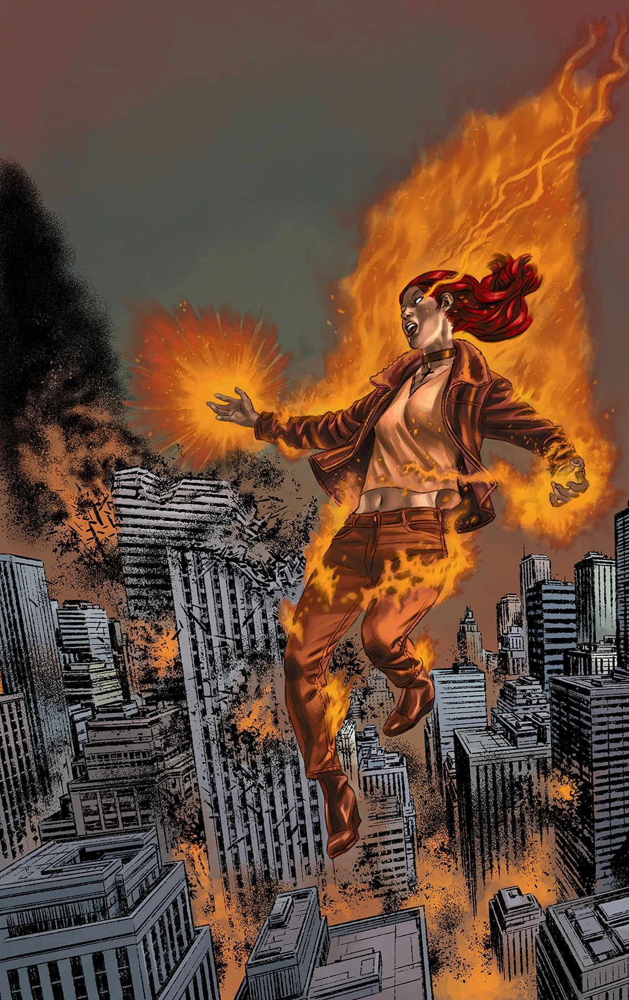
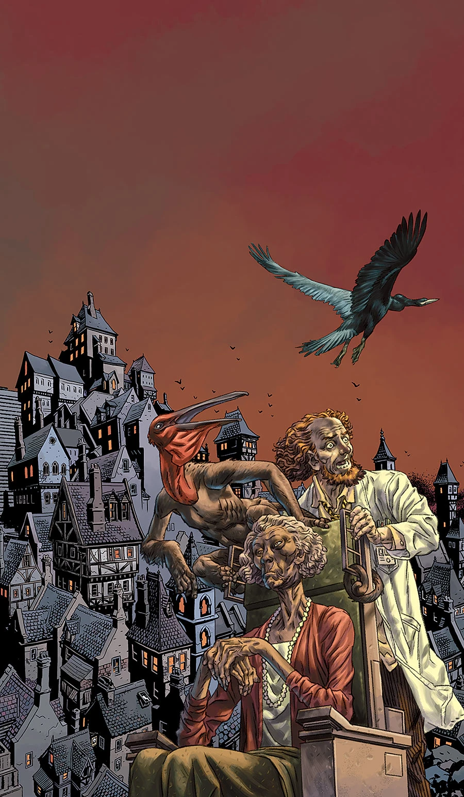
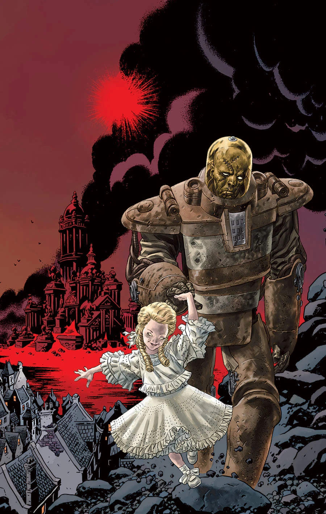
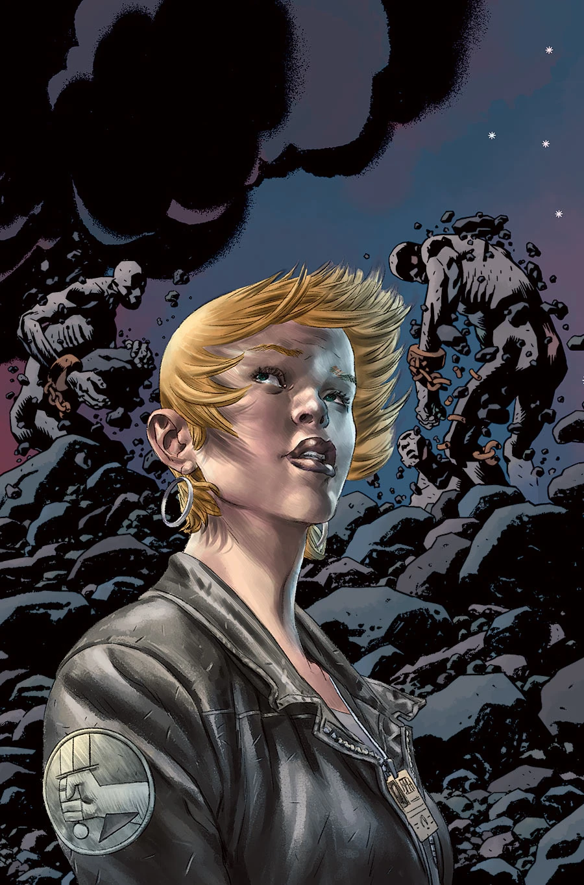
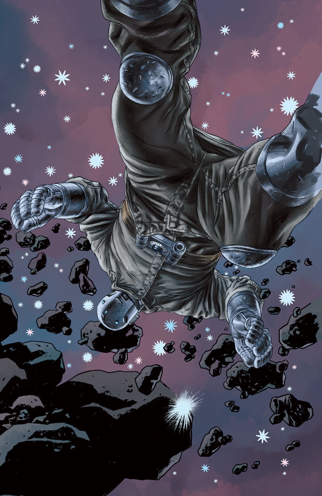

***Cometh the Hour*** is a five-issue arc and the ending the [*B.P.R.D.: Hell on Earth* cycle](/entry/BPRD%3F%E4%BA%BA%E9%97%B4%E5%9C%B0%E7%8B%B1)). It also sets up *[B.P.R.D.](/entry/B.P.R.D._%28series%29)* for its [final cycle](/entry/The_Devil_You_Know_%28story_cycle%29).

## Synopsis

### Part One

Kate and Panya argue over abandoning BPRD headquarters, while in New York City Johann and Liz fight a seemingly unstoppable opponent as the Ogdru Jahad spawns dozens more monsters by the hour.

### Part Two

Liz and Johann try to fend off the Ogdru Hem while Kate evacuates BPRD headquarters before the towering Ogdru Jahad can flatten it—and Varvara leads Iosif deeper into Hell.

### Part Three

Liz and Johann run out of strength, unable to keep up with the Ogdru Jahad. In Colorado, Kate tries to evacuate BPRD headquarters before the monster can kill everyone.

### Part Four

The BPRD faces heavy fatalities as western states are laid waste in the battle with the embodiment of cosmic evil, the Ogdru Jahad. The only hope to destroy the beast may be the unholy plan of the little demon girl Varvara.

### Part Five

Liz Sherman blew up the center of the earth to stop the spread of the frog men with which the Black Flame planned to overrun the world. Although she killed that Black Flame, the devastation Liz wrought brought about a new Black Flame and a more terrifying worldwide wave of monsters. Facing an uncertain future, the BPRD count up their casualties as *Hell on Earth* comes to a close.

## *Varvara: That Evil Little Russian Girl*

This two-page back-up feature written and drawn by [Matt Strackbein](/entry/Matt_Strackbein) appeared in *B.P.R.D.: Hell on Earth—Cometh the Hour* \#2. It recapped the history of [Varvara](/entry/Varvara). It is not included any any collections.

## Gallery

