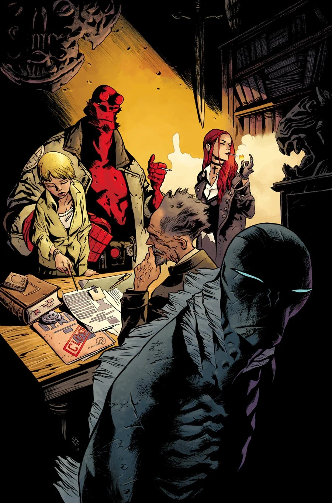
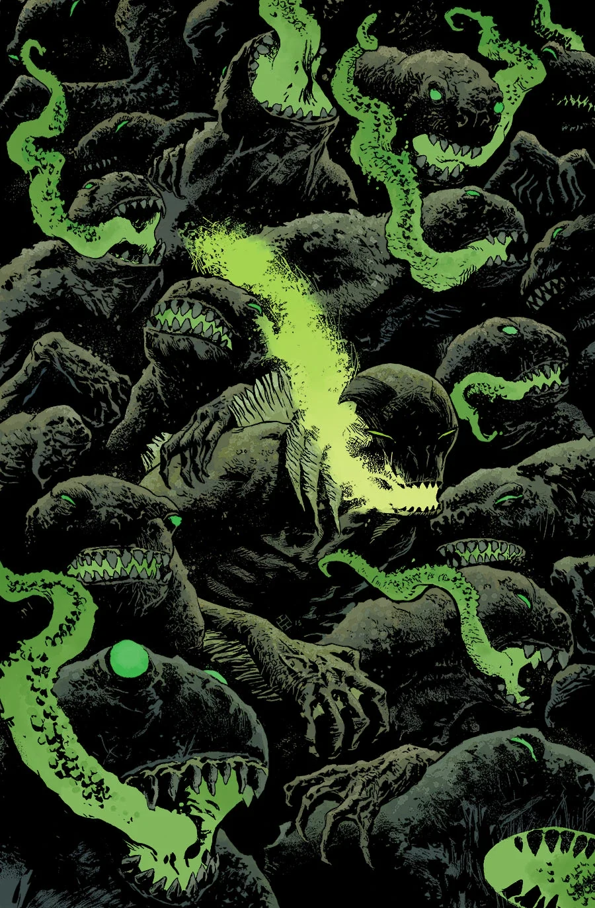
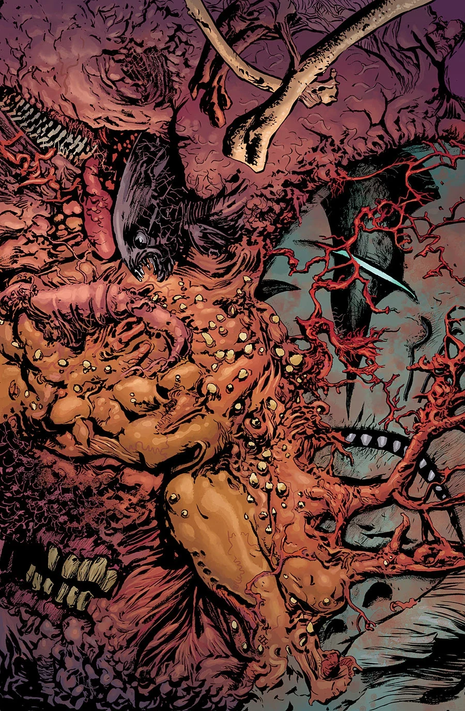

***The Shadow Over Suwanee*** is a three-issue arc kicking off in July 2015.

## Synopsis

### Part One

Haunted by memories of Hellboy, Abe crosses paths with a horrible monster in a sunken town, which reveals secrets of his own pre-human origins.

### Part Two

A small Florida town manages a strange kind of survival in the shadow of a giant monster where Abe finds secrets about his origins and his role in the end of the world.

This issue includes a flashback to the last scenes of *[Witchfinder: The Mysteries of Unland](/entry/The_Mysteries_of_Unland)*.

### Part Three

Abe left the B.P.R.D. to confront the monsters to which people said he was connected. Now he’s found one, towering over a doomed Florida town, leading to a terrifying meeting of the minds as Abe dives headfirst into the question of his own origins and purpose.

## Gallery

