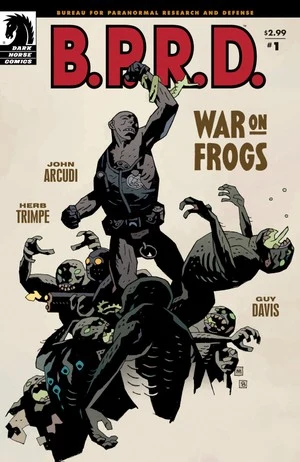
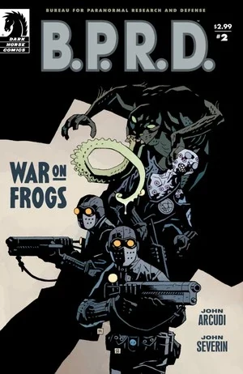
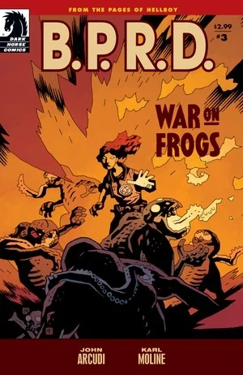
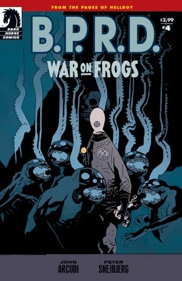
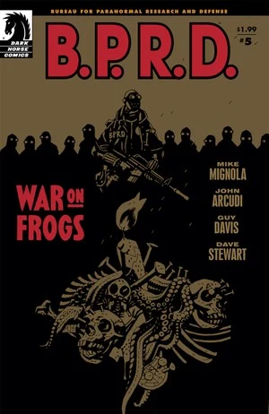

***War on Frogs*** is a four-issue miniseries. It follows members of the B.P.R.D. in the war against the [frog monsters](/entry/frog_monster). Each issue had a different guest artist and were all one-shots.

## Publication History

The four-issue miniseries was published from June 2008 to December 2009. The story was collected together with an expanded version of *[Revival](/entry/Revival)* in the trade paperback *[B.P.R.D.: War on Frogs](/entry/Trade_Collections)* in April 2009. The four issues and Revival were re-numbered put into a different reading order:

- *War on Frogs* \#1 (Re-titled "Chapter 1")
- *Revival* (Re-titled "Chapter 2")
- *War on Frogs* \#2 (Re-titled "Chapter 3")
- *War on Frogs* \#4 (Re-titled "Chapter 4")
- *War on Frogs* \#3 (Re-titled "Chapter 5")

In October 2011, the expanded version of the short story *[Revival](/entry/Revival)* was re-released by Dark Horse Digital as *War on Frogs* \#5.

The series was later collected in the omnibus format in *[B.P.R.D.: Plague of Frogs – Volume 2](/entry/Omnibus_Editions)* along with *[The Dead](/entry/The_Dead)* and *[The Black Flame](/entry/The_Black_Flame_%28story%29)*. As explained by [Scott Allie](/entry/Scott_Allie) in the introduction, *War on Frogs* and *The Black Flame* were put into a different reading order:

- *The Black Flame* \#1 (Re-titled *"War on Frogs*: Chapter 1")
- *War on Frogs* \#1 (Re-titled *"War on Frogs*: Chapter 2")
- *Revival* (Re-titled *"War on Frogs*: Chapter 3")
- *War on Frogs* \#2 (Re-titled *"War on Frogs*: Chapter 4")
- *War on Frogs* \#4 (Re-titled *"War on Frogs*: Chapter 5")
- *The Black Flame* \#2-6 (Re-titled *"The Black Flame*: Chapters 1-5")
- *War on Frogs* \#3 (Re-titled *"The Black Flame*: Epilogue")

## Synopsis

### Part One

The first issue was illustrated by Herb Trimpe and focused on [Roger](/entry/Roger).

As the frog cult spreads across America, Roger the Homunculus returns to the site of the B.P.R.D.'s first clash with the frog creatures--the ruins of Cavendish Hall, where [Hellboy](/entry/Hellboy_%28character%29), [Abe](/entry/Abe_Sapien), and [Liz](/entry/Liz_Sherman) first encountered both the frogs and [Rasputin](/entry/Rasputin) to track down the final pieces of the puzzle of the Cavendish family.

After Abe turns down [Kate's](/entry/Kate_Corrigan) suggestion of re-visiting Cavendish Hall, (the site of the events featured in *[Seed of Destruction](/entry/Seed_of_Destruction)*) for clues regarding the frogs, Roger leads a B.P.R.D. field team to investigate the site. Roger scouts the caverns under the remains of the hall, where he uncovers a shrine left by the Cavendish brothers to their dead mother, including her preserved corpse. The brothers reveal themselves as a form of evolved frog monster. After an extended battle with the monsters, Roger gets the upper hand after they become distracted when a stray bullet destroys the corpse of Emma Cavendish. As the brothers grieve over their mother's corpse, Roger destroys them with a volley from his gun. As the cleanup team arrives, Roger ponders whether it was worth disturbing the frogs in the first place and orders the clean up crew to just leave without further action.

### Part Two

The second issue was illustrated by [John Severin](/entry/John_Severin) and focused on a team of ordinary B.P.R.D. soldiers hunting down a nest of frog monsters on an abandoned battleship -- only to become their quarry's prey. This issue features the first and last appearance of several B.P.R.D. agents, presumably drafted from the military.

In May 2005, a squadron of B.P.R.D. soldiers are sent to investigate a possible frog nest on an abandoned battleship on the Calafornia Coast. Lead by Lieutenant Bradley, agents Varadi, Demers, Bernie D'Andrea, Whitcomb, Bama and Kohler investigate the wreck. As they explore the claustrophobic corridors of the ship, they learn that the frogs may still be alive. The team is gradually picked off one by one by frog monsters as a helpless [Abe Sapien](/entry/Abe_Sapien) listens in on the radio frequency. Finally Demers, the last remaining member of the team, makes it onto the deck of the ship and is confronted by a frog monster. Having no weapons, Demers arms himself with a broken pipe and prepares to go down fighting. The final pages of the story feature an army major reaching the site and corresponding with Abe over radio. He reveals that there was actually only one frog monster on the ship and commends Demers for his bravery in slaying the monster at the cost of his own life.

### Part Three

The third issue was illustrated by [Karl Moline](/entry/Karl_Moline) and focused on [Liz Sherman](/entry/Liz_Sherman) and [Ashley Strode](/entry/Ashley_Strode), a new character.

Set in July 2006, Ashley greets a despondent and disaffected Liz in the [B.P.R.D.](/entry/Bureau_for_Paranormal_Research_and_Defense) canteen. After being blanked by Liz, Ashley discusses with her colleagues how she admires Liz as a strong female presence in the B.P.R.D., but worries that she hasn't seemed right since the events of [*B.P.R.D.: The Black Flame*](/entry/The_Black_Flame_%28story%29).

In a flashback to April 2005, Liz has destroyed a frog nest in a sewage plant in Louisianna. [Daimio](/entry/Ben_Daimio) expresses concern for Liz's reckless handling of the mission, but Liz is dismissive of his comments. Ashley Strode is informed of Liz's tragic history by a fellow B.P.R.D. agent.

In a montage, Liz is shown leading B.P.R.D. field teams to clear out frog nests in Iowa, Washington, Utah & Oregan throughout 2005.

In the B.P.R.D. headquarters, February 2006, Ashley and her partner encounter Liz in a corridor and Ashley attempts to introduce herself. However Liz is dismissive and distant, and doesn't even ask her name.

In a meeting with [Kate](/entry/Kate_Corrigan) and [Abe](/entry/Abe), Liz brings up Abe's reluctance to engage in field work. However Kate criticizes Liz's recent approach to missions, advising her to focus on developing agent's skills rather than cold efficiency. With this in mind Liz is sent to lead a mission to check up on an abandoned frog nest in Handelson, Montana.

The B.P.R.D. team searches the sight, Liz searching the sub-basement while Ashely and her partner search upstairs. Liz exits the buliding believing the site to be safe. Meanwhile Ashley and her partner are ambushed by frogs. Ashley is incapacitated and her partner is killed by the monsters. Just before Ashley is killed Liz arrives to save the day. Ashely quickly recovers and helps Liz destroy the remaining frogs. They leave the mission on friendly, first name terms.

The flashback sequences end and the issue ends where it started in the B.P.R.D. canteen with Ashley and her colleagues mystified as to Liz's current state of mind.

In the final panels, we are given a glimpse into Liz's point of view. The [mysterious mystic](/entry/Memnan_Saa) who appeared to Liz in [*B.P.R.D.: The Black Flame*](/entry/The_Black_Flame_%28story%29) stands behind Liz, an ever-looming presence.

### Part Four

The fourth and final issue was illustrated by Peter Snejbjerg, with colors by Bjarne Hansen. The story focused on [Johann Kraus](/entry/Johann_Kraus).

Johann Kraus, the ectoplasmic man, leads a team of B.P.R.D. agents against the frog monsters as they spread across the country. But this time, burning the nest of frogs is not the end of the battle for Johann, as he learns about the horrifying afterlife of the Bureau's sworn enemies.

In March, 2006, Johann leads a field team to exterminate a frog nest in Kansas. After quickly destroying the frogs, Johann orders [Agent Catlett](/entry/Agent_Catlett) to burn the remains. However, unseen by everyone except Johann, their ghosts remain. Johann briefly tells the ghosts to try and move on. Despite this they continue to haunt the team as they return back to the B.P.R.D. HQ. The ghosts begin to induce illness in agent Catlett to blackmail Johann into helping them. After discussing the problem with [Ben Daimio](/entry/Ben_Daimio) and seeing Catlett's condition worsen, Johann is persuaded into helping the frogs. In spirit form he leads them into the atmosphere and holds a seance. A vast breach opens into another plain of existance and the frog spirits transcend. However, Johann's soul is also nearly pulled into the abyss, but he eventually escapes. Back in the B.P.R.D. HQ Johann is seen reading from a bible. Daimio approaches him and apologizes for dismissing the existential risk Johann faced.

Note: This final scene and conversation with Daimio is later referenced in a dream Johann experiences in the [The Long Death](/entry/The_Long_Death).

### Part Five

*See [Revival](/entry/Revival) for full article*

[Ben Daimio](/entry/Ben_Daimio) hunts down frog monsters masquerading as faith healers.

## Content

Note 1: This doesn't include the content of [The Black Flame](/entry/The_Black_Flame_%28story%29) \#1, which is rebranded as chapter one of [War on Frogs](/entry/War_on_Frogs) on all collected editions
Note 2: This includes the content of [War on Frogs](/entry/War_on_Frogs) \#3, which serves as an epilogue for [The Black Flame](/entry/The_Black_Flame_%28story%29) on all collected editions
Note 3: For the content of Part Five go to [Revival](/entry/Revival)

### Part One

#### Characters

- [B.P.R.D.](/entry/Bureau_for_Paranormal_Research_and_Defense)
  - [Katherine Corrigan](/entry/%E5%87%AF%E7%89%B9%C2%B7%E8%80%83%E7%91%9E%E6%A0%B9))
  - [Abraham Sapien](/entry/Abraham_Sapien)
  - [Roger](/entry/Roger)
  - Agent Mazzei
  - Other Agents
- [Hellboy](/entry/Hellboy_%28character%29) (Flashback)
- [Rasputin](/entry/Rasputin) (Flashback)
- [Ogdru Hem](/entry/Ogdru_Hem)
  - [Sadu-Hem](/entry/Sadu-Hem) (Flashback)
- Cavendish Family
  - Emma Cavendish (Corpse & Photograph)
  - Two Brothers (Turned into [Frog Monsters](/entry/Frog_monster))

#### Locations

- U.S.A.
  - [B.P.R.D.](/entry/Bureau_for_Paranormal_Research_and_Defense) Headquarters (Colorado)
  - [Cavendish Hall's](/entry/Cavendish_Hall) ruins (Lake Talutah, Upstate New York)

### Part Two

#### Characters

- [B.P.R.D.](/entry/Bureau_for_Paranormal_Research_and_Defense)
  - [Abraham Sapien](/entry/Abraham_Sapien)
  - Lieutenant Bradley
  - Agents Demers, Varadi, Bama, Kholer, Whitcomb and D'Andrea
  - [Katherine Corrigan](/entry/%E5%87%AF%E7%89%B9%C2%B7%E8%80%83%E7%91%9E%E6%A0%B9))
- [Hellboy](/entry/Hellboy_%28character%29) (Flashback)
- [Frog Monster](/entry/Frog_monster)
- Military Personnel

#### Locations

- U.S.A.
  - [B.P.R.D.](/entry/Bureau_for_Paranormal_Research_and_Defense) Headquarters (Colorado)
  - Abandoned Ship (Coast of California)

### Part Three

#### Characters

- [B.P.R.D.](/entry/Bureau_for_Paranormal_Research_and_Defense)
  - [Elizabeth Sherman](/entry/Elizabeth_Sherman)
  - [Ashley Strode](/entry/Ashley_Strode)
  - [Johann Kraus](/entry/Johann_Kraus) (Flashback)
  - [Benjamin Daimio](/entry/Benjamin_Daimio) (Flashback)
  - [Roger](/entry/Roger) (Flashback)
  - [Katherine Corrigan](/entry/%E5%87%AF%E7%89%B9%C2%B7%E8%80%83%E7%91%9E%E6%A0%B9)) (Flashback)
  - [Abraham Sapien](/entry/Abraham_Sapien) (Flashback)
  - Other Agents
- Old Lady (Flashback)
- [Frog Monsters](/entry/Frog_monster) (Flashback)
- [Memnan Saa](/entry/Memnan_Saa)

#### Locations

- U.S.A.
  - [B.P.R.D.](/entry/Bureau_for_Paranormal_Research_and_Defense) Headquarters (Colorado)
  - Various Mission Locations: Lousiana, Iowa, Washington, Utah and Oregon (Flashbacks)
  - Sherman Residence (Kansas City, KA) (Flashback)
  - Abandoned Pharmacy (Handelson, MT) (Flashback)

#### Noteworthy Artifacts

- [Memnan Saa's](/entry/Memnan_Saa) Flower (Flashback)

### Part Four

#### Characters

- [B.P.R.D.](/entry/Bureau_for_Paranormal_Research_and_Defense)
  - [Johann Kraus](/entry/Johann_Kraus)
  - [Benjamin Daimio](/entry/Benjamin_Daimio) (Flashback)
  - Other Agents
- [Frog Monsters](/entry/Frog_monster)

#### Locations

- U.S.A.
  - Barn in Kansas
  - [B.P.R.D.](/entry/Bureau_for_Paranormal_Research_and_Defense) Headquarters (Colorado)

## Gallery

 \#1

 \#2

 \#3

 \#4

 \#5
