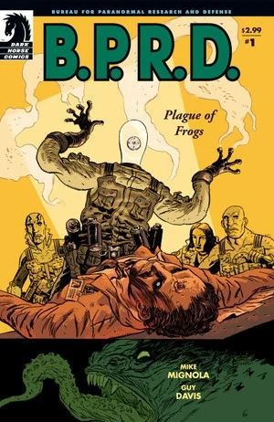
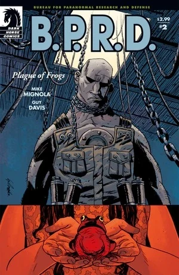
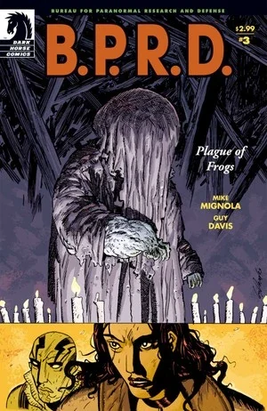
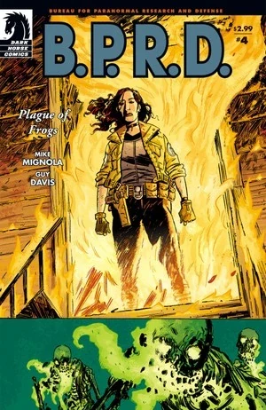
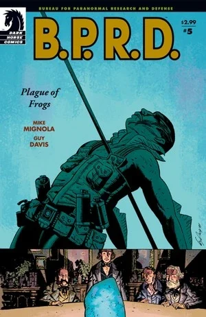

*This is the article about the*Plague of Frogs*miniseries. For the story cycle see*[Plague of Frogs *(story cycle)*](/entry/Plague_of_Frogs_%28story_cycle%29).

***Plague of Frogs*** is a five-issue miniseries written by [Mike Mignola](/entry/Mike_Mignola) and drawn by [Guy Davis](/entry/Guy_Davis).

## Publication History

Following the four one-shot [B.P.R.D.](/entry/B.P.R.D.) stories published in 2003 (*[The Soul of Venice](/entry/The_Soul_of_Venice)*, *[Dark Waters](/entry/Dark_Waters)*, *[Night Train](/entry/Night_Train)* and *[There's Something Under My Bed](/entry/There%27s_Something_Under_My_Bed)*), [Mike Mignola](/entry/Mike_Mignola) changed directions by returning to themes from [Seed of Destruction](/entry/Seed_of_Destruction).[1]

The five issue mini-series was published from March to July 2004. This was the first time that [Guy Davis](/entry/Guy_Davis) provided art to a [Mike Mignola](/entry/Mike_Mignola) script. The story was collected in the trade paperback *[B.P.R.D.: Plague of Frogs](/entry/Trade_Collections)* in February 2005.

## Synopsis

### Part One

In New Jersey at a [B.P.R.D.](/entry/B.P.R.D.) lab, a scholar of fungus shows a visiting processional colleague his latest research, a massive fungus which has rapidly grown in an abnormal shape. Suddenly the visiting professor shoots the doctor in the back. Security guards rush in as the man calls to his 'master.' Many gun shots are heard and the building goes black.

[Abe Sapien](/entry/Abe_Sapien) sits in the ocean watching the bodies of people sink into the deep. In the background Abe hears the same words spoken to him by the dead priest in *[Wake the Devil](/entry/Wake_the_Devil)* \#5, "Do you hear... sunken bells are tolling for thee. Out of the Caverns of Num-Yabisc, dark and terrible deep, the ocean is calling her children... home." He follows the falling bodies into a bright light, and suddenly wakes up.

[Kate Corrigan](/entry/Kate_Corrigan) gathers the team and they head to New Jersey to investigate. The security tape shows the professor shooting the researcher and then being shot by two security guards. The fungus, its container shattered by the gun shots, appears to go into the professor, and then the power in the building gets cut off. Abe, [Elizabeth Sherman](/entry/Elizabeth_Sherman), [Roger](/entry/Roger) and [Johann Kraus](/entry/Johann_Kraus) enter the building. Abe and Liz search downstairs, while Roger and Johann check the doctor's office.

As Abe and Liz explore, they talk. Abe says he is worried about Roger. Liz replies that they know Roger's past. They also know what happened to her and Johann. What they do not know is Abe's past.

Roger and Johann find the doctor's body. Something left a mark on his forehead. Meanwhile one of the missing guards changes into a [Frog monster](/entry/Frog_monster) and attacks Abe and Liz. The other guard, now also a monster attacks as well, though Abe is able to kill them. Upstairs the doctor stands up, attacks and also turns into a frog monster. Roger manages to kill the monster.

### Part Two

Back at B.P.R.D. headquarters in Connecticut, agents examine the frogs. A single fungus spore entered each one's head causing the transformation. Abe and Roger each recall seeing similar creatures before. Abe in Cavendish Hall (as seen in *[Seed of Destruction](/entry/Seed_of_Destruction)*) and Roger in Hunte Castle (as seen in *[Conqueror Worm](/entry/Conqueror_Worm_%28story%29)*). [Professor O'Donnell](/entry/Professor_James_Henry_O%27Donnell) says it is [Sadu-Hem](/entry/Sadu-Hem), and yells at [Thomas Manning](/entry/Thomas_Manning). Manning explains that every 6 months a team checks Cavendish Hall. For 10 years there was no sign of life but then a small fungus was found. They moved the sample to the New Jersey storage facility and allowed it to grow.

With professor Derby's body still unaccounted for, they look into his life for any strange behavior. They find out that recently he started giving a lot of money to "The New Temple of Mysteries" based out of Crab Point, Michigan. The team flies out to investigate further. When they arrive the town looks abandoned. [Johann](/entry/Johann) senses activity in an old church house. Inside a man in a robe preaches to his congregation, telling them the enemy has come but not to fear.

Suddenly the helicopter carrying the agents crashes. Roger falls out separating him from the group. He finds a young girl and tries to help her, but she too is really a Frog monster. the creature attacks leaving Roger hanging from his neck by a chain.

Meanwhile in the crashed helicopter, Abe Sapien, unconscious, again hears a voice call, "Do you hear... sunken bells are tolling for thee," as he sees bodies sink.

### Part Three

In the crashed helicopter, Kate Corrigan radios back to headquarters that she needs backup, but the signal did not go through, leaving the agents on their own.

Inside the Temple of New Mysteries, Abe, Liz, Johann and the remaining pilot lay wounded on the floor. Before them stands the leader and a large covered figure. The covered figure, who the leader calls Sadu-Hem, reaches out and turns the pilot into a frog monster. Johann tries to stop the man, but the congregation, all frogs, stop him destroying his suit. The cloaked figure is revealed as a man-fungus creature, and the creature somehow forces Johann to flee the room.

Liz uses her power to set the creature Sadu-Hem on fire, killing the creature. However its essence travels into the ground animating bodies in the cemetery. The glowing skeletons attack Kate. Liz goes to save Kate, while Abe follows the cult leader.

### Part Four

Liz sets the remaining frogs in the temple on fire and rushes outside to save Kate. She immolates the walking skeletons in the cemetery getting rid of Sadu-Hem for good.

Meanwhile Abe searches a large old house in search of the cult leader. He finds news paper articles about a boy named Humbert T. Jones. He also finds a shrine to [Rasputin](/entry/Rasputin). The Cult leader attacks Abe impaling him on a large spear, in fulfillment of Rasputin's prophecy (as seen in *[Wake the Devil](/entry/Wake_the_Devil)* \#5). Abe shoots the man and both tumble out of a nearby window.

The pair sit bleeding in the woods. Abe realizes that the cult leader was in fact the boy Humbert, his youth taken by the [Ogdru Jahad](/entry/Ogdru_Jahad). He says that he was chosen just like Rasputin. He served Sadu-Hem and allowed his children, the frogs, to come into the world. Abe says that the B.P.R.D. will catch the frogs, but Humbert responds that some will get away and gather together awakening the old gods. This in turn will cause the end of the world, and the beginning of a new world. His work completed Humbert walks into the fire to die.

As Abe lay dying, Johann comes to him to return to the living, but Abe slips away. Liz and Kate arrive, only for Johann to tell them that Abe is gone.

### Part Five

The town burns all around the team as other B.P.R.D. agents rush in.

Abe sinks down into the ocean into a massive underwater temple.[2] Inside he sees a [Water Spirit](/entry/Water_Spirit). Before his eyes time passes and the creature forms a sort of cocoon. Now broken down, a lone diver enters the temple and takes the cocoon.

Abe is transported to the Victorian era. During a lightning storm frogs fall from the sky. Abe walks through a bookcase and into a secret meeting. Four men sit around the cocoon as another stands before them. The man lifts the cocoon and begins chanting. The cocoon crumbles and the spirit is absorbed into the man. Suddenly the man, [Caul](/entry/Caul), is able to see Abe, and yells at him to stay back. Abe approaches and merges with Caul. They put him in water but are eventually forced to leave Caul when Abraham Lincoln is shot.

Abe wakes up with his fellow agents around him. Some agents try in vain to capture all of the frog monsters. Other agents retrieve and revive [Roger](/entry/Roger).

## Story Chronology

While not explicit, the events of *Plague of Frogs* take place in 2004, some time before July. *Plague of Frogs* \#2 states that the events occurred 10 years after *[Seed of Destruction](/entry/Seed_of_Destruction)* in 1994. According to the intro to the reprint of *[Revival](/entry/Revival)* the [Frog monsters](/entry/Frog_monster) were already spreading by July of that year.

## Content

### Characters

#### [B.P.R.D.](/entry/Bureau_for_Paranormal_Research_and_Defense)

- [Abraham Sapien](/entry/Abraham_Sapien)
- [Johann Kraus](/entry/Johann_Kraus)
- [Elizabeth Sherman](/entry/Elizabeth_Sherman)
- [Katherine Corrigan](/entry/%E5%87%AF%E7%89%B9%C2%B7%E8%80%83%E7%91%9E%E6%A0%B9))
- [Roger](/entry/Roger)
- Storage Facility Personnel
  - Doctor Platt
  - Howard (Security Guard)
- [Thomas Manning](/entry/Thomas_Manning)
- Former Members
  - [Hellboy](/entry/Hellboy_%28character%29) (Mentioned)
  - [Trevor Bruttenholm](/entry/Trevor_Bruttenholm) (Mentioned)
- [James Henry O’Donnell](/entry/J%C2%B7H%C2%B7%E5%A5%A5%E5%94%90%E7%BA%B3%E6%95%99%E6%8E%88))
- Jim

#### [Ogdru Hem](/entry/Ogdru_Hem)-related

- New Temple of Mysteries
  - Irwin Derby
  - Crab Point residents (Turned into [Frog Monsters](/entry/Frog_monster))
  - Humbert T. Jones
- [Ogdru Hem](/entry/Ogdru_Hem)
  - [Sadu-Hem](/entry/Sadu-Hem)
- [Frog Monsters](/entry/Frog_monster) (Formerly B.P.R.D. Storage Facility Personnel)
- Cavendish Family (Flashback)
  - Emma Cavendish (Corpse) (Flashback)
  - Three Brothers (Turned into [Frog Monsters](/entry/Frog_monster)) (Flashback)
- [Grigori Rasputin](/entry/Grigori_Rasputin) (Photograph and Flashback)
- [Sven Olafson](/entry/Sven_Olafson) (Mentioned)
- [Ogdru Jahad](/entry/Ogdru_Jahad) (Mentioned)
- Living Skeletons

#### Other

- [Cloacina](/entry/Cloacina) (Mentioned)
- Chengdow incident victims (Flashback)
- S.W.A.T. Officer
- Abe's Vision/Flashback/Spiritual Time-Travel
  - [Water Spirit](/entry/Water_Spirit)
  - [Oannes Society](/entry/Oannes_Society)
    - Langdon Everett Caul (Pre-Transformation [Abraham Sapien](/entry/Abraham_Sapien))
    - Other Members

### Locations

- U.S.A.
  - [B.P.R.D.](/entry/Bureau_for_Paranormal_Research_and_Defense) Storage Facility (New Jersey, NJ)
  - [B.P.R.D.](/entry/Bureau_for_Paranormal_Research_and_Defense) Headquarters (Farfield, CT)
  - Sherman Residence (Kansas City, KA) (Flashback)
  - St. Trinian's Hospital (Washington D.C.) (Flashback)
    - [Oannes Society](/entry/Oannes_Society) Meeting Place (Flashback)
  - [Cavendish Hall](/entry/Cavendish_Hall) (Upstate New York) (Flashback)
  - Crab Point, MI
  - Michigan/Wisconsin border
- Romania (Flashback)
  - [Edel Mischrasse's](/entry/Edel_Mischrasse) workshop under Czege Castle (Fălticeni) (Flashback)
- Germany (Flashback)
  - Krauss Residence (Heidelberg) (Flashback)
- Atlantic Ocean
  - Caverns of Num-Yabisc

### Noteworthy Artifacts

- [Oannes Society](/entry/Oannes_Society)
  - Diving Suit (Flashback)
  - Submarine (Flashback)

## Gallery

 \#1

 \#2

 \#3

 \#4

 \#5

## Notes

<references/>

[1] In the [Hellmail](/entry/Hellmail) of *Plague of Frogs* \#1, [Scott Allie](/entry/Scott_Allie) calls the comic "a whole new direction in Mignola's world of comics" and connects the story "back to the ideas \[of\] *[Seed of Destruction](/entry/Seed_of_Destruction)*."

[2] While not explicit this is the almost certainty the Caverns of Num-Yabisc
