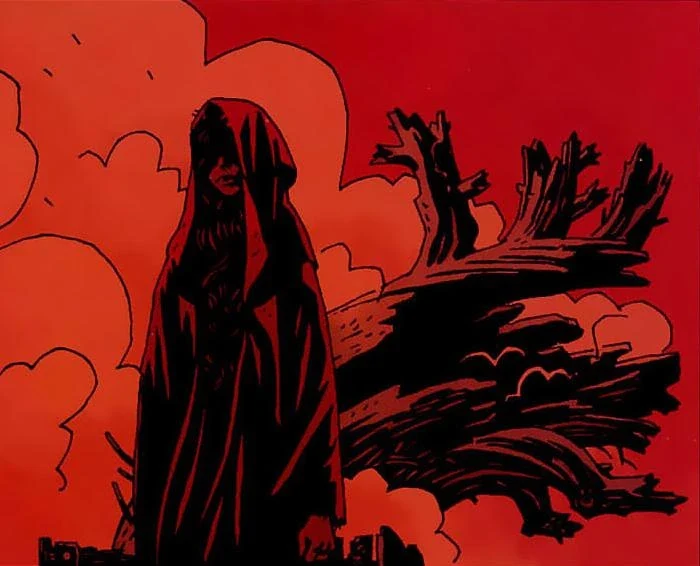
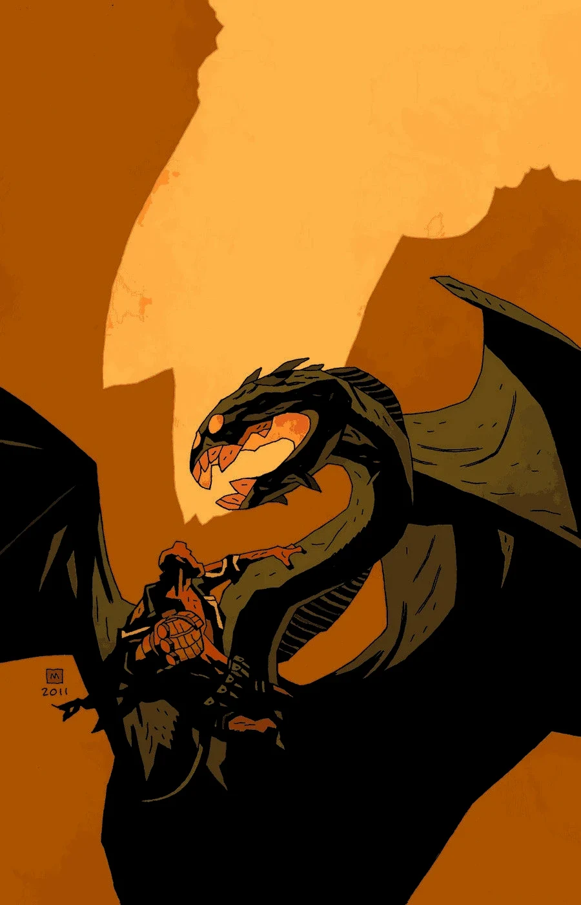
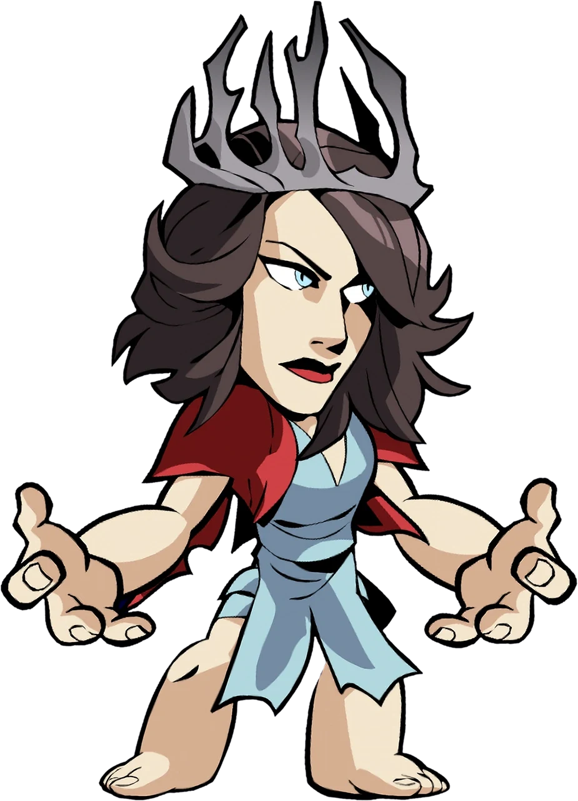

**Nimue**, also known as "the Queen of Blood" or "the Lady of the Lake," was the greatest of all British witches. She is the main antagonist of "[The Wild Hunt](/entry/The_Wild_Hunt) trilogy" from *[Hellboy](/entry/Hellboy_%28series%29)* comics. A powerful sorceress, Nimue lived during the reign of King Arthur. Due to her power, she was imprisoned by the other witches of Britain for 1,500 years before her revival to lead the Wild Hunt.

## History

Nimue lived during the reign of [King Arthur](/entry/King_Arthur), and was beloved by [Merlin](/entry/Merlin), who told her all of his secrets. She used this knowledge to imprison him in a grave for eternity. But without Merlin to guide her, Nimue's knowledge of magic drove her to madness and eventually to worship the [Ogdru Jahad](/entry/Ogdru_Jahad). Her madness was so great that all the other [witches](/entry/witches) killed her, cut her into many pieces and scattered them all over the earth. However, the pieces would always rejoin, so the witches shut them into a wooden box and buried it deep within the earth.

Centuries later, during the events of *[Darkness Calls](/entry/Darkness_Calls)*, the witches of Britain tried to find a new leader, after [Hecate](/entry/Hecate) was imprisoned by [Igor Bromstead](/entry/Igor_Bromhead). They offered the honor to Hellboy, but he refused outright. Instead, [Gruagach](/entry/Gruagach) arrived at their meeting and nominated Nimue. The witches eventually agreed despite their reservations, and gave Gruagach a letter, allowing him and his two companions access to the tomb where Nimue's box was sealed. Seeing the letter, the giant overseeing the tomb had no choice but to lift the seal and remove Nimue's box. Having done this, the giant descended into the hole and dragged the seal over himself, in spite of the glorious new world Gruagach promised was coming. The giant said he preferred a lonely exile to seeing what would come from releasing Nimue.

 During the events of the *[The Wild Hunt](/entry/The_Wild_Hunt)*, Gruagach was still in possession of the box, but unable to revive Nimue. He was approached by [Astaroth](/entry/Astaroth) in human form, who gave Gruagach a Ciborium containing the blood of all the inhabitants of a nearby human village. When Gruagach poured the blood into the box, the Queen of Blood arose.

After settling her score with the remaining Witches of England (the majority having drowned themselves to escape her wrath and avoid the horror facing the world) Nimue demanded that an army be marshaled for her. While she awaited her army, Gruagach pleaded for only two things: that she restore his powers and give Hellboy to him. She promised she would do so, when the time was right.

Nimue received her first emissary from King Uddsvik of Jutland. The King's ambassador presented her with a golden crown, with promises that he and all the kings of the north would bring their armies to her side. Instead of accepting the crown, she told the ambassador to hammer it into a knife, murder his king with it, then cut out his heart and burn it in a furnace, and use the ashes to forge an iron helmet in the shape of three ravens joined together, bearing the names Badhbh, Macha, and Mor-Rioghain. Nimue said she had no use for a crown, as she was no longer the Queen of Witches, but instead the Goddess of War.

Later, when Hellboy retrieved the sword [Excalibur](/entry/Excalibur), Nimue wondered what [Morgan Le Fey](/entry/Morgan_Le_Fey) had planned but said that it would makes no difference. As she continued to wait for the arrival of her army, Gruagach continued to plead that she fulfill her promise to restore his powers. When he suggested that she was not yet strong enough to do so, she flew into a rage and cast him away before disappearing with her followers.

### [The Storm](/entry/The_Storm) and [The Fury](/entry/The_Fury)

Nimue as a dragon, transformed by the Ogdru Jahad

Having killed [Queen Mab](/entry/Queen_Mab) and used her blood to empower a fairy in her service to kill Hellboy, Nimue begins to gather her forces. On the other side, Hellboy uses Excalibur to raise an army of British knights from the grave to oppose her. What Nimue does not realize is that the [Ogdru Jahad](/entry/Ogdru_Jahad) have chosen her to serve as their vessel for their return to the world, and the revelation causes her body to transform.

By the time Hellboy arrives and knocks her helmet off, Nimue has been completely possessed by the Ogdru Jahad, and transforms into a dragon-like creature, while the two armies battle each other. [Alice Monaghan](/entry/Alice_Monaghan) has learned from Queen Mab's spirit that this battle will mark the beginning of the end of the world, but Hellboy's role is to ensure that his friends survive to enable humanity to endure the end of the current age.

Receiving a sword from [Vasilisa](/entry/Vasilisa), created from one of the ravens that formed Nimue's helmet, acting on its owner's residual humanity, Hellboy uses it to kill Nimue. Emerging from her body, Nimue's spirit senses that she is being dragged to [Hell](/entry/Hell) by the ghosts of England's drowned witches. But Nimue refuses to die alone, and she tears Hellboy's heart from his chest and drags him down to Hell with her.

## Powers and Abilities

**[Magic](/entry/Magic)**: Nimue is an incredibly powerful witch; she is an expert in dark magic and curses. She has Many magical and demonic powers.

**Dragon Physiology:** Nimue is revealed to have been used by the Ogdru Jahad as a vessel and possessed by them, resulting in her transformation into a dragon-like creature that attempts to kill Hellboy.

## Appearances in other media

The 2019 film iteration of Nimue, as she appears in <em>Brawlhalla</em>.

### Brawlhalla

[Nimue](/entry/Nimue_%28Brawlhalla%29) appears in Blue Mammoth Games' game *[Brawlhalla](/entry/Brawlhalla)* as a crossover skin for [Dusk](/entry/w%3Ac%3Abrawlhalla%3ADusk).

### *Hellboy* (2019)

The character appears in the 2019 film *[Hellboy](/entry/%E5%9C%B0%E7%8B%B1%E7%94%B7%E7%88%B5%EF%BC%9A%E8%A1%80%E7%9A%87%E5%90%8E%E5%B4%9B%E8%B5%B7))*, portrayed by [Milla Jovovich](/entry/Milla_Jovovich).
