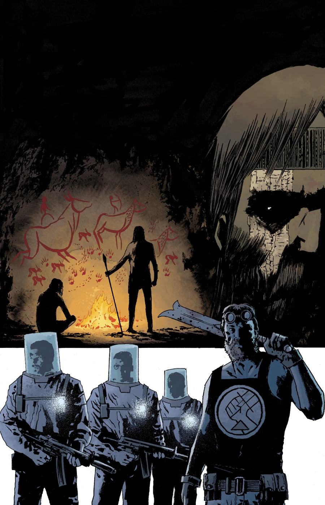
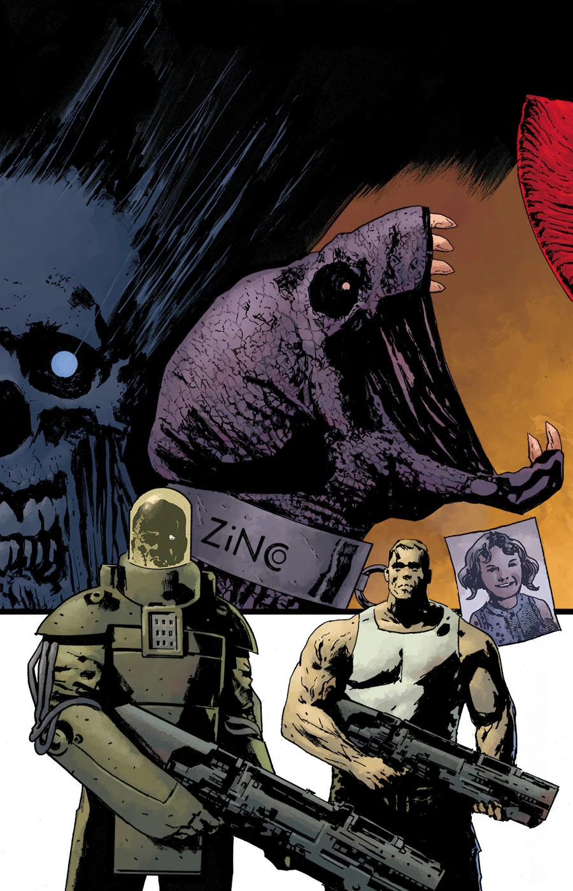
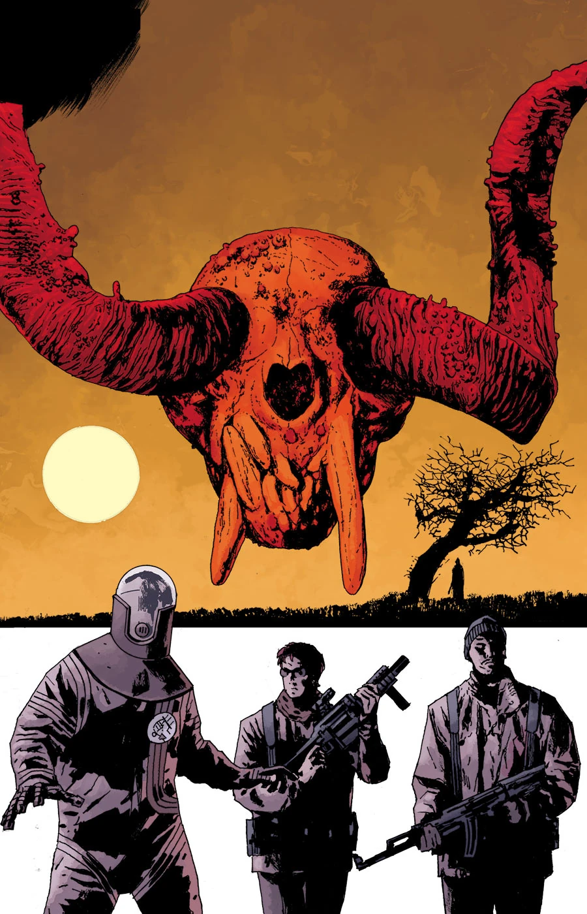
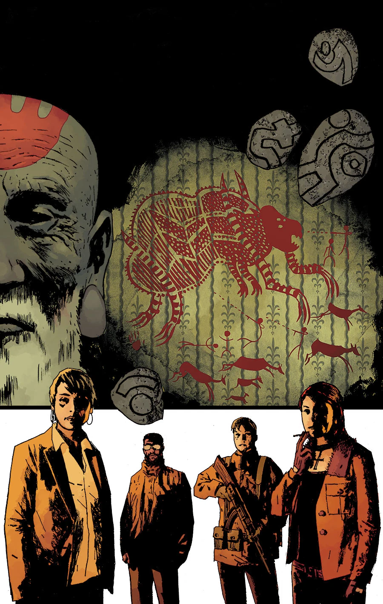
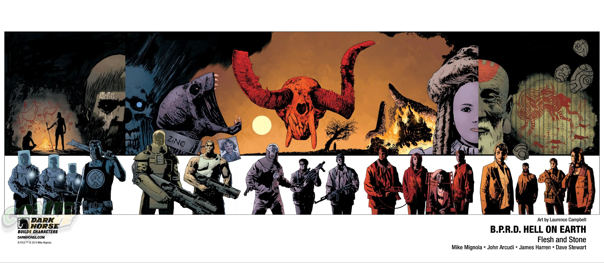

***Flesh and Stone*** is a five-issue arc drawn by James Harren with covers by Laurence Campbell.

## Synopsis

### Part One

Things seem to be going well for the [B.P.R.D.](/entry/Bureau_for_Paranormal_Research_and_Defense). With their alliance with the military, they now have all the munitions they need, and, after New York, an easy mission to clear a small town. But the town has strange connections to [Howards’s](/entry/Ted_Howards) past as a [prehistoric warrior](/entry/Gall_Dennar), and more than its share of monsters.

### Part Two

A monster terrorizes a mountain where Howards finds a connection to his past as a prehistoric warlord. The Russians struggle with their own monsters, and in New York, the [Zinco Corporation](/entry/Zinco_Corporation) operates under the mysterious directions of the [Black Flame](/entry/The_Black_Flame_%28character%29).

### Part Three

Agent Howards's past as a prehistoric warlord gives clues to how the B.P.R.D. can kill the monster they've been chasing. But will Howards be able to put his knowledge to use before the whole squad gets wiped out?

### Part Four

The B.P.R.D.’s attempts to kill the monster terrorizing a snowy mountainside have failed. While the team tries desperately to escape, one man stands against the monster... the mysterious Agent Howards. Will this warrior from the past be able to kill the beast or be crushed in its path?

### Part Five

Howards uses his link to the past to save the B.P.R.D. from a rampaging monster in the snowy mountains. But will the secrets he has learned be enough?

## Gallery

