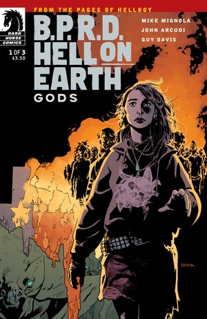
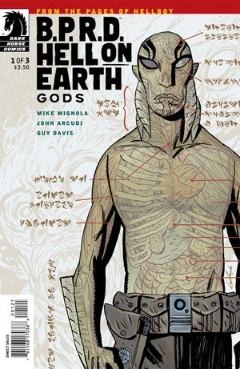
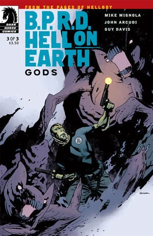

***Gods*** is a three-issue miniseries published from January to March 2011.

## Publication History

This is the second arc of the [*Hell on Earth* cycle](/entry/BPRD%3F%E4%BA%BA%E9%97%B4%E5%9C%B0%E7%8B%B1)), following *[New World](/entry/New_World_%28B.P.R.D._story_arc%29)*. The issues were published with covers by [Ryan Sook](/entry/Ryan_Sook). The first issue was also published with a variant cover by [Guy Davis](/entry/Guy_Davis).

The story was collected together with *[Monsters](/entry/Monsters)* in the *[B.P.R.D.: Hell on Earth—Gods and Monsters](/entry/Trade_Collections)* trade paperback.

## Synopsis

### Part One

As Texas goes to Hell, a group of homeless outcasts--led by a young woman who appears to have second sight--evade volcanic eruptions, mass hysteria, and man--eating monsters. When the B.P.R.D. take notice of this, the results turn out to be deadly.

### Part Two

Monsters overrunning the American southwest, a volcano in Houston burning in the night, and a group of outcasts with a prophetic leader; prove to be great threats to a struggling bureau.

### Part Three

Giant bat--eared beasts wage war against the Bureau, Abe finally confronts the mysterious prophet, and Devon’s suspicions are verified.

## Gallery

 \#1

 \#1 variant

 \#2

 \#3
