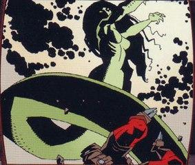
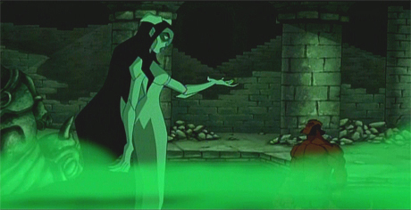

**Hecate** is the Goddess of [Witches](/entry/Witches), also known as Gorgon Eyes, the Queen of Dogs, and [Kali](/entry/Kali). She states that she's connected to [Hellboy](/entry/Hellboy_%28character%29), because they both are related with the coming of the Apocalypse. She is based on Greek Goddess of Magic.

## History

Hecate's origins were steeped in mystery for most of her appearances in the Hellboy storyline, only being divulged at the behest of [Edward Grey](/entry/Edward_Grey) in the second epilogue of *[Darkness Calls](/entry/Darkness_Calls)*. During Grey and Hecate's conversation, Hecate verified the ancient claims that she had been born from the shadows and delivered from the belly of a wolf, as well as the old stories of her living at the summit of Mount Eos with birds of prey and serpents as her only company, drinking only blood and possessing otherworldly beauty.  She has had several different names throughout the ages such as Heca-Emem Ra, Neb-Ogeroth, Black Heccata, The Black Goddess, Goddess of Crossroads, and Witch Queen.

Hecate then revealed to Grey several portions of her legend that went unrecorded, most of them involving her time living with the Golden People, the [Hyperboreans](/entry/Hyperboreans).  She lived among them in their capital of [Gorinium](/entry/Gorinium). According to Hecate, she was able to gain the favor of the Hyperborean king, [Thoth](/entry/Thoth), and in turn seduced him. Her reason for doing so was to gain access to a secret garden Thoth possessed, a garden that held three supernatural captives; [a trio of outcast angels](/entry/Watchers). If Hecate's word is to be believed, Thoth recorded the knowledge of these angels onto forty two books, of which only two were revealed to his people, with the remaining forty being kept for himself. By pretending to be his lover, Hecate hoped to steal this knowledge, going so far as to kill the three angels and drink their blood, blood that she later vomited out inside Thoth's temple and "painted the walls of that place with all that knowledge that he (Thoth) would have kept secret".

Now possessing all of the outcast angel's knowledge, Hecate went out to the people of Hyperborea as a makeshift prophet, preaching the secrets that Thoth had kept for himself. Realizing Hecate's treachery, Thoth cursed her to be half transformed into a shape that reflected her true nature, making her lower body akin to a snake's and turning her skin scaly and unlovely. The curse also made the light of the sun deadly to her, forcing her to hide in shadow for the rest of her days.

However, none of this particularly fazed Hecate because, according to her, she had accomplished what she had sought out to do. The knowledge of the three angels had spread across Hyperborea, out of the king's control. Unfortunately, that knowledge also led to the kingdom's downfall, with the citizens turning away from what had made them great and causing them to degenerate into cult worshiping savages. It can be assumed that this was the same event that led to the awakening of the ancient statue that possessed the [Right Hand of Doom](/entry/Right_Hand_of_Doom), causing it to destroy all that remained of Hyperborea, as documented by the unnamed mystic in *[The Island](/entry/The_Island)*.

After this, Hecate is said to have created many horrific creatures to plague mankind, after which she became both a goddess of darkness and at some point Queen of Witches. Many temples were dedicated to her beneath the earth, out of the reach of the sun, scattered all over the world. It is at this point that Hecate's description of her early life to Sir Edward Grey ends.

### *Wake the Devil*

There is no information on what specific activities Hecate partook in after her banishment from Hyperborea. The earliest plot details in the Hellboy timeline after that point involve her being pulled up from the bottom of a lake by Greek fisherman in 1492, after which her body fell into the possession of the father of [Vladimir Giurescu](/entry/Vladimir_Giurescu), who used various substances to make her flexible again. Later, when Vladimir himself drowned as a young man, Hecate rewarded his father by resurrecting Vladimir from death, in the process granting Vladimir a portion of her soul and transforming him into a [vampire](/entry/Vampire_%28creature%29), making him her "son". Vladimir Giurescu later partook in the Napoleonic wars and received many fatal wounds, all of which he recovered from thanks to his vampiric abilities and secret arcane rituals. It can be assumed that Hecate played an important part in each of these rituals.

 Hecate first encountered [Hellboy](/entry/Hellboy_%28character%29) in the 1990's, after the resuscitation of [Grigori Rasputin](/entry/Grigori_Rasputin)'s disciples and the continuation of the Nazi doomsday project "[Vampir Sturm](/entry/Vampir_Sturm)". Hellboy, investigating a European castle while searching for Giurescu, had a brief encounter with Giurescu's undead father before destroying him, after which he found Giurescu himself. The two of them fought briefly with Hellboy gaining the upper hand, ending with Giurescu escaping by the skin of his teeth and badly wounded. Giurescu prayed to Hecate for help, of which she rapidly responded, healing him in the darkness below the castle.

Hecate then met Hellboy face to face within the castle, right after Hellboy had rigged the entire building to explode. Hecate accused Hellboy of denying his destiny as the bringer of the Apocalypse and for murdering his own kind. Hellboy, uninterested in what Hecate had to say, was about to turn his back on her when Hecate attacked him. Around this time, [Ilsa Haupstein](/entry/Ilsa_Haupstein), a disciple of Rasputin and lover of Giurescu, willingly placed herself in the "Maiden of Joo" (an iron maiden that had once belonged to Elizabeth Bathory) in order to become the new bringer of doom.

After a brutal fight, Hellboy managed to destroy Hecate by forcing her into the sunlight outside the castle. Unable to stand the light of day thanks to Thoth's curse, Hecate disintegrated into dust, though not long before the explosives Hellboy had rigged detonated and knocked Hellboy unconscious.

Though Hecate was destroyed, a piece of her spirit still remained within [Vladimir Giurescu](/entry/Vladimir_Giurescu), who was now fully recovered. Seeking out Hellboy, he found him tied to a post (by local townsfolk under Giurescu's control) with Haupstein's iron maiden standing watch. Charging Hellboy on horseback, Giurescu willingly allowed himself to be destroyed by Hellboy in a single blow, reducing himself to bones so that the fragment of Hecate's soul that remained inside him could be deposited into the iron maiden. Using Haupstein's blood for life and crafting the iron maiden into her new body, Hecate was reborn even more powerful then she had been before. Grabbing Hellboy and biting into him, Hecate forced Hellboy to face his destiny by casting him into the darkness, hoping that he would bring about the end of the world. Hellboy, defiant to the end, resisted and broke off his newly regrown horns, allowing himself to re-enter the normal world in the exact spot he had left it. Hecate was nowhere to be seen.

### *Conqueror Worm*

Hecate next appeared before the ghost of Rasputin after the events of *The Conqueror Worm.* At first, Rasputin believed the living iron maiden to be occupied by the spirit of Ilsa Haupstein, but a quick transformation on Hecate's part revealed this to not be the case. After mocking him a little, Hecate revealed her visions of the future, all of which involved her and Hellboy standing together during the end of the world. She believed that these visions indicated that the two of them would usher in the rebirth of the planet, though she also admitted it was equally likely that both of them would simply die and that she was unsure which outcome would come about. Rasputin, unhappy with these claims, countered that the [Ogdru Jahad](/entry/Ogdru_Jahad) had chosen him to bring about the rebirth of the world, and that it was his divine destiny to do so. Pitying his ignorance, Hecate pointed out the obvious truth; only Hellboy's Right Hand of Doom could bring about the end, and that Rasputin was powerless to do so. Furious, Rasputin screamed in rage that he was still Hellboy's master, after which Hecate destroyed him with a casual sweep of her arm, leaving only a single crumb of his soul intact to be collected by the Baba Yaga.

### *The Island*

Hellboy crossed path's with Hecate again after being adrift for two years in the ocean, following his encounter with the African sea witch known as the [Bog Roosh](/entry/Bog_Roosh). Hecate approached him in peace, once again offering him a chance to fulfill what she believed to be his destiny. Transforming into a massive version of the iron maiden that made up her body, Hecate opened herself to Hellboy, hoping that he would join with her and bring about the end. True to his character, Hellboy refused and told her, none too gently, to leave him alone. Still full of confidence that Hellboy would do what he was prophesized to do in time, Hecate left him be. After his encounter with an unnamed mystic and the [Ogdru Hem](/entry/Ogdru_Hem) that gave him power, Hellboy set off for England on a makeshift raft, though not before seeing Hecate gazing out at him from the cliffs of the shore in her gigantic iron maiden form.

### *Darkness Calls*

Hecate's undoing finally came at the hands of [Igor Bromhead](/entry/Igor_Bromhead), an old enemy of Hellboy and the [B.P.R.D.](/entry/B.P.R.D.) who previously served [Ualac](/entry/Ualac). Using blood to write incantations and chanting ancient spells in one of Hecate's temples in Italy, Bromhead called Hecate forth, claiming to be her humble servant. Unconvinced and unimpressed, Hecate mocked Bromhead by mentioning the disfigurement he suffered from the partial curse that Ualac inflicted on him. Bromhead responded to this by speaking Ilsa Haupstein's name in conjunction with a spell of binding, effectively paralyzing Hecate and rendering her powerless before him. Asking him in disbelief how he had done this, Bromhead revealed he acquired Gieurescu's remains and had the skeleton tell him how Hecate ended up in her current condition and is linked to Haupstein through her dependence on the human's life essence to maintain her existence. In this way, Haupstein's name held power over her, as she was both an immortal, an iron maiden, and a human, effectively a "triple goddess". Forcing her to transform into her iron maiden form, Bromhead removed Ilsa Haupstein's corpse, which contained Hecate's soul, and chained it with Gierescu's skeleton in an underground room and walled the room closed with bricks and cement. Though Bromhead would fail in using the power vacuum left by Hecate to become ruler of the witches, it caused a series of events that would led to the beginning of the end.

Afterward, the powerless Hecate was approached by [Sir Edward Grey](/entry/Sir_Edward_Grey) and she freely told him her story. In turn, Hecate told Grey in a very straight forward way that one day Hellboy would call for her, and the world would meet its end. But before this was to happen, Hellboy would die in an [upcoming war against a revived witch queen](/entry/The_Fury) and it would to be Grey's destiny to retrieve Hellboy from the grave. Hecate also noted that Grey would commit horrible acts in the process and Hellboy would ultimately be both his salvation and his destruction before biding him farewell.

At the conclusion of [Ragnarok](/entry/Ragna_Rok_%28event%29), after the Ogdru Jahad and the Ogdru Hem were killed and Hellboy regained the Right Hand of Doom, Hecate appeared to him one last time over the ruined Earth. Hellboy was expecting to fight, but Hecate asked him if he was tired of fighting and pointed his attention to [Liz Sherman](/entry/Liz_Sherman), who had been wandering the Earth in a trance trying to control her flames. Hellboy, wished not for Liz to meet such an end, but was finally convinced by Hecate to do what was always meant to happen. He called out to Liz to release her fire to burn the world clean, then Hecate welcomed him once more to be swallow up in her iron maiden form and finally met his end. Through their fusion she spilled his blood, thus bringing life back into the world for the next race of men to inhabit.

## Powers and Abilities

Prior to her imprisonment at the hands of Igor Bromhead, Hecate was easily the most powerful witch in the Hellboy universe, outdoing even the infamous Baba Yaga in power. She was worshiped as a goddess in many cults around the world, most of them being centered around witchcraft; she was also known as the Queen of Witches. Her life history predates that of modern man, indicating that she is immortal.

Ironically, unlike most of the other evil magical forces Hellboy and the B.P.R.D. have encountered, Hecate is rarely seen using magic in the conventional manner; in fact, she is shown during her battle with Hellboy to prefer physical force over magical force when it comes to confrontations. When fighting, Hecate demonstrated great physical strength and speed, possibly on par or even greater then Hellboy's, using serpentine lower body with equal effect. Hecate's only weakness is that she is extremely vulnerable to sunlight due to the curse bestowed upon her by Thoth.

Hecate also has some degree of precognition. While her powers in this regard are easily in a league of their own, even going so far as to see the world's end, they are still not perfect, leaving certain key aspects foggy and unclear. She has also demonstrated the ability to speak through animals, namely snakes, many times, though it is not always clear if the snakes she speaks through are actual snakes or avatars she creates through magic. She has on rare occasions granted portions of her power, even her soul, to human beings, making them something other then human. Edward Grey claims that she had "given birth" to many monsters in her time; her earlier mentioned ability to bestow power might explain this.

A more subtle power at Hecate's disposal seems to be that of teleportation. Many times she has been shown appearing unexpectedly in places hundreds of miles apart from story to story, occasionally in response to an incantation that requests/demands her presence. It has never been shown how she does this, adding further mystery to the true extent of her power.

After her destruction via sunlight, Hecate was reborn in Ilsa Haupstein's iron maiden, a change which increased her power dramatically with a reinforced iron body. Hecate can also resume her original form and assume the iron maiden's form with varying degrees, allowing her to mix-and-match aspects of both shapes as she saw fit. She was even able to take on the form of the iron maiden and cause it to grow to colossal size, all while maintaining the ability to move and talk. On the flip side, as her soul resides in Ilsa's body, Hecate could also become completely humanoid. This new body also seemed to neutralize Hecate's vulnerability to sunlight, at least to a certain degree. However, Hecate later learned that she acquired a new weakness because of metaphysical bond with Ilsa Haupstein, whose name can be used to magically bound and control the goddess.

Even after being removed from her iron maiden body, Hecate still possessed the abilities of speech, speaking through snakes, and precognition.

## Other media

 Voiced by Cree Summer, Hecate appears in *[Hellboy: Blood and Iron](/entry/Hellboy%3A_Blood_and_Iron)* as the main antagonist and is first seen watching Hellboy fighting a mechanical minotaur. As revealed in the flashback scenes, Hecate made a pact with [Erzsebet Ondrushko](/entry/Erzsebet_Ondrushko) to give her life as a vampire before she was killed by a young Professor [Trevor Bruttenholm](/entry/Trevor_Bruttenholm) in 1939. But with the assistance of two [Women of Thessaly](/entry/Women_of_Thessaly), credited as Harpy-Hags, and the werewolf [Father Lupescu](/entry/Father_Lupescu), Erzebet is resurrected in the present. When Hellboy got separated from the others during the mission, Hecate appears before him as she attempts to have him embrace his destiny as the Beast of the Apocalypse. When Hellboy refuses to listen, fighting off her snakes, Hecate uses a iron-maiden-like sarcophagus to assume physical form to personally battle Hellboy, increasing in size with every hit. Though Hecate gets serious after Erzabet's permanent death, Hellboy ultimately defeats the goddess by dragging her out into the sunlight. This causes Hecate's physical form to revert back into a sarcophagus, with Hecate emerging from it in form of the giant serpent that slithers back into the shadows.

## Gallery

[pt-br:Hecate](/entry/pt-br%3AHecate)
