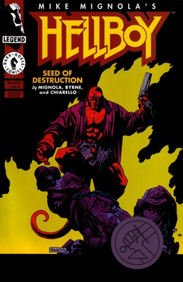
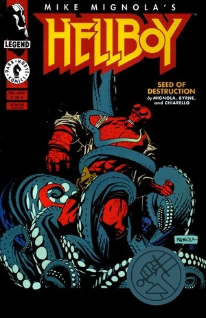
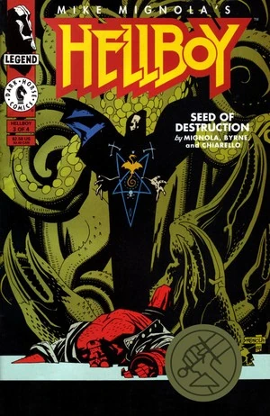
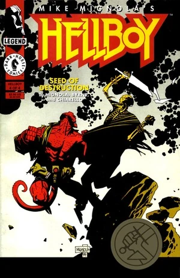
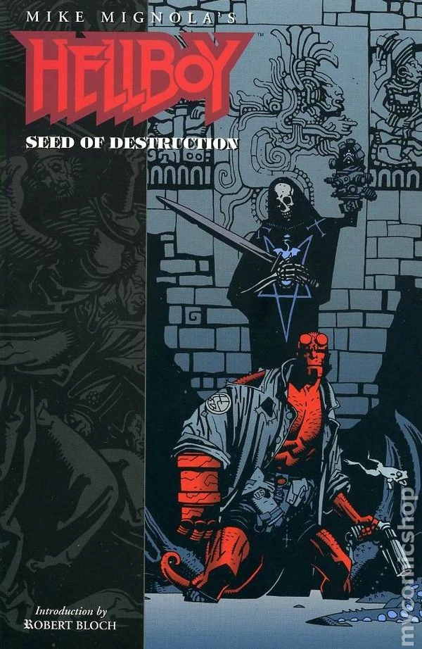
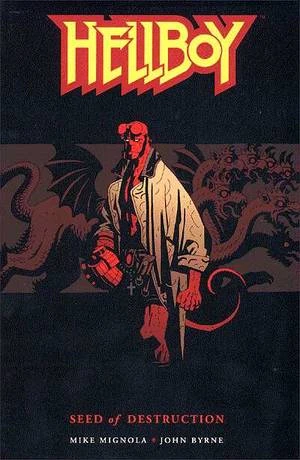
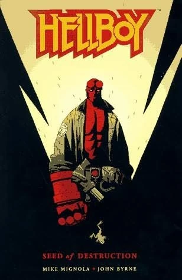
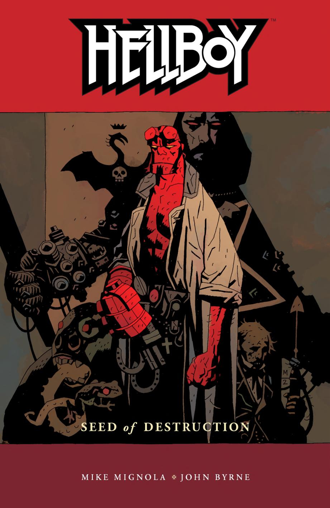
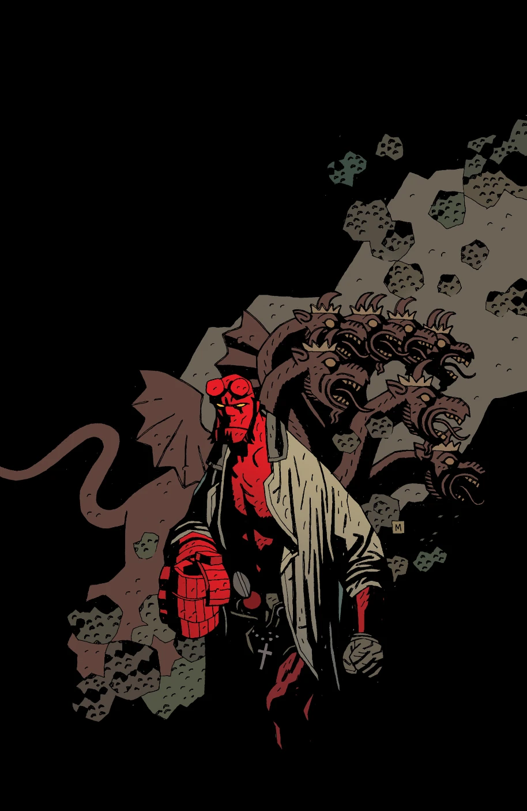
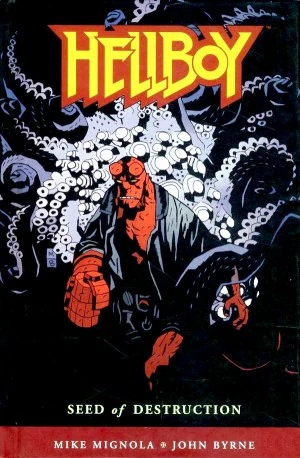

**Mike Mignola** is an American comic book writer and artist, primarily known for creating [*Hellboy*](/entry/Hellboy_%28series%29) and its related titles.

## Writer

Mike Mignola has been involved in the writing of virtually every Hellboy Universe story with only a few exceptions:

- [*Abe Sapien: Drums of the Dead*](/entry/Drums_of_the_Dead)
- [*B.P.R.D.: Dark Waters*](/entry/Dark_Waters)
- [*B.P.R.D.: Night Train*](/entry/Night_Train)
- [*B.P.R.D.: There's Something Under My Bed*](/entry/There%27s_Something_Under_My_Bed)
- [*Abe Sapien: The Calm Before the Storm*](/entry/The_Calm_Before_the_Storm)
- [*Abe Sapien: Subconscious*](/entry/Subconscious)
- [*Witchfinder: The Mysteries of Unland*](/entry/The_Mysteries_of_Unland)
- *[Mood Swings](/entry/Mood_Swings)*
- *[Crimson Lotus](/entry/Crimson_Lotus_%28story%29)*

## Interior Art

- [*Hellboy* promotional comic \#1](/entry/World%27s_Greatest_Paranormal_Investigator_%28SDCC%29)
- [*Hellboy* promotional comic \#2](/entry/World%27s_Greatest_Paranormal_Investigator_%28CBG%29)
- [*Hellboy: Seed of Destruction*](/entry/Seed_of_Destruction)
- [*Hellboy: The Wolves of Saint August*](/entry/The_Wolves_of_Saint_August)
- [*“Hi, My Name's Hellboy”* promtional comic](/entry/Hi%2C_My_Name%27s_Hellboy)
- [*Hellboy: The Corpse*](/entry/The_Corpse)
- [*Hellboy: The Iron Shoes*](/entry/The_Iron_Shoes)
- [*Hellboy: Wake the Devil*](/entry/Wake_the_Devil)
- [*Hellboy: Almost Colossus*](/entry/Almost_Colossus)
- [*Hellboy: A Christmas Underground*](/entry/A_Christmas_Underground)
- [*Hellboy: Heads*](/entry/Heads)
- [*Hellboy: The Baba Yaga*](/entry/The_Baba_Yaga)
- [*Hellboy: The Right Hand of Doom*](/entry/The_Right_Hand_of_Doom)
- [*Hellboy: The Vârcolac*](/entry/The_V%C3%A2rcolac)
- [*Hellboy: Goodbye Mister Tod*](/entry/Goodbye_Mister_Tod)
- [*Hellboy: Pancakes*](/entry/Pancakes)
- [*Hellboy: Box Full of Evil*](/entry/Box_Full_of_Evil)
- *[Abe Sapien versus Science](/entry/Abe_Sapien_versus_Science)* (Inks only)
- [*Hellboy: The Nature of the Beast*](/entry/The_Nature_of_the_Beast)
- [*Hellboy: King Vold*](/entry/King_Vold)
- [*Hellboy: Conqueror Worm*](/entry/Conqueror_Worm_%28story%29)
- [*Hellboy: The Third Wish*](/entry/The_Third_Wish)
- [*Hellboy: Dr. Carp's Experiment*](/entry/Dr._Carp%27s_Experiment)
- [*Hellboy: The Penanggalan*](/entry/The_Penanggalan)
- [*Hellboy: The Troll-witch*](/entry/The_Troll_Witch)
- [*Hellboy: The Ghoul*](/entry/The_Ghoul)
- [*Hellboy: The Island*](/entry/The_Island)
- [*Hellboy: Makoma*](/entry/Makoma_%28story%29)
- [*Hellboy: The Hydra and the Lion*](/entry/The_Hydra_and_the_Lion)
- [*Hellboy: In the Chapel of Moloch*](/entry/In_the_Chapel_of_Moloch)
- [*Hellboy: The Whittier Legacy*](/entry/The_Whittier_Legacy)
- *[Hellboy versus the Aztec Mummy](/entry/Hellboy_versus_the_Aztec_Mummy)*
- [*Hellboy in Hell*](/entry/Hellboy_in_Hell_%28series%29)
- [*Hellboy in Hell: The Exorcist of Vorsk*](/entry/The_Exorcist_of_Vorsk)
- [*Sir Edward Grey: Acheron*](/entry/Acheron_%28story%29)

### Selected Interior Art

- [*Hellboy: Makoma*](/entry/Makoma_%28story%29), ten-page framing sequence
- [*B.P.R.D.: The Universal Machine*](/entry/The_Universal_Machine), last five pages
- [*Hellboy: Darkness Calls*](/entry/Darkness_Calls), seven-page second epilogue
- [*B.P.R.D.: King of Fear*](/entry/King_of_Fear_%28story%29), two pages in Chapter 4
- [*Hellboy: The Storm and the Fury*](/entry/Trade_Paperback_Collections), three-page epilogue
- [*B.P.R.D.: The Devil You Know—Pandemonium*](/entry/Pandemonium_%28story_arc%29), first three pages
- [*B.P.R.D.: The Devil You Know—Ragna Rok*](/entry/Ragna_Rok_%28story_arc%29), last thirteen pages

## Cover Art

**NOTE:** *This section is under construction*

### *Hellboy: Seed of Destruction*

|*Hellboy: Seed of Destruction* \#1

|*Hellboy: Seed of Destruction* \#2

|*Hellboy: Seed of Destruction* \#3

|*Hellboy: Seed of Destruction* \#4

|*Hellboy – Volume 1: Seed of Destruction* (1994, first edition)

|*Hellboy – Volume 1: Seed of Destruction* (2003, third edition)

|*Hellboy – Volume 1: Seed of Destruction* (2004)

|*Hellboy – Volume 1: Seed of Destruction* (4¾"x7½" edtion, 2006)

|*Hellboy – Volume 1: Seed of Destruction* (2008 hardcover)

### *Hellboy: The Wolves of Saint August*, *The Corpse*, and *The Iron Shoes*

### *Hellboy: Wake the Devil*

### *Hellboy: Almost Colossus*, *The Chained Coffin*, *The Right Hand of Doom*, *Box Full of Evil*, and *The Nature of the Beast*

### *Hellboy and the B.P.R.D.*

### *Hellboy* Library Editions

### *Hellboy* Omnibus Editions

### [Koshchei the Deathless](/entry/Koshchei_the_Deathless_%28story%29)

## External Links

- [**Wikipedia:** Mike Mignola](https://en.wikipedia.org/wiki/Mike_Mignola)
- [**Comic Book DB:** Mike Mignola](http://comicbookdb.com/creator.php?ID=171)
- [The Art of Mike Mignola](http://artofmikemignola.com/)
- [**Twitter:** Mike Mignola](https://www.twitter.com/artofmmignola)
