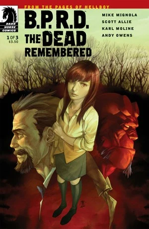
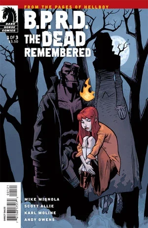
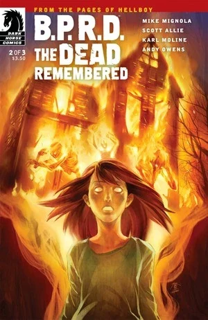
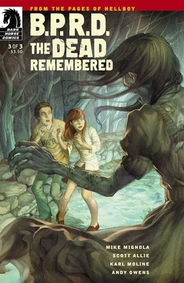

***The Dead Remembered*** is a flashback story to 1976, [Liz Sherman's](/entry/Elizabeth_Sherman) first "mission", also featuring [Trevor Bruttenholm](/entry/Trevor_Bruttenholm).

## Publication History

The three-issue miniseries was published from April to June 2011. The story was collected in the trade paperback *[B.P.R.D.: Being Human](/entry/Trade_Collections)* in November 2011. It is the first miniseries to be written by long-time *Hellboy* and *B.P.R.D.* editor, Scott Allie.

## Synopsis

### Part One

Three years after accidently burning her family alive, 14-year-old firestarter Liz Sherman travels with Professor Broom to investigate a small New England town, where a terrible witch hunt occurred and a ghost plagues a priest’s house.

### Part Two

While Broom banishes a ghost from a priest’s home, Liz explores the woods around the house, where a terrible witch hunt occurred and a woman was murdered!

The accident in which Liz killed her family is finally revealed in detail!

### Part Three

Liz Sherman relives the fate of an accused woman who was tortured three hundred years ago, but she has to rein in her own fire power, or an entire New England town will be forced to relive the day when Liz burned her own family to death.

## Connections to Other Stories

In the story we get flashbacks to Liz's first major incident, in which she accidentally killed her own family, this was first mentioned in the second issue of [Seed of Destruction](/entry/Seed_of_Destruction).

In the story [The Whittier Legacy](/entry/The_Whittier_Legacy) we learn that the Whittier family from Providence, Rhode Island (state that borders Massachusetts) were involved in occult rituals. It's possible that the ghost, Anne, was part of the same family, as her maiden name was Whittier and she also moved from England to the New England region of the United States when she was accused of witchcraft.

Father Yafides' mentions Witchfinder [Henry Hood](/entry/Henry_Hood), who first appeared in [Darkness Calls](/entry/Darkness_Calls), in one page we see is a recreation of one of [Duncan Fegredo's](/entry/Duncan_Fegredo) panels from that story, depicting Hood hanging a group of women.

## Content

### Characters

Anne Caldwell (Née. Whittier) Massachusetts residents

- [B.P.R.D.](/entry/Bureau_for_Paranormal_Research_and_Defense)
  - [Trevor Bruttenholm](/entry/Trevor_Bruttenholm)
  - [Hellboy](/entry/Hellboy_%28character%29)
  - [Elizabeth Sherman](/entry/Elizabeth_Sherman)
  - Jenny
- Father Yafides
- Sotiropoulos family
  - Ted Sotiropoulos
  - Ted Sotiropoulos Sr.
  - Michael Sotiropoulos
- [Henry Hood](/entry/Henry_Hood) (Flashback)
- Thomas Caldwell (Flashback)
- Sherman family members (Flashback)

### Locations

- U.S.A.
  - Caldwell Residence (Massachusetts Bay Colony) (Flashback)
  - [B.P.R.D.](/entry/Bureau_for_Paranormal_Research_and_Defense) Headquarters (Farfield, CT)
  - Peerlo Air Force Base (New Mexico) (Photograph)
  - Unnamed town (Massachusetts)
    - Yafides Residence
    - Hayes Hotel
    - Diner
  - Sherman Residence (Kansas City, KA) (Flashback)
- England (Flashback)

## Gallery

All covers by [Jo Chen](/entry/Jo_Chen) unless otherwise stated.

 \#1

 \#1 variant cover by Karl Moline

 \#2

 \#3

## Trivia

- The song that plays in the car while Liz and Trevor are travelling to Father Yafides' house is ["Loves Me Like A Rock" by Paul Simon](https://www.youtube.com/watch?v=CjFzw8AxSBA). The song was released in 1973, which, in-universe, is the year Liz accidentally killed her family.
