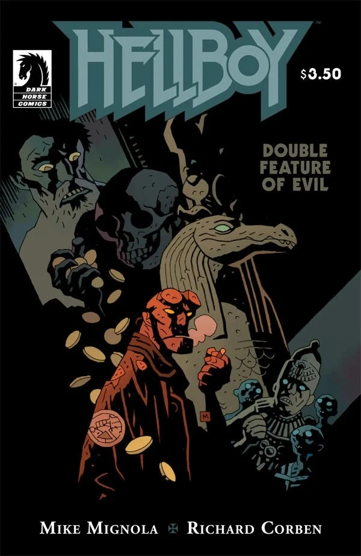

***Double Feature of Evil*** is a one-shot featuring two short stories. In the first he travels to a haunted house. In the second to a museum.

## Publication History

*Double Feature of Evil* was published as a single issue in November of 2010. It was published with two covers, one by [Richard Corben](/entry/Richard_Corben) and an alternate by [Mike Mignola](/entry/Mike_Mignola).

## Synopsis

### Framing Sequence

In an old run down movie theater a group of zombies sit watching a horror movie double feature. The movies they are watching are the two [*Hellboy*](/entry/Hellboy_%28series%29) stories.

### *Sullivan's Reward*

In 1960, Hellboy travels to Kansas to meet with Mr. Sullivan. Sullivan explains that he was a drunk until a stranger appeared and gave him the deed to a house. He moved there and learned that by putting a person in a certain room, the house would kill the person and pay him gold. The man tricks Hellboy and locks him in the room. In the room Hellboy sees the spirit of the creator of the house and it attacks. Outside, Sullivan is paid for bringing Hellboy, as a giant pile of gold crushes him to death. Hellboy escapes and destroys the remains of the builder. The house crumbles.

### *The House of Sebek*

In a university museum, a man claiming to be a pharaoh manages to bring mummies back to life. Hellboy easily stops the mummies and the man flees. He enters a temple to [Sebek](/entry/Sebek) that was reconstructed in the museum. The man prays to [Horus](/entry/Horus). This angers Sebek and the statue of the crocodile god comes to life and eats the man.

## Gallery

|by Mike Mignola
