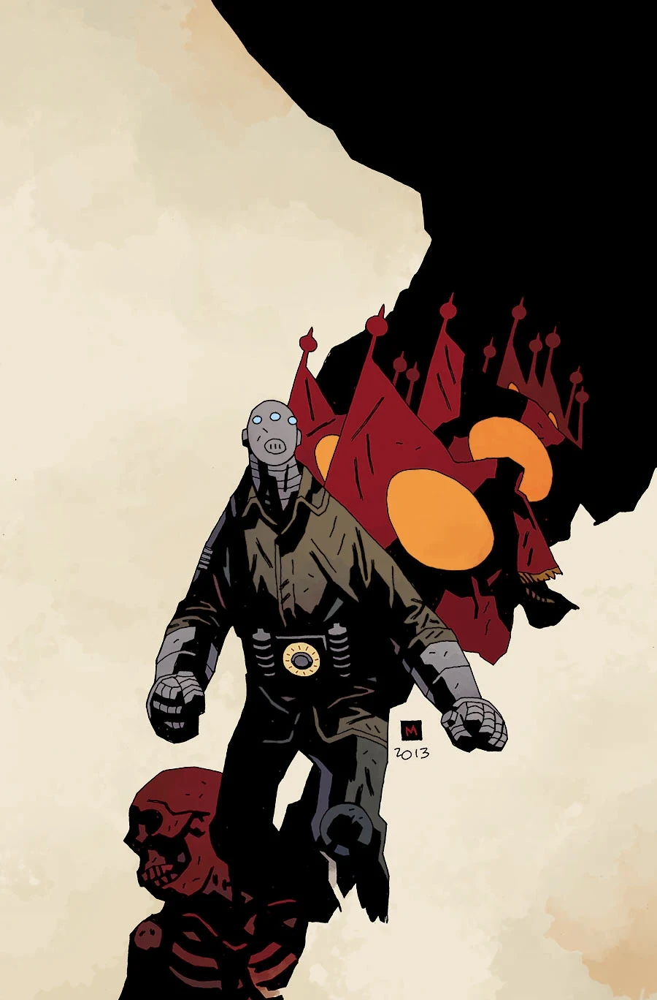

***Lightning War*** is a three-issue miniseries published in 2013 with art by Laurence Campbell. It is a continuation of *[Sledgehammer 44](/entry/Sledgehammer_44_%28story%29)*.

## Synopsis

### Part One

After the classified, advanced airplane known as the Flying Wing is hijacked by the Nazis, Sledgehammer is sent on a special recovery mission that pits him against the deadly [Black Flame](/entry/The_Black_Flame_%28character%29)!

### Part Two

The iron soldier known as Sledgehammer is the only one who can lead a rescue mission of a kidnapped American about to spill top-secret information on the Flying Wing warplane to the Nazis and their own supersoldier — the Black Flame!

### Part Three

A battle between the Black Flame and the iron soldier known as Sledgehammer heats up as the fight over a cutting-edge American warplane explodes in the sky!

## Gallery

## Notes

The synopsis for Part One mentions the experimental aircraft "Flying Wing" This aircraft is referred to in *[B.P.R.D.: The Dead](/entry/The_Dead)*. The scrapbook in the story shows a photo of the Black Flame on the wing of an aircraft. The photo is labeled "photographed during experimental flight of "Flying Wing". 9/20/44"
