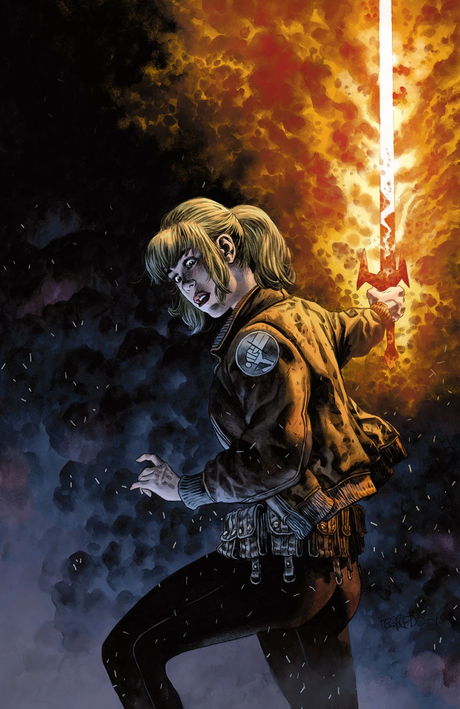
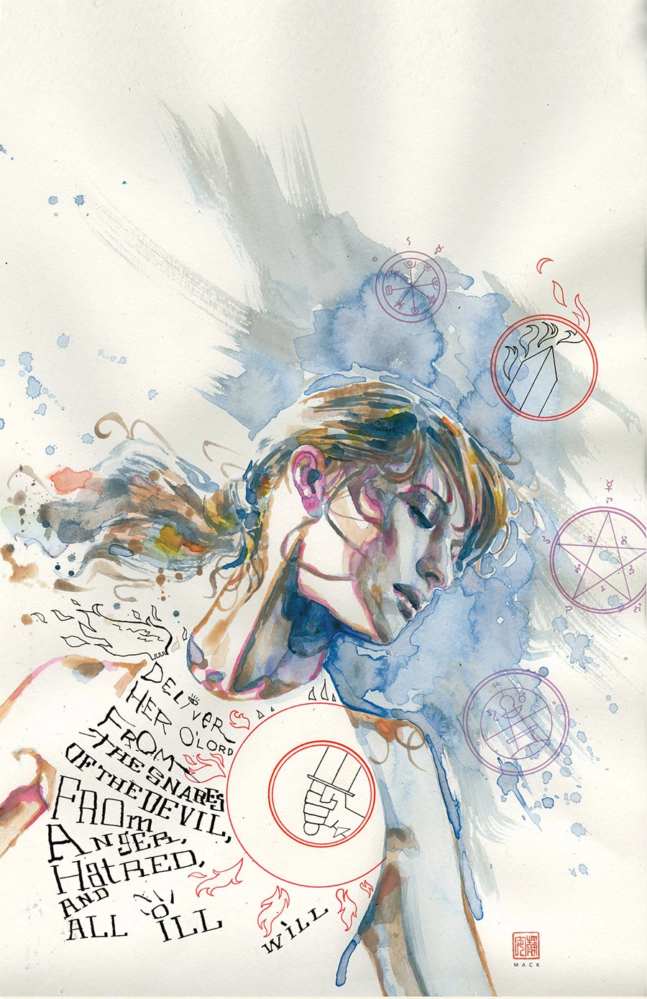
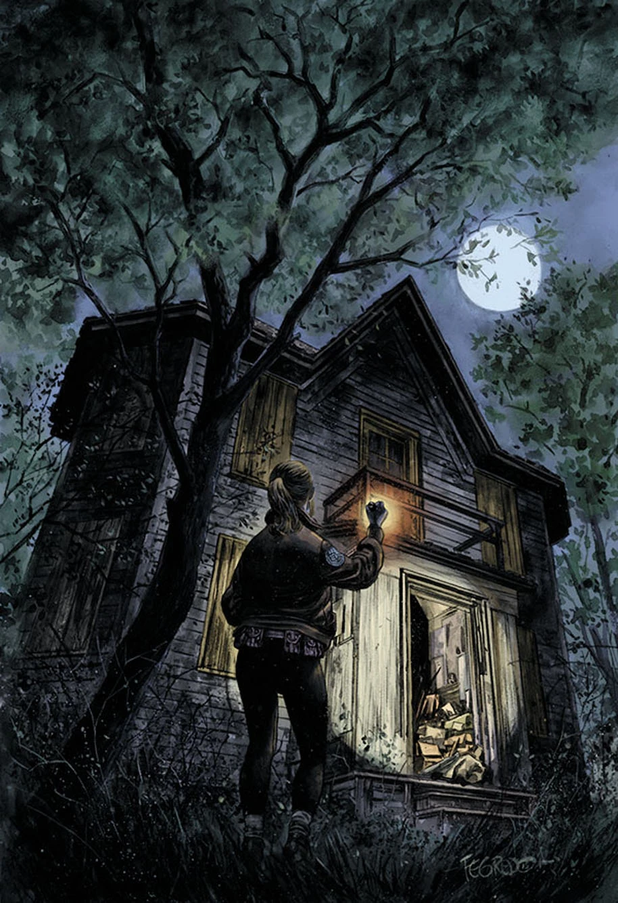
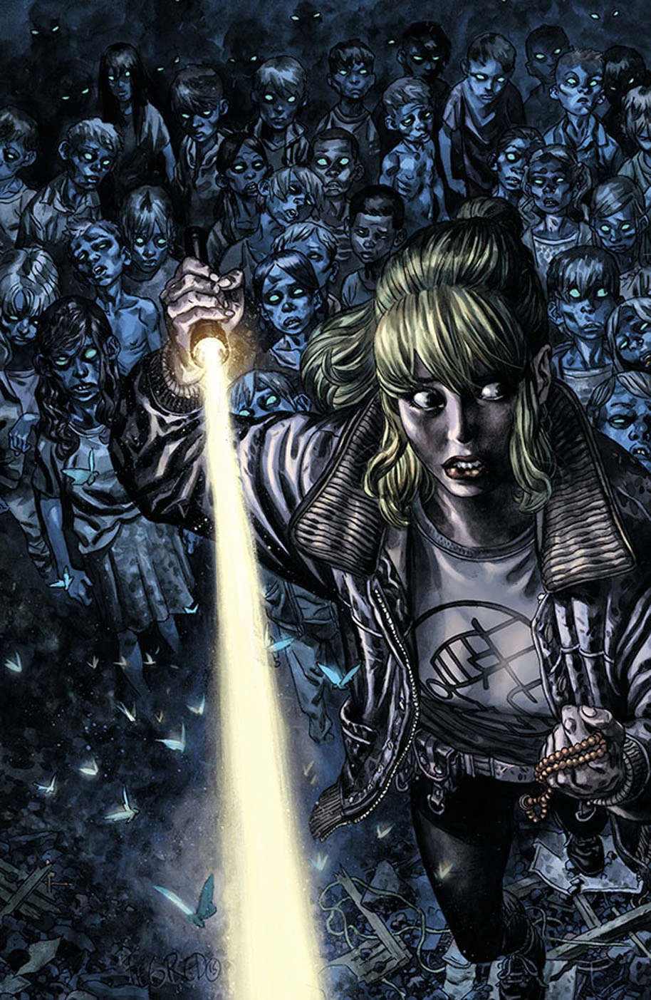

***The Exorcist*** is the second of [Cameron Stewart](/entry/Cameron_Stewart)'s pair of [Ashley Strode](/entry/Ashley_Strode) stories.

## Publishing History

This three-issue story was originally supposed to be written and drawn by Cameron Stewart and begin February 2016. However, when the story was delayed until April 2016, the creative team changed. Working from an outline by Cameron Stewart, the script for *The Exorcist* was written by [Chris Roberson](/entry/Chris_Roberson). [Mike Norton](/entry/Mike_Norton) took over art duties with some help from [Dave Stokes](/entry/Dave_Stokes) on thumbnails.

Stewart said he was unable to finish the story alone due to his commitments for *Fight Club 2* and *Batgirl*. He also said this would likely be his last Ashley Strode story, as he was going to focus on his own solo projects.[1]

## Synopsis

### Part One

Cameron Stewart (*Fight Club 2*, *Batgirl*) returns to the character he developed in *[BPRD Hell on Earth: Exorcism](/entry/Exorcism)*. Last time we saw Ashley Strode she’d learned only the most basic aspects of exorcism, as the world started to fall apart around her. Now that Hell’s closed its doors and civilization has ground to a halt in the face of the apocalypse, Ashley’s using what she knows to delay the end. A crumbling house in a small town holds bizarre secrets that make Ashley wish she’d stayed with the [Liz](/entry/Elizabeth_Sherman) and [Kate](/entry/%E5%87%AF%E7%89%B9%C2%B7%E8%80%83%E7%91%9E%E6%A0%B9))—because it might take the whole [B.P.R.D.](/entry/B.P.R.D.) to handle this.

### Part Two

Missing children and rumors of devil worship have led BPRD exorcist Ashley Strode to a rural near ghost town, where not everyone is ready to banish the town’s demons.

### Part Three

After tracing the origins of a demonic symbol to an abandoned house in a rural town, Ashley must face the town’s demons before more children disappear.

## Gallery

David Mack variant

<references />

[1] <http://www.comicbookresources.com/article/roberson-norton-team-with-stewart-for-ghostly-bprd-story>
