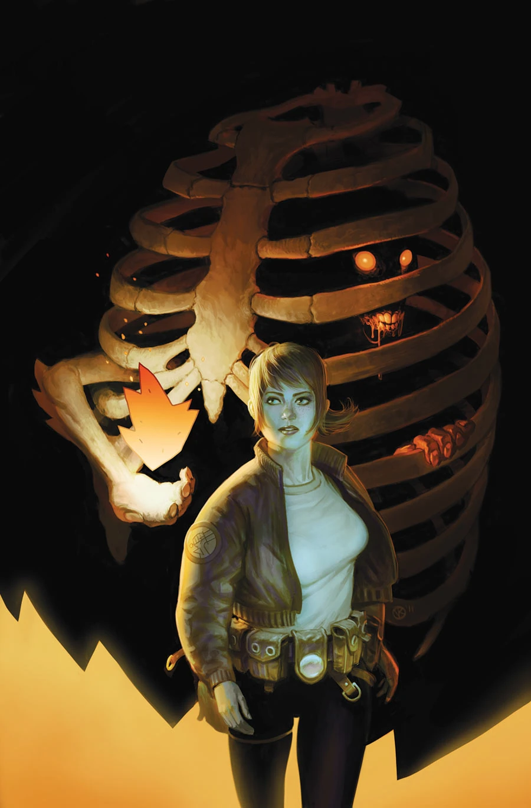
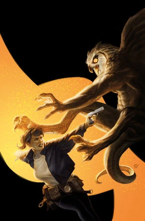

***Exorcism*** is the first of two stories from [Cameron Stewart](/entry/Cameron_Stewart) about [Agent Ashley Strode](/entry/Ashley_Strode).

## Publication History

*B.P.R.D.: Hell on Earth—Exorcism* is a two-issue miniseries published from June to July 2012. The plot focuses on [Agent Strode](/entry/Ashley_Strode) as she investigates a series of exorcisms in a rural Indiana town.

This is a part of the [*Hell on Earth* cycle](/entry/BPRD%3A%E4%BA%BA%E9%97%B4%E5%9C%B0%E7%8B%B1)), but it is a side story not following on from *[The Long Death](/entry/The_Long_Death)*. The issues feature covers by [Viktor Kalvachev](/entry/Viktor_Kalvachev).

## Synopsis

### Part One

Field agent [Ashley Strode](/entry/Ashley_Strode) is deployed to a Mexican village after a demon commands her to release one of its brethren, or lose the soul of a small child.

### Part Two

Field agent [Ashley Strode](/entry/Ashley_Strode) attempts to purge a demon from a 100-year-old exorcist, utilizing a deadly rite that sends both of them into a spiritual hell.

## Gallery

 \#1

 \#2
