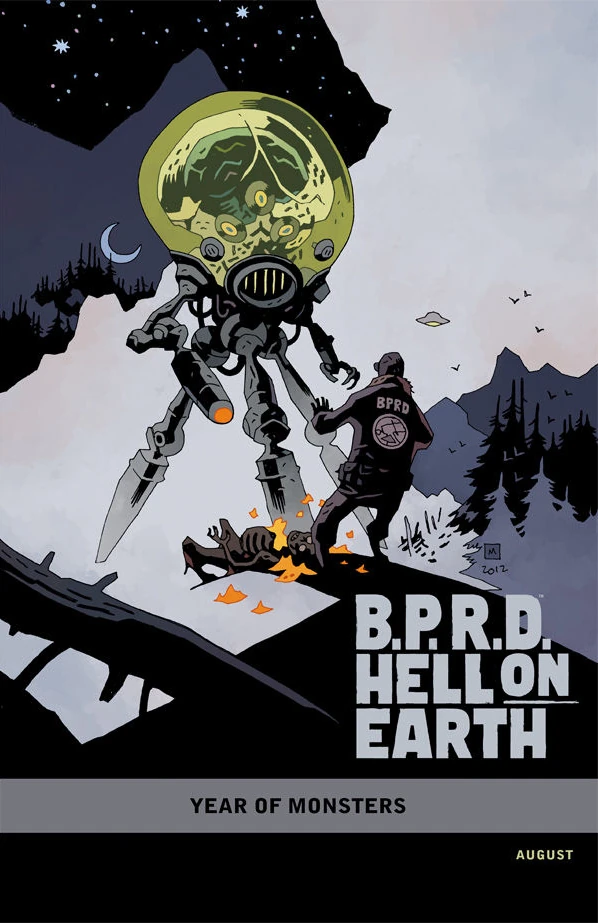
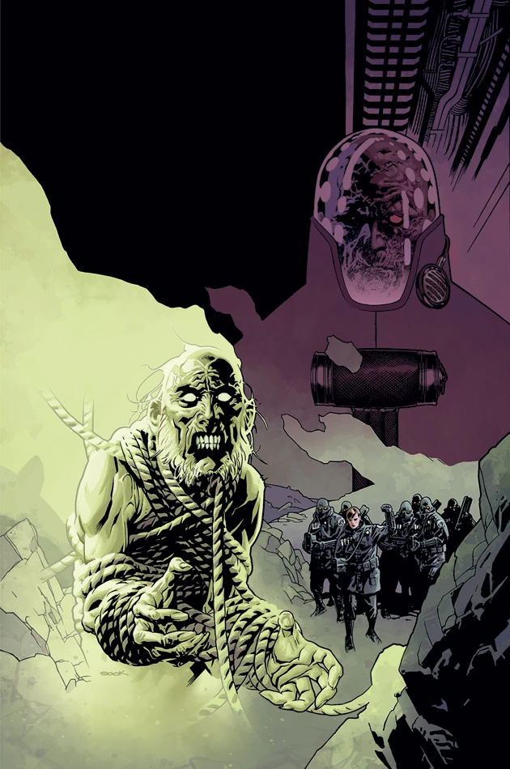
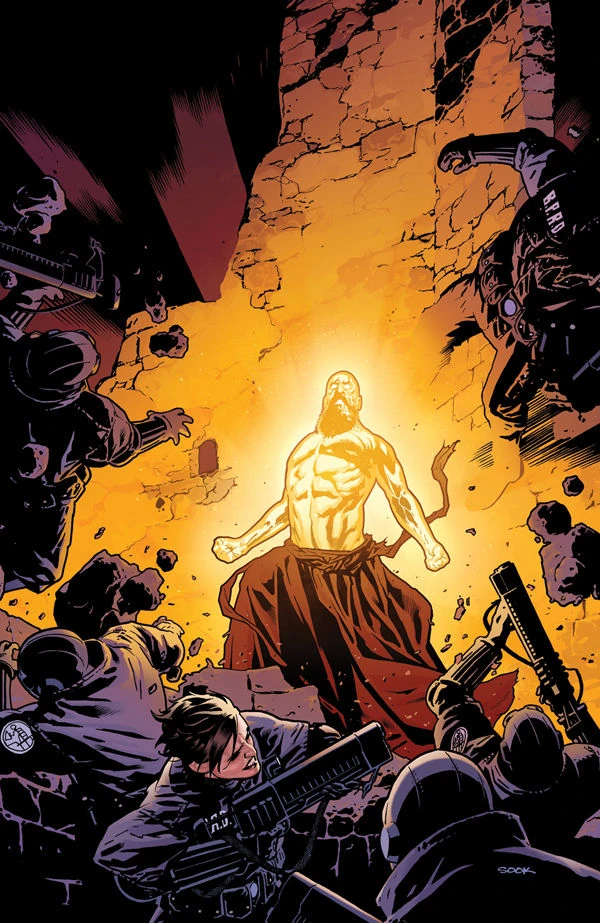
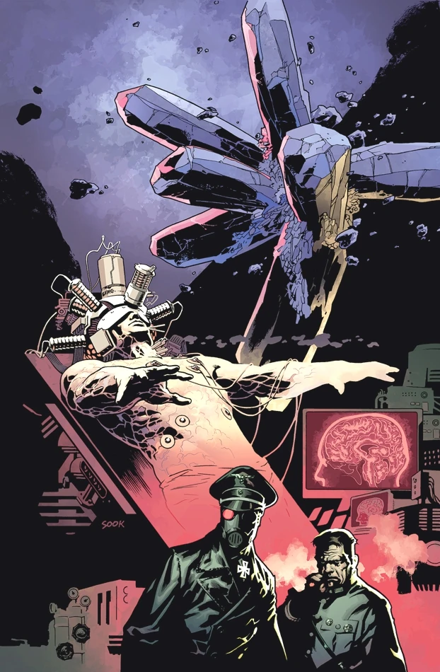
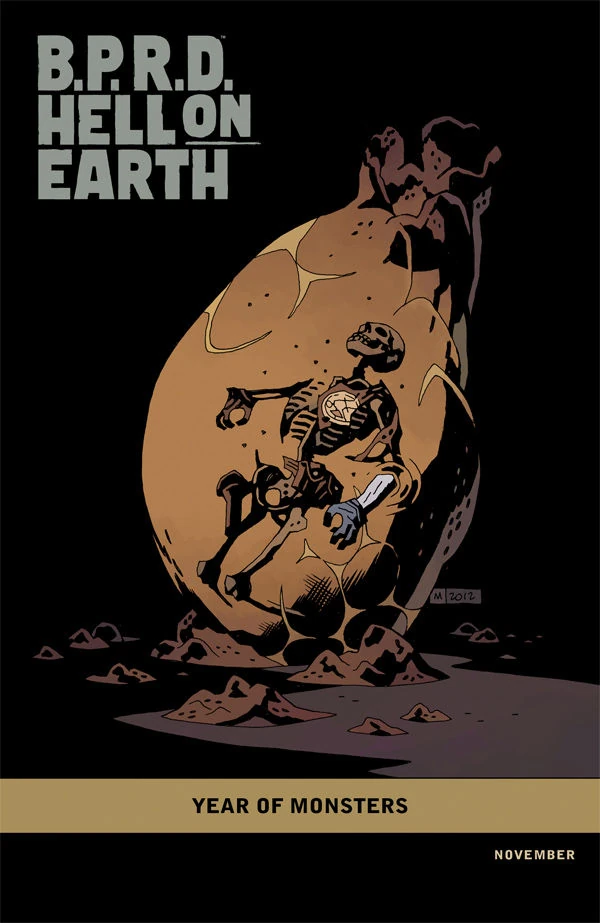
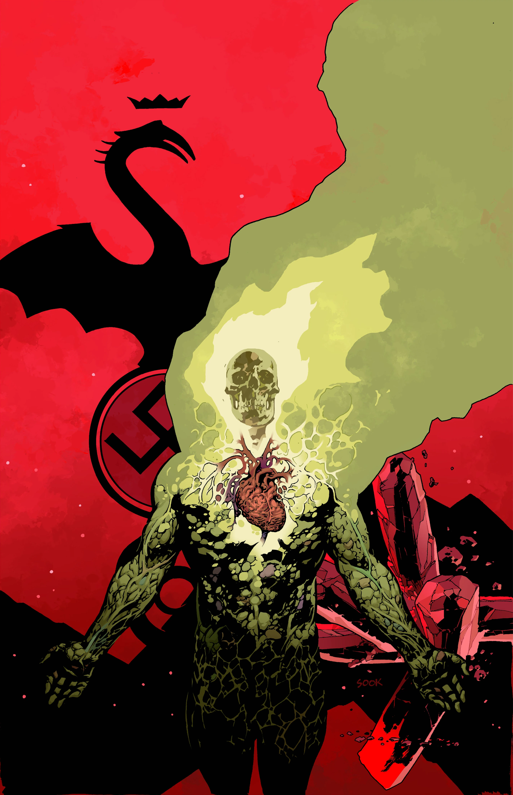
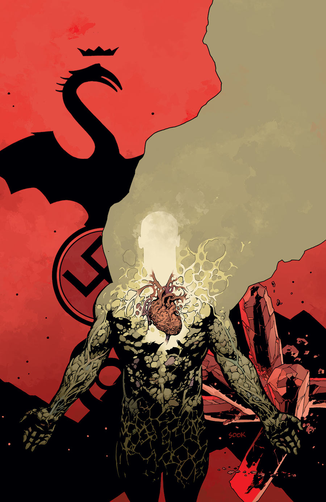

***The Return of the Master*** is a five-issue miniseries published from August to December 2012. The third issue is the 100th issue of *[B.P.R.D.](/entry/B.P.R.D._%28series%29)*

## Synopsis

### Part One

In the Scottish Highlands, a rogue scientist who escaped the bloody massacre in *[B.P.R.D.: Hell on Earth—Russia](/entry/Russia)* assembles a paranormal cult bent on world destruction. Can the B.P.R.D. hunt down this group in time, or will demons be released into a world already teetering on the edge of apocalypse?

### Part Two

An elite B.P.R.D. team hunts down a mad Russian scientist in the Scottish Highlands, only to be ambushed by a horrifyingly savage ghost. Meanwhile, Zinco and the Bureau meet to plan special experimentations on Johann.

### Part Three

A special B.P.R.D. task force reach the stronghold of a mad Russian scientist and his cult of followers only to find themselves trapped in a deadly fortress full of horrific black magic.

### Part Four

Chaos erupts as the B.P.R.D.’s forces are weakened by the crazed Russian scientist and his cult of followers. Meanwhile, the Zinco experiment at the Bureau headquarters reaches a dangerous and unexpected conclusion.

### Part Five

Hell on Earth reaches its apex as massive devastation covers the globe and horrific monsters spew forth from the ground.

## Gallery

All covers by Ryan Sook unless otherwise stated.

"[Year of Monsters](/entry/Year_of_Monsters)" variant
by [Mike Mignola](/entry/Mike_Mignola)

 \#2

 \#3

 \#4

 \#4
"[Year of Monsters](/entry/Year_of_Monsters)" variant
by [Mike Mignola](/entry/Mike_Mignola)

 \#5

### Alternate Issue \#5 Cover

 For the solicitations, the cover of issue \#5 was modified to keep the reveal of issue \#4 a secret. Shortly after the publication of issue \#4, the true cover was revealed.
