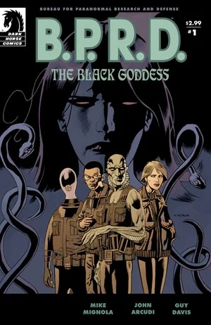
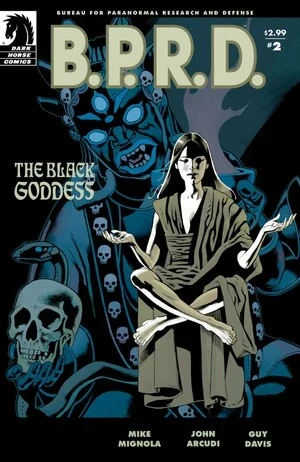
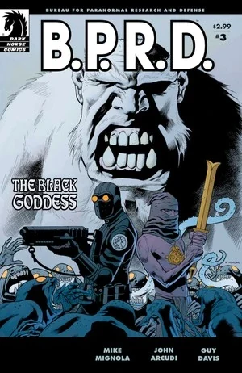
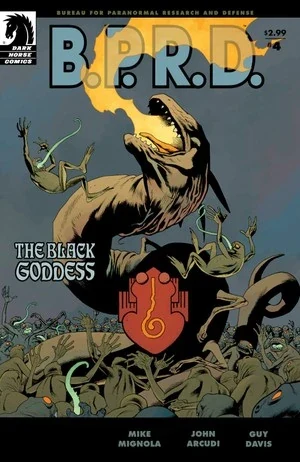
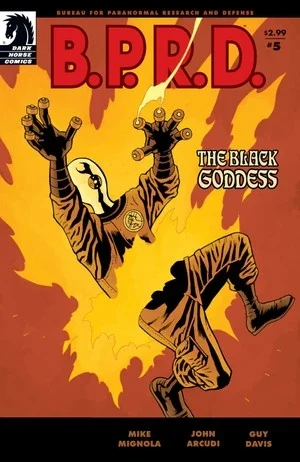

***The Black Goddess*** is a five-issue miniseries and the second part of the [*Scorched Earth* trilogy](/entry/Scorched_Earth_Trilogy).

## Publication History

The five-issue miniseries was published from January to May 2009. The story was collected in the trade paperback *[B.P.R.D.: The Black Goddess](/entry/Trade_Collections)* in October 2009.

## Synopsis

### Part One

At the turn of the twentieth century, a British museum curator with a bent for the occult traveled east in search of power and immortality. He was never heard from again.

In 1937, masked crimefighter The Lobster faced a magic-wielding madman bent on fulfilling an apocalyptic prophecy. The plans were foiled, and the world saved, but the villain himself disappeared…

Seventy years later, B.P.R.D. agent Liz Sherman began to experience visions of a mysterious gentleman who warned of coming catastrophes. When the Bureau tracked him down, he disappeared—and kidnapped Liz.

Now, Liz's friends race to find her as their old enemies band together for a final, catastrophic attack.

### Part Two

With the help of the Lobster's last surviving ally, the B.P.R.D. has tracked Memnan Saa to the mountain refuge where he is holding Liz. But even the Bureau for Paranormal Research and Defense is unprepared for the apocalyptic battle ahead.

### Part Three

As Johann faces the fight of his life, Abe and Kate learn the story of Victorian occultist Martin Gilfryd's transformation into Memnan Saa, the prophesied king of Hyporborea who would "tame fire to breed dragons."

### Part Four

Outside Memnan Saa's sanctum, two armies of monsters clash over the fate of the world; within, the B.P.R.D. can only watch as Saa's machinations continue to unfold around them, building up to an apocalyptic climax with Liz at its core.

### Part Five

Trapped between a mad prophet and an apocalyptic battle, Abe, Kate, and Johann must determine the price of their souls as they decide where their loyalties lie-and whether the life of a friend is more valuable than the fate of the world.

## Content

### Characters

#### [B.P.R.D.](/entry/Bureau_for_Paranormal_Research_and_Defense)

- [Johann Kraus](/entry/Johann_Kraus)
- [Andrew Devon](/entry/Andrew_Devon)
- [Abraham Sapien](/entry/Abraham_Sapien)
- [Katherine Corrigan](/entry/%E5%87%AF%E7%89%B9%C2%B7%E8%80%83%E7%91%9E%E6%A0%B9))
- [Panya](/entry/Panya_%28character%29)
  - Olly
  - Mutated Animals
- Doris (Panya's Caretaker)
- [Elizabeth Sherman](/entry/Elizabeth_Sherman)
- Other Agents and Personnel

#### [Harry's](/entry/Harold_McTell) Stories

- [The Lobster's Crew](/entry/%3ACategory%3ALobster%27s_crew)
  - [Harold McTell](/entry/Harold_McTell)
  - [The Lobster](/entry/The_Lobster)
  - [Robert Isherwood](/entry/Robert_Isherwood) (Flashback)
  - [Bill](/entry/Bill) (Flashback)
  - [Lester](/entry/Lester) (Flashback)
- [Rudolf Bergen (The Steel Hawk)](/entry/Rudolf_Bergen) (Flashback)
- African-Themed Lobster Villain (Flashback)
- [Helena Gallaragas](/entry/Helena_Gallaragas) (Flashback)

#### Others

- [Memnan Saa/Martin Gilfryd](/entry/Martin_Gilfryd)
- Thadrethes Monks
  - Were-Yetis
- American Soldiers
  - General
- [Nazis](/entry/%3ACategory%3ANazi)
  - [Rasputin](/entry/Rasputin) (Vision)
  - [Adolf Hitler](/entry/Adolf_Hitler) (Vision)
  - Soldiers and Scientists (Flashback)
- [Frog Monsters](/entry/Frog_monster)
- [Landis Pope](/entry/Landis_Pope) ([The Black Flame](/entry/The_Black_Flame_%28character%29)) (Vision)
- [Servants of the Left Hand](/entry/Servants_of_the_Left_Hand)
- Agartha Monks (Flashback)
- [Vril](/entry/Vril) Dragons
- [Watchers](/entry/Watchers) (Flashback)
- [Hyperboreans](/entry/Hyperboreans) (Flashback)
  - [Hecate](/entry/Hecate) (Flashback)
  - [Thoth](/entry/Thoth) (Flashback)
  - Others (Flashback)
- T'shethuan Shamans (Flashback)
  - [Shonchin](/entry/Shonchin) (Flashback)
  - Others (Flashback)
- Nimung-Gula (Flashback)
- [Ogdru Hem](/entry/Ogdru_Hem) (Vision)

### Locations

- U.S.A.
  - [The Lobster's](/entry/The_Lobster) Headquarters (New York, NY)
  - Nursing Home where [Harold McTell](/entry/Harold_McTell) Resides
  - [Memnan Saa's](/entry/Memnan_Saa) Warehouse (New Jersey) (Flashback)
  - [B.P.R.D.](/entry/Bureau_for_Paranormal_Research_and_Defense) Headquarters (Colorado)
- England (Flashback)
  - Bedlam (London) (Flashback)
  - London Streets/Dock (Flashback)
- Russia
  - Thadrethes
  - Agartha (Flashback)
- Austria (Flashback)
  - Hunte Castle (Flashback)
- China (Flashback)
  - Garden of Nurtured Harmony (Beijing) (Flashback)

### Noteworthy Artifacts

- Jade Frogs
- [Oeming](/entry/Ernst_Oeming) Capsule (Flashback)
- [Memnan Saa's](/entry/Memnan_Saa) Amulets
- [Hyperborean](/entry/Hyperboreans) War Machines
- [Spiked Cylinder](/entry/Spiked_Cylinder) ([Hyperborean](/entry/Hyperboreans) Artifact) (Flashback)
- [Vril Energy Suit](/entry/Vril_Energy_Suit) (Prometheus model) (Flashback)

## Trivia

- The look of the American general is based on actor [Ernest Borgnine](https://en.wikipedia.org/wiki/Ernest_Borgnine)

## Gallery

Covers by [Kevin Nowlan](/entry/Kevin_Nowlan).

 \#1

 \#2

 \#3

 \#4

 \#5
