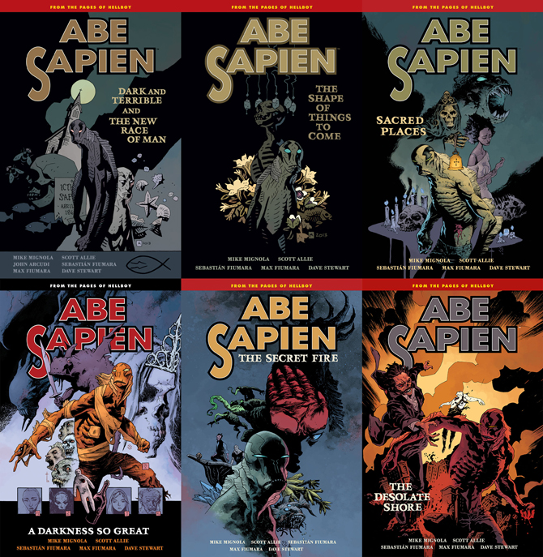
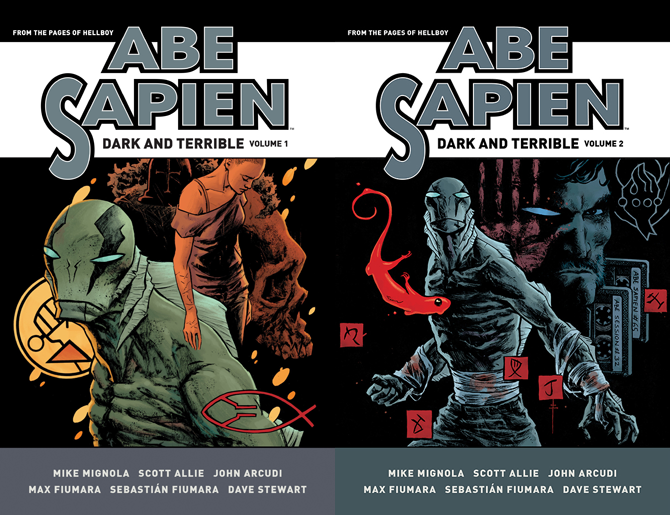

*Dark and Terrible* is an *[Abe Sapien](/entry/Abe_Sapien_%28series%29)* story cycle running parallel to the events of *[B.P.R.D. Hell on Earth](/entry/BPRD%3F%E4%BA%BA%E9%97%B4%E5%9C%B0%E7%8B%B1))*. It's an ongoing series written by [Mike Mignola](/entry/Mike_Mignola) and [Scott Allie](/entry/Scott_Allie) with [Max Fiumara](/entry/Max_Fiumara) and [Sebastián Fiumara](/entry/Sebasti%C3%A1n_Fiumara) handling art duties. Occasionally there are flashback stories in the ongoing series, but these are not a part of *Dark and Terrible*.

## Stories Published

- *[Dark and Terrible](/entry/Dark_and_Terrible_%28story%29)* \#1–3 (April – June 2013)
- *[The New Race of Man](/entry/The_New_Race_of_Man)* \#1–2 (July – August 2013)
- *[The Shape of Things to Come](/entry/The_Shape_of_Things_to_Come)* \#1–2 (October – November 2013)
- *[To the Last Man](/entry/To_the_Last_Man)* \#1–3 (January – March 2014)
- *[The Garden (I)](/entry/The_Garden_%28I%29)* (May 2014)
- *[The Healer](/entry/The_Healer)* (June 2014)
- *[Visions, Dreams, and Fishin'](/entry/Visions%2C_Dreams%2C_and_Fishin%27)* (July 2014)
- *[Sacred Places](/entry/Sacred_Places)* \#1–2 (September – October 2014)
- *[A Darkness so Great](/entry/A_Darkness_so_Great)* \#1–5 (December 2014 – April 2015)
- *[The Shadow Over Suwanee](/entry/The_Shadow_Over_Suwanee)* \#1–3 (July – September 2015)
- *[The Garden (II)](/entry/The_Garden_%28II%29)* (November – December 2015)
- *[The Black School](/entry/The_Black_School)* (February 2016)
- *[Regressions](/entry/Regressions)* (April – May 2016)
- *[Dark and Terrible Deep](/entry/Dark_and_Terrible_Deep)* (June 2016)
- *[The Garden (III)](/entry/The_Garden_%28III%29)* (July 2016)
- *[The Desolate Shore](/entry/The_Desolate_Shore)* (August 2016)

## Collections

*Dark and Terrible* is collected in the regular line of [*Abe Sapien* trade paperbacks](/entry/TPB) from Volume 3 to 8.

670 px|center|All six <em>Abe Sapien</em> trade paperbacks collecting the stories from the <em>Dark and Terrible</em> cycle.

The *Dark and Terrible* cycle will be collected in [omnibus editions](/entry/Omnibus_Editions) beginning November 2017. These feature expanded sketchbooks.

670 px|center|The two volumes of the <em>Abe Sapien: Dark and Terrible</em> omnibuses.
