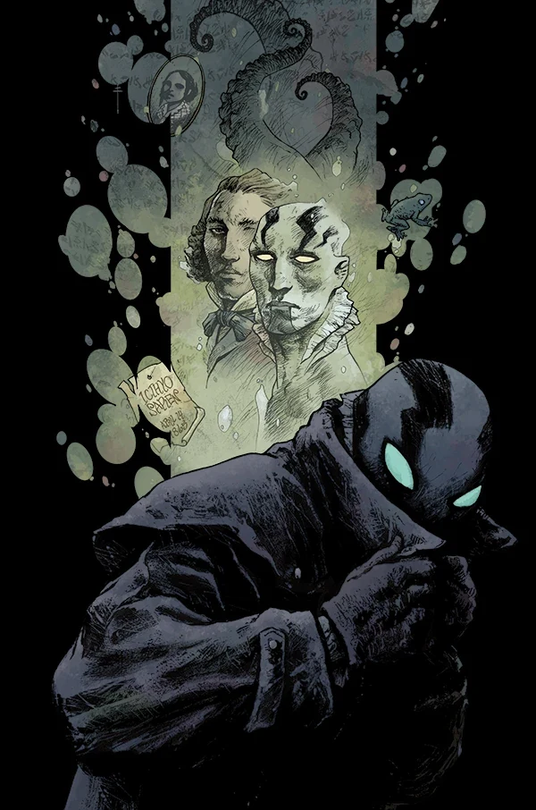
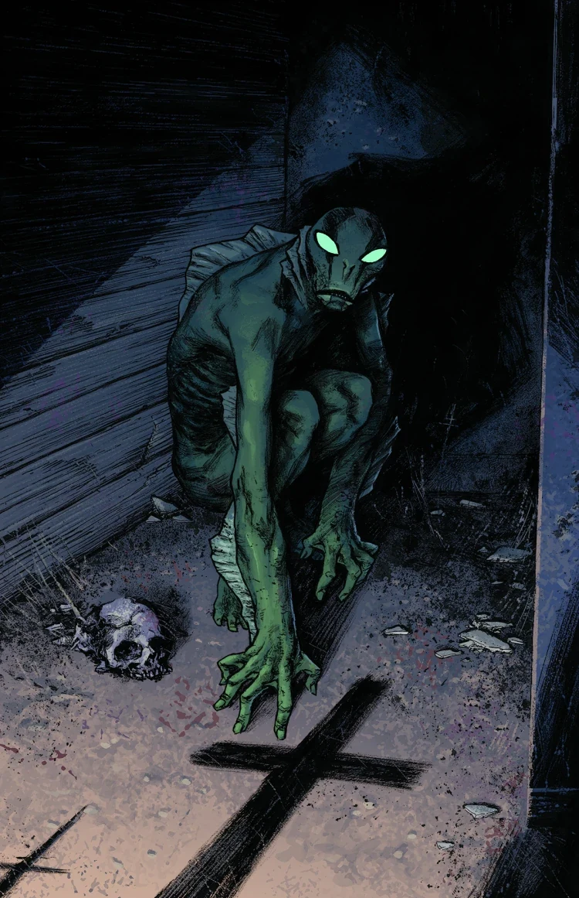
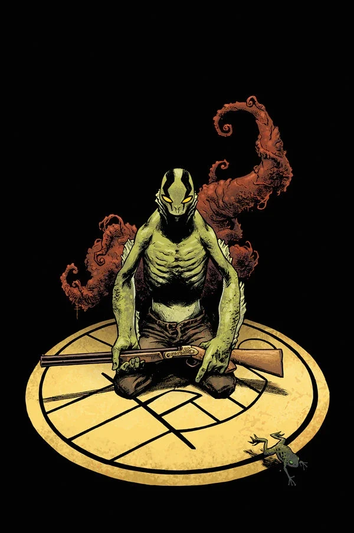

***Dark and Terrible*** is the first arc of the ongoing *Abe Sapien* series, and the beginning of the [*Dark and Terrible* story cycle](/entry/Dark_and_Terrible_%28story_cycle%29). It follows the events of *[B.P.R.D.: Hell on Earth—A Cold Day in Hell](/entry/A_Cold_Day_in_Hell)* with Abe on the run from the B.P.R.D.

## Publication History

*Dark and Terrible* is a three-issue arc published in April 2013 with art by [Sebastián Fiumara](/entry/Sebasti%C3%A1n_Fiumara).

*Dark and Terrible* was originally the name of a stalled Hellboy and Abe Sapien story [Mike Mignola](/entry/Mike_Mignola) was working on in 1996.[1] Some elements of that story ended up becoming part of *[Plague of Frogs](/entry/Plague_of_Frogs_%28story%29)*. It is unlikely this story has anything to do with this new version, as Abe Sapien's backstory has changed significantly since then.

## Synopsis

### Part One

On the run from the [B.P.R.D.](/entry/Bureau_for_Paranormal_Research_and_Defense), a mutated [Abe Sapien](/entry/Abraham_Sapien) traverses a devastated America, with monster corpses scattered around and cities in ruin.

### Part Two

Abe Sapien battles his way through terrible Ogdru Hem and human monsters as the world comes crashing down around him, on his quest to reveal his own role in the end of the world.

### Part Three

A town cut off from the world by rampaging monsters must decide if the strange fishman in their midst signals salvation, or the end of days.

## Gallery

 \#1 variant

 \#2

 and Terrible 1 for $

## Notes

<references />

[1] [The Art of Hellboy](/entry/The_Art_of_Hellboy)
