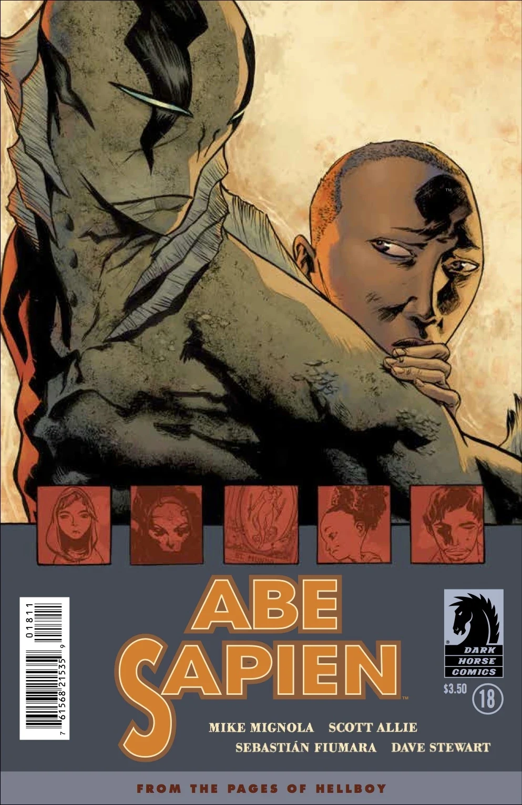
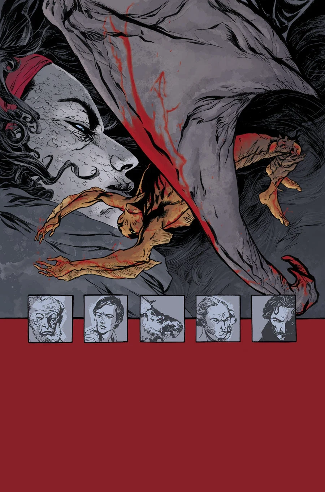
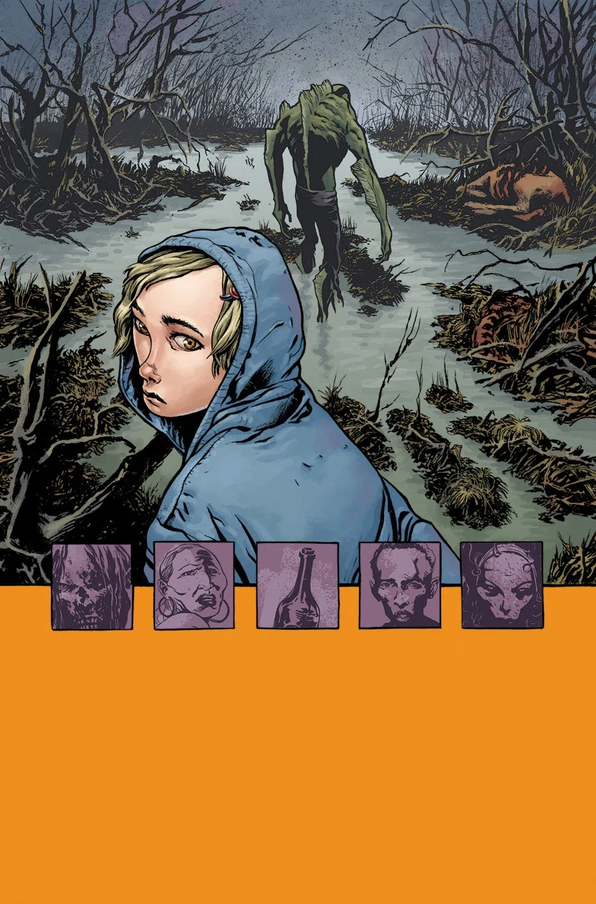
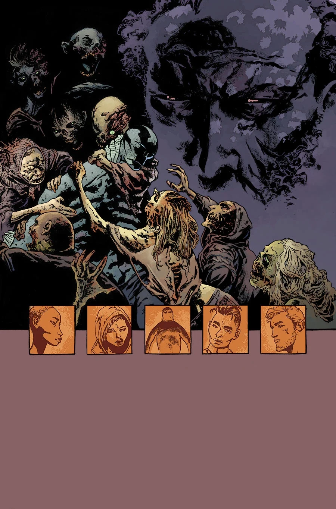
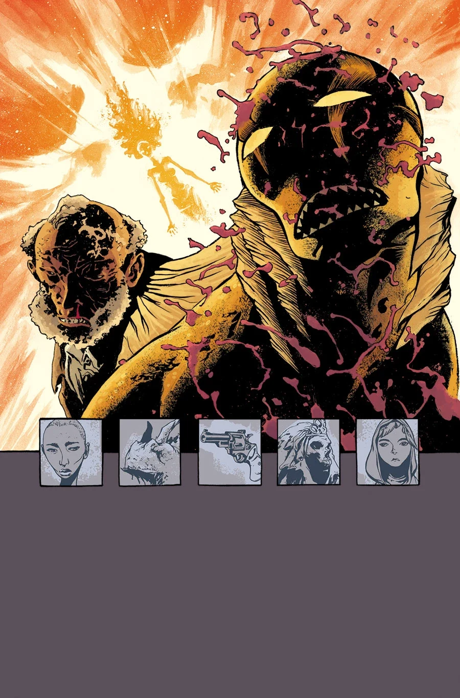

***A Darkness so Great*** is a five-issue arc kicking off in December 2014. This series will alternate art duties for each issue.

## Synopsis

### Part One: Grace

Abe Sapien travvels to Texas so he can find some peace after his mutation and hunting from the BPRD.

### Part Two: Dayana

In a strangely tranquil town on the Texas Gulf Coast, Abe has found a little peace. That peace is threatened by Abe's hunch that there's a connection between this town and a deadly threat he faced not too long ago...

### Part Three: Megan

A little girl taking shelter from the end of the world with a mysterious Mexican death cult turns to Abe for protection.

### Part Four: Arbogast

The villain takes center stage as south Texas’s necromancy problem is revealed, and Sebastián Fiumara gives Geof Darrow a run for his money.

### Part Five: Abe

A tranquil Texas town, the last safe place in America, erupts in supernatural violence as Abe Sapien gets a true taste of Hell on Earth, and the lonely road he’s walked since leaving the Bureau gets even lonelier.

## Gallery

