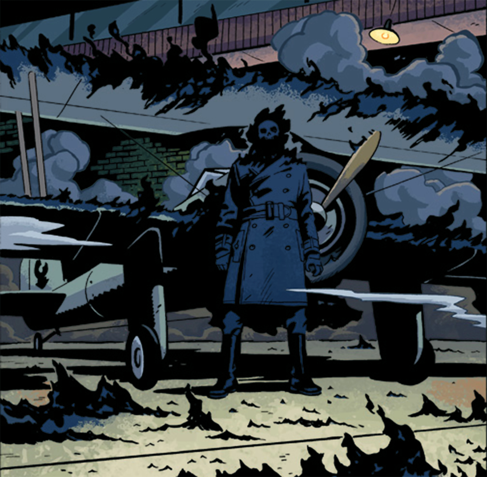
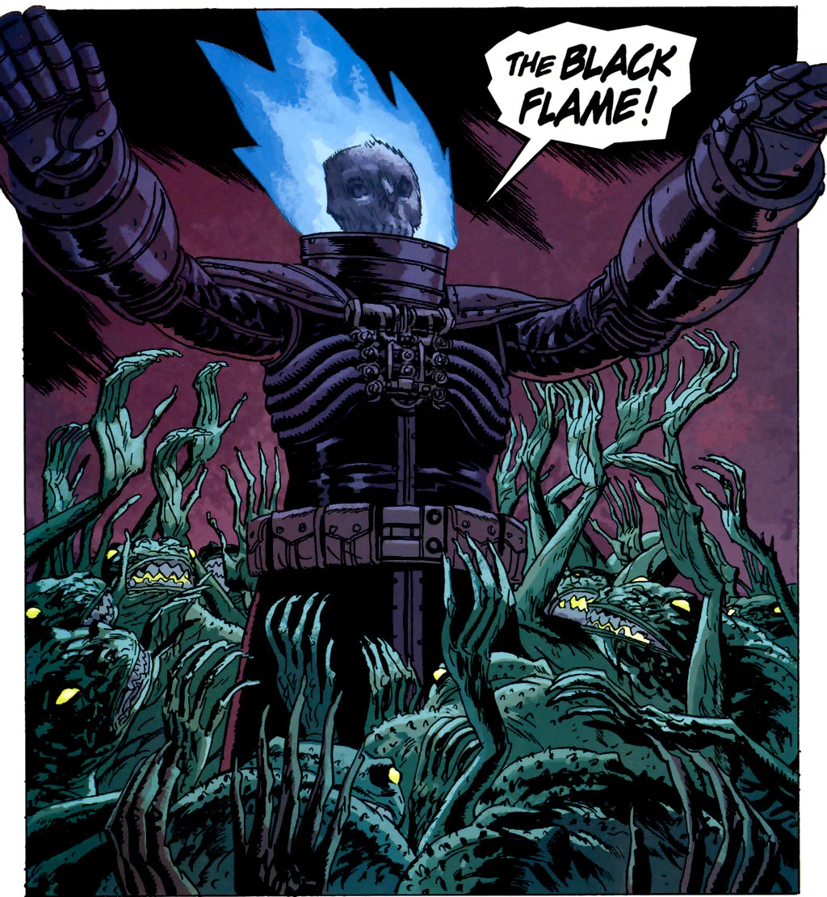
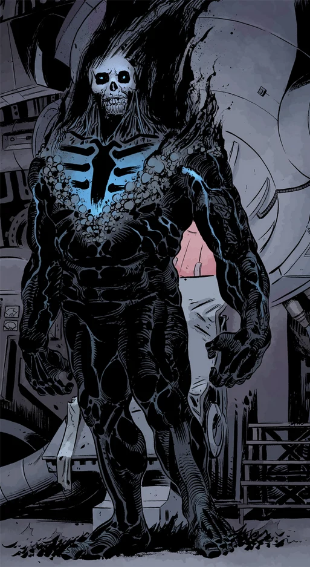

**The Black Flame** is the name of an entity seen throughout the Hellboy Universe on several host bodies. Its supernatural powers are connected in some way to the [Ogdru Hem](/entry/Ogdru_Hem) creatures.

## Raimund Diestel (1923–1944)

 The first known Black Flame was [Raimund Diestel](/entry/Raimund_Diestel).

As far back as May 1910, Diestel had intense visions of The Black Goddess and [Ereshkigal](/entry/Ereshkigal). After deserting the Imperial German Navy in November 1914, he traveled to Siam, where he spent years engaging in heavy drinking and opium use.[1]

By 1923, he was working in Bangkok as a guide to the local territory. He was hired by [Sarah Jewell](/entry/Sarah_Jewell) to lead an entourage into the jungle to find the mysterious Temple of the Black Flame. When they reach the temple, he stops what appears to be the sacrifice of a young girl by cultists, only to find that he was to be the subject of their blood ritual, and he becomes filled with the power of The Black Flame. The young girl he saved, named [Kamala](/entry/Kamala), was tasked - seemingly by The Black Goddess in a dream - to help him, as both his spouse and teacher, to fulfill his destiny. [2]

In early 1932, The Black Flame and Kamala were hired by [Mr. Isog](/entry/Isog) to sail to America to assist mob boss [Arnie Wald](/entry/Arnie_Wald) in a scheme to terrorize a neighborhood so that the land could be purchased cheaply *(see:* **[The Burning Hand](/entry/The_Burning_Hand)**). When they arrive, in February, [The Lobster](/entry/The_Lobster) first confronted him while The Black Flame was burning down some tenement buildings for Wald. In the fight that followed, the Black Flame is shown to be unaffected by bullets. One of the Lobster's crew, [Massimo](/entry/Massimo), was burnt, killed and his body abducted by The Black Flame.

With Massimo's body, Kamala conducted an occult ritual to absorb his knowledge of the Lobster. With this, Wald, his goons and The Black Flame launch a raid on the Lobster's warehouse headquarters. The Black Flame is seemingly unstoppable until the Lobster uncovers a cannon and blasts him with a high-caliber shell.

For a moment the Black Flame appears defeated, but Kamala begins to sing, and the flames reignite. The confrontation ends when a car rams into Kamala, killing her. The Black Flame immediately rushes to her side, utters, "*Kleine...?*" then falls to the ground as his flame diminishes.

He is last seen in America being taken away by the police. By June 1933 he remains a prisoner, though now is held in a cell in Haufftiz Castle in Germany, under the orders of Paul von Hindenberg. He is freed by Adolf Hitler in Sledgehammer 44: [Lightning War](/entry/Lightning_War).  

On September 20, 1944, The Black Flame captures the experimental X.F.W.-12, the *Flying Wing*, from the Americans during a trial run near the combat zone. When Sledgehammer was sent out to recover the plane and its pilot, in October 1944, The Black Flame fought with him several times, ultimately being destroyed in an explosion. His remains were soon recovered by the Nazis. Hitler, who viewed Diestel as one of the mythical Aesir, ordered to have him buried in an officer's uniform.

He was first shown in [*The Dead* \#3](/entry/The_Dead) in a photograph labelled, "*Black Flame? Photographed during experimental flight of "Flying Wing". 9/20/44*" among the many old files Johann Kraus had been studying once the B.P.R.D. moved to their new facility in Colorado. In *[The Black Flame](/entry/The_Black_Flame_%28story%29)*, Diestel's remains are shown in [Landis Pope](/entry/Landis_Pope)'s secret office in a glass case.

### Powers and Abilities

The Black Flame is an undead creature, a skeleton wrapped in black flames. These flames are controlled by him and can be summoned into quite a large area around him or onto a specific target. They cannot be extinguished by water and can turn men into burnt skeletons within seconds. The Black Flame is also shown to teleport through a burst of black flame, and is able to take others with him. He can also fly. The Black Flame speaks German, English, and fluent Thai.

## [Landis Pope](/entry/Landis_Pope) (2000s)

 During his time as CEO of the [Zinco Corporation](/entry/Zinco_Corporation), [Landis Pope](/entry/Landis_Pope) acquired the bodily remains of the previous Black Flame, Raimund Diestel, along with several other Nazi artifacts and mystic texts. Under the hidden guidance of the [frog monsters](/entry/frog_monster), he constructed an armour that allowed him to become the new Black Flame and leader of the frogs. At first he had a blue flame artificially generated by his suit and controlled by the mechanisms on it; immediately after firing Zinco's Board of Directors, Pope completed a ritual with the Frogs, whereupon he burnt with the black spectral flame of his predecessor.

Frogs began to migrate all across North America, heading to Nebraska, called by Pope and his tame frogs to form his army. As the Frog War dragged on, Pope encountered Roger in Raith, Ontario, and wiped out the homonculus and his team. It was at this point the Frogs made Pope's true position clear - his role was simply to light the way for the tired eyes of [Katha-Hem](/entry/Katha-Hem), whom the frogs were working to resurrect, and there would be no power for himself. Unable to take off his armour or stop the flame, a horrified Pope suddenly found himself a prisoner within his own army, screaming futilely to the heavens for forgiveness. By the time Katha-Hem was destroyed, he had escaped his jailers, but the respite was brief - he had just enough time to apologize to [Liz Sherman](/entry/Liz_Sherman) for Roger's death before a party of frogs dragged him wailing and despairing down into the bowels of the Earth.

Many months later he was later discovered deep underground, having allied with the [King of Fear](/entry/King_of_Fear_%28character%29). The relentless burning of the flame had reduced him to a state much closer to the original Black Flame - the skin and flesh had all been burnt from his head, and the flame now burnt not from the workings of his suit but his own body. This new semi-undead Pope seemed to have embraced his role in the apocalypse. Chatty and gregarious, he treated his surprised BPRD captives with politeness and attentiveness. He proclaimed [Abe Sapien](/entry/Abe_Sapien) to be an evolved form of the frog monsters and went quite far to convince Abe of this - even off-handedly killing the King of Fear to convince Abe that they were allies - but to no avail. He was subsequently killed and his corpse burned to ashes by Liz.

### Powers and abilities

Pope had most of the original Black Flame's powers. He apparently lacked the ability to teleport though. In addition to human languages Pope was fluent in many mystic languages, including the languages used by the frogs. Initially his flames were blue-ish black as they were artificially created by Zinco R&D department, but later as the frogs sing to him, he is engulfed in the real Black Flame.

Though initially able to remove his armor he gradually bonded with it, thus ending his life as a human. The armor provides substantial protection from harm as well as preventing accidental flame release.

## The Black Flame (2010s)

 The Black Flame's latest incarnation made his debut appearance in [*The Return of the Master* \#4](/entry/The_Return_of_the_Master). In [\#5](/entry/The_Return_of_the_Master) it is revealed that Zinco was not working to revive [Rasputin](/entry/Rasputin) as [Leopold Kurtz](/entry/Leopold_Kurtz) and [Dr. Kroenen](/entry/Karl_Ruprect_Kroenen) believed, but rather they were trying to revive Landis Pope as the Black Flame. In this they succeeded, with Pope greatly mentally changed by his death and rebirth, for in death his spirit joined with the heart of the Ogdru Jahad, far closer than any servant of the Dragon has come before. His first act upon his resurrection was to wipe out the last of the frog creatures himself. He then took control of Zinco and made himself a god over the city of New York, where he was connected to the life of the creatures that lived within it. With his return, many of the [Ogdru Hem](/entry/Ogdru_Hem) imprisoned within the Earth reawaken and begin to menace humanity.

He was now capable of fighting and defeating Liz, something not even Katha-Hem could do. In his first battle with Liz, he claimed that he was so intimately connected that the island must first be cleansed of life before he could even die.

Later on, the Black Flame expanded his power upon realizing its cosmic reach. With his power he managed to do the impossible and free [Nunn-Jahad](/entry/Nunn-Jahad), one of the seven Ogdru Jahad, from its crystal prison in deep space. The dragon fell to Earth in Kansas, its power linked to the Black Flame as it began to spawn new Ogdru Hem. The Black Flame would claim in its fight with Liz and [Johann](/entry/Johann_Kraus) (using the Sledgehammer suit) that the Ogdru Jahad are the 'seven that are mine',

Panya attempted to aid Liz and Johann through the comatose Fenix, but the Black Flame revealed to her that he was well aware of her presence in his psychic network and attempted to frighten her into submission. With Shonchin's aid and Ted Howards' ancient script, she, Shonchin, Fenix and Eris channeled a mystic cantrip to cut the Black Flame's connection to the network of life that empowered it. This enables Liz and an enraged Johann to finally finish him off. Unfortunately, his death caused Nunn-Jahad to go on a total rampage, marching and spawning more Ogdru Hem than it did before.

[pt-br:Chama Negra](/entry/pt-br%3AChama_Negra)

[1] Rise of the Black Flame

[2]
