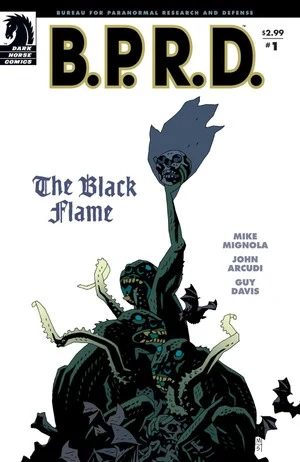
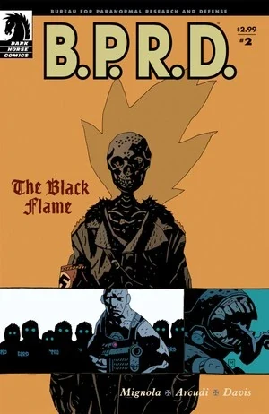
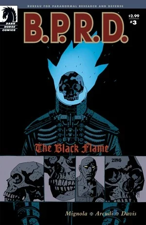
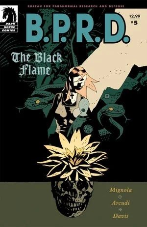

The [B.P.R.D.](/entry/Bureau_for_Paranormal_Research_and_Defense) returns its focus to the plague of frogs as it spreads across North America. The Bureau tries to make sense of the [Frog monster](/entry/Frog_monster)'s behavior, and a madman seeks to control the creatures.

## Publication History

The six-issue miniseries was published from September 2005 to January 2006. The story was collected in the trade paperback *[B.P.R.D.: The Black Flame](/entry/Trade_Collections)* in July 2006.

Later the series was collected in the omnibus format in *[B.P.R.D.: Plague of Frogs – Volume 2](/entry/Omnibus_Editions)* along with *[The Dead](/entry/The_Dead)* and *[War on Frogs](/entry/War_on_Frogs)*. As explained by [Scott Allie](/entry/Scott_Allie) in the introduction, *War on Frogs* and *The Black Flame* were put into a different reading order:

- *The Black Flame* \#1 (retitled *War on Frogs: Chapter 1*)
- *War on Frogs* \#1 (retitled *War on Frogs: Chapter 2*)
- *Revival* (retitled *War on Frogs: Chapter 3*)
- *War on Frogs* \#2 (retitled *War on Frogs: Chapter 4*)
- *War on Frogs* \#4 (retitled *War on Frogs: Chapter 5*)
- *The Black Flame* \#2-6 (retitled *The Black Flame: Chapters 1–5*)
- *War on Frogs* \#3 (retitled *The Black Flame: Epilogue*)

## Synopsis

### Part One

[Ben Daimio](/entry/Ben_Daimio), [Elizabeth Sherman](/entry/Elizabeth_Sherman), [Roger](/entry/Roger) and [Johann Kraus](/entry/Johann_Kraus) along with a team of agents infiltrate a sewer full of [frog monsters](/entry/frog_monster). After fighting their way to a lower level, they find a chamber full of large bloated frogs. Puncturing one, they learn the frogs are full of tadpoles. Liz decides to burn up the entire nest.

Some of the tadpoles slip through a grate into a lower level. A man in a Zinco containment suit picks up the tadpoles, puts them in a cooler full of water, and walks away.

### Part Two

Mr. Pope, head of Zinco, talks to his worried board about research and development spending. He tells them he has a vision and returns to his office, covered in Nazi paraphernalia including what appears to be the body of the 1940's Black Flame. He calls Marsten in R&D and asks about progress. Marsten stands in a lab room with two Frog Monsters and tells Pope that they are going to be ready earlier than expected.

Meanwhile in Colorado at the [B.P.R.D.](/entry/B.P.R.D.) headquarters, Abe has stayed at a desk position depressed over the life he never knew.

Pope and Marsten continue to train a number of Frogs, teaching them basic English, and getting them used to being around people. One Frog tells Pope "No home here," Pope replies they will go there soon.

Roger, and a squad of Agents kill a group of Frogs in British Columbia. Daimio congratulates him on a job well done.

Pope and Marsten arrive at the opening to a mine and release three 'trained' Frogs. The three talk to the other Frogs and seem to recognize Pope, dressed as [the Black Flame](/entry/The_Black_Flame_%28character%29), as their master.

In Montana, Liz and Johann talk about the Frogs and about the changes in Roger. An old lady walks up and gives Liz a flower to thank her, but Liz immediately collapses.

### Part Three

Liz sits in a strange room as a man tells her that their fight against the "frogs" is not going as well as they think. Liz begins to cough. She wakes up in a hospital bed and spits out a piece of parchment.

Mr. Pope enters the Zinco boardroom and tells the directors that they are all fired. The trained frogs enter and in a ritual put a black fire on the head of Pope's suit.

[Professor O'Donnell](/entry/Professor_James_Henry_O%27Donnell) looks at the parchment and reads the mane [Katha-Hem](/entry/Katha-Hem). He explains that this is another of the [Ogdru Hem](/entry/Ogdru_Hem) like [Sadu-Hem](/entry/Sadu-Hem). Liz runs to find Ben Daimio and tells him that something bad will happen to Roger.

A B.P.R.D. team is destroying yet another frog nest. Pope as the Black Flame appears in the factory. A massive explosion kills all the men still inside and leaves Roger blown apart.

### Part Four

The remainder of Roger's body is brought back to the B.P.R.D. HQ as Liz moves out of her room and into Roger's old room which is filled with souvenirs from past missions. Johann becomes angry when he finds that Roger's body has not been put into a body bag like the others.

The Black Flame is shown in Idaho with an enormous army of frogs monsters preparing their attack.

Ben Daimio writes his resignation letter to Kate Corrigan, blaming himself for any shortcomings in Roger's performance. During this the 'Chinaman' appears but Daimio dismisses him.

Liz is still having dreams where she interacts with Memnan Saa who tells her that she may know how to destroy the Katha-Hem and that nothing will bring Roger back. When she awakens, Kate is entering the room and the two talk about her dreams, before Liz asks 'Where's Abe?'

Abe Sapien begins to blame himself for Roger's death due to his leave from field work, so he decides to replace Roger by going back to being a field agent. His first mission is in Nebraska where they find there is a large amount of targets underground.

The Black Flame begins to summon Katha-Hem and a huge pillar emerges from the ground. Pope exults that he is about to claim the power of Katha-Hem for himself, only for one of the frogs to inform him that the Black Flame's role is simply to "light the way" for Katha-Hem to enter the world, and Pope has no control over it, or the frogs.

Kate tells Abe to abort the mission as there are thousands and thousands of frogs moving across Western North America. At this point Abe and this team are ambushed by hundreds of frogs.

### Part Five

Abe wakes up and sees The Black Flame hunching over him, admitting that he might have made a mistake in summoning Katha-Hem. Katha-Hem is an enormous monster which has the power to destroy cities effortlessly.

Professor O'Donnell confirms that the monster is Katha-Hem. Liz tells Kate and Johann that they need to find Abe as the man from her dreams, Memnan Saa, told her so. Johann puts her into a sleep like state so that she can contact Memnan Saa.

Ben Daimio attempts to leave B.P.R.D. HQ, after resigning due to Roger's death, but is stopped by [Tom Manning](/entry/Thomas_Manning). As Abe returns to the B.P.R.D., Daimio reveals to him that he wants to apologize.

The US Army begins attacking Katha-Hem by shooting missiles at it from fighter jets but this appears to have no effect. As the Katha-Hem begins transforming and growing legs, General Ramsey informs Tom Manning that they have 24 hours to stop it before the President and Joint Chiefs take nuclear action.

When Liz finds Memnan Saa she confronts him and he shows her a carved stone in which she sees an object resembling the [spiked cylinder](/entry/Spiked_Cylinder). Liz wakes up in realization and searches for the spiked cylinder in Roger's room, which he picked up in [Born Again](/entry/Born_Again).

### Part Six

Whilst travelling to the current location of Katha-Hem, Johann tells the rest of the group that it will locate a strong geomantic center which means that at least one major city will be destoyed. He then reads a text written by Professor O'Donnell which forsees of a future in which Katha-Hem's appearence will begin a million years of change where the frog monsters will inherit the Earth.

At the site Johann spots The Black Flame, which he first believes to be a 'strange creature'. Daimo tells him that this their mission is getting Liz close enough to Katha-Hem to figure out how to use the spiked cylinder. When Daimo makes a comment on Roger's death, Johann then has an angry outburst, claiming Roger is not dead.

An earthquake occurs, creating a crack in the ground which Liz Sherman falls down as frog monsters begin emerging from the hole. As the others fight off these monsters, Abe runs to the hole in attempt to get Liz out.

In total darkness Liz sees a vision of Memnan Saa who tells her that she has been shown the path before presenting her a vision of a Shaman of the Left Hand holding the spiked cylinder. She begins to repeat the chant that the shaman is using.

Meanwhile, The Black Flame has been captured by the frog creatures and calls out for forgiveness and mercy but the only reply is for him to 'Burn in silence.' Liz then appears high in the air, harnessing the power of the artifact, which she then concentrates all of her power in to it and destroys Katha-Hem.

When Liz awakes on the ground she is met by Pope, who says his Black Flame armor has fused shut, and he begs for help in getting out of it, while apologising for killing Roger. When Liz realises that Pope killed Roger, she stands back and does not interfere as the surviving frog monsters seize Pope and drag him down into a crevasse in the earth, screaming and begging for mercy.

Back at the B.P.R.D. HQ, Abe and Kate are confused at what has happened but they know that Liz caused the whole thing. Johann then asks to see Roger but finds that his remains are being cut apart for medical purposes, this infuriates Johann who kicks everyone out of the room and sits silently with Roger.

Jax and Daxter the Lost Heroes

Animation Director SADAHARU MATSUOKA

## Content

Note 1: This includes the content of Issue \#1, which is rebranded as chapter one of [War on Frogs](/entry/War_on_Frogs) on all collected editions
Note 2: This doesn't include the content of [War on Frogs](/entry/War_on_Frogs) \#3, which serves as an epilogue for this story on all collected editions

### Characters

#### [B.P.R.D.](/entry/Bureau_for_Paranormal_Research_and_Defense)

- [Johann Kraus](/entry/Johann_Kraus)
- [Elizabeth Sherman](/entry/Elizabeth_Sherman)
- [Benjamin Daimio](/entry/Benjamin_Daimio)
- [Roger](/entry/Roger)
- [Abraham Sapien](/entry/Abraham_Sapien)
- [Katherine Corrigan](/entry/%E5%87%AF%E7%89%B9%C2%B7%E8%80%83%E7%91%9E%E6%A0%B9))
- [James Henry O’Donnell](/entry/J%C2%B7H%C2%B7%E5%A5%A5%E5%94%90%E7%BA%B3%E6%95%99%E6%8E%88))
- [Thomas Manning](/entry/Thomas_Manning)
- Other Agents and Personnel

#### Others

- [Frog Monsters](/entry/Frog_monster)
- [Zinco Corporation](/entry/Zinco_Corporation)
  - Scientists
  - [Landis Pope](/entry/Landis_Pope) (Becomes [The Black Flame](/entry/The_Black_Flame_%28character%29))
  - Isiah Marsten
- [Herman von Klempt](/entry/Herman_von_Klempt) (Corpse)
- [Hellboy](/entry/Hellboy_%28character%29) (Mentioned)
- Edith Howard (Photograph)
- Old Lady
- [Memnan Saa](/entry/Memnan_Saa)
- [Ogdru Hem](/entry/Ogdru_Hem)
  - [Katha-Hem](/entry/Katha-Hem)
  - [Sadu-Hem](/entry/Sadu-Hem) (Mentioned)
- "Chinaman"
- [Black Goddess](/entry/Hecate) (Statue)
- Prehistoric People
  - [Shonchin](/entry/Shonchin)

### Locations

- U.S.A.
  - [B.P.R.D.](/entry/Bureau_for_Paranormal_Research_and_Defense) Headquarters (Colorado)
  - [Zinco Corporation](/entry/Zinco_Corporation) Headquarters (Manhattan, New York)
  - [Zinco](/entry/Zinco_Corporation) Research and Development
  - Western British Columbia
  - Handelson, Montana
  - Onurb Caverns, Idaho
  - Lincoln, Nebraska
- [Memnan Saa's](/entry/Memnan_Saa) Temple

### Noteworthy Artifacts

- [Landis Pope's](/entry/Landis_Pope) Office
  - [Project Ragna Rok](/entry/Project_Ragna_Rok) Insignia
  - [Noh Monkey's](/entry/Noh_monkey) Corpse
  - [Raimund Diestel's](/entry/Raimund_Diestel) (Previous [Black Flame](/entry/The_Black_Flame_%28character%29)) Corpse
  - [The Steel Hawk's](/entry/Rudolf_Bergen) Belongings
- [Black Flame](/entry/The_Black_Flame_%28character%29) Suit
- [Memnan Saa's](/entry/Memnan_Saa) Flower
- Note coughed by [Elizabeth Sherman](/entry/Elizabeth_Sherman)
- [Roger's](/entry/Roger) Room
  - Drawing of [Cloacina](/entry/Cloacina)
  - Air Force Wings
  - Ball of the girl from [Plague of Frogs](/entry/Plague_of_Frogs_%28story%29)
  - [Spiked Cylinder](/entry/Spiked_Cylinder) ([Hyperborean](/entry/Hyperboreans) Artifact)

## Gallery

Covers by [Mike Mignola](/entry/Mike_Mignola).

 \#1

 \#2

 \#3

 \#4

 \#5

 \#6
