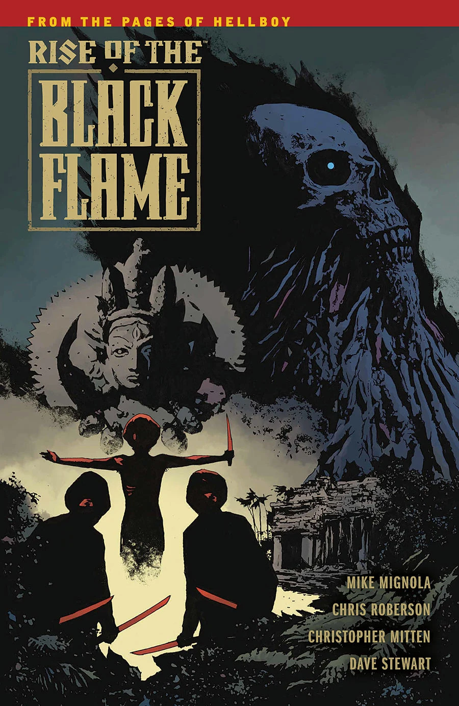
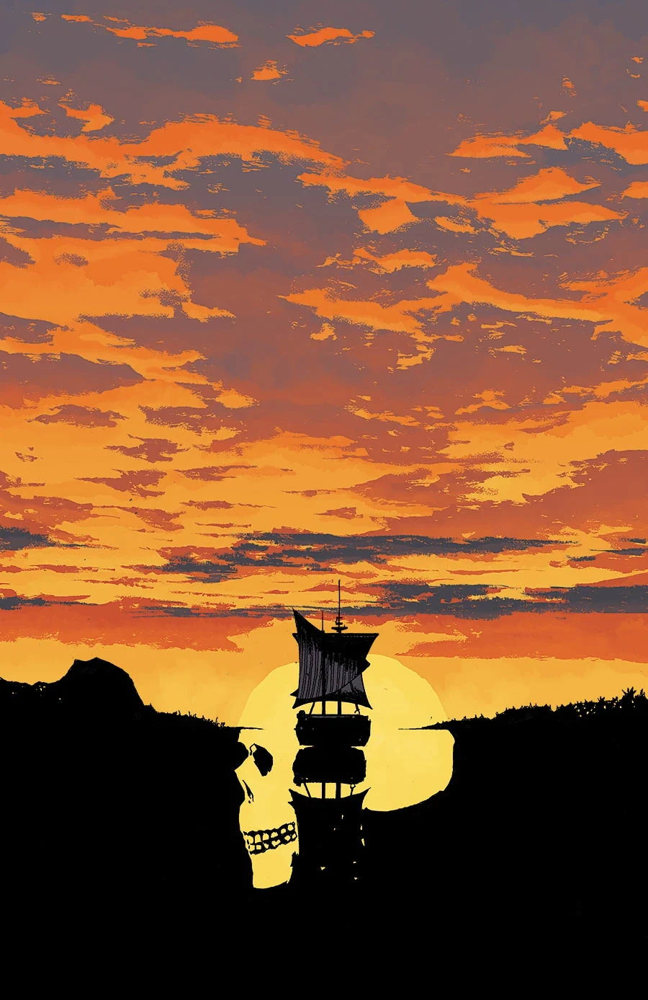
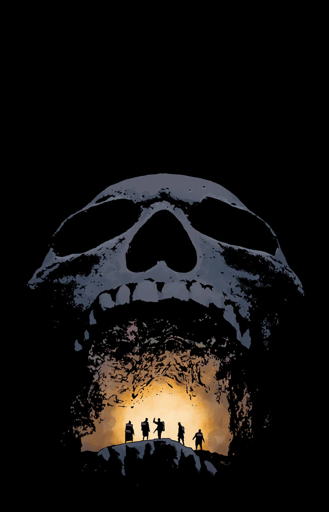
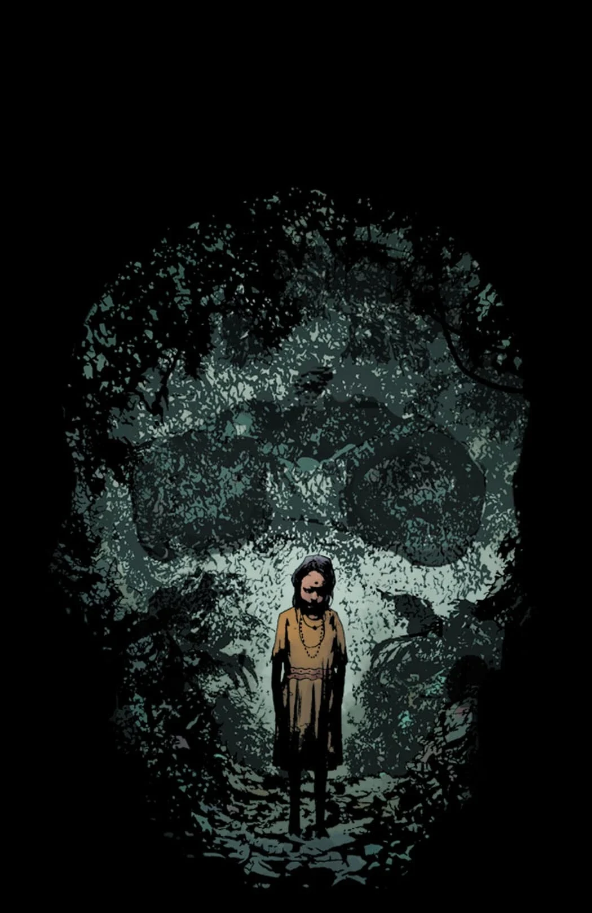
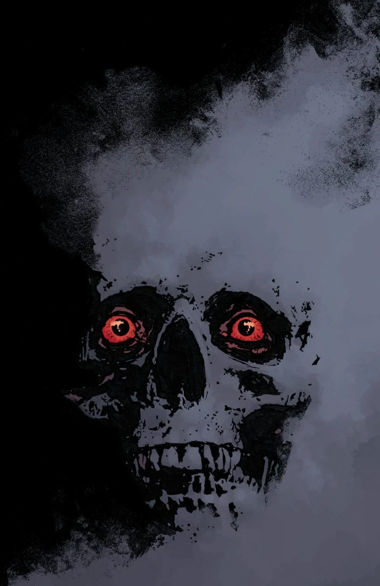

***Rise of the Black Flame*** is a five-issue miniseries announced in June 2016 for release in September 2016. It explores the origins of the Cult of the Black Flame in Siam.

## Synopsis

### Part One

In 1923, young girls are going missing from the cities of Siam, and the trail leads to the jungle hideout of a bloodthirsty cult wielding an ancient evil power—the Cult of the Black Flame.

### Part Two

Rumors of the Black Flame cult practicing human sacrifice lead downriver and deep into the jungle, while the group's guide is plagued by dreams of a dark goddess.

### Part Three

In an ancient temple lost deep in the jungle, the heroes find proof of the rumored human sacrifices and answers about the Cult of the Black Flame.

### Part Four

A narrow escape from hooded attackers slows the team on their mission to stop a cult’s human sacrifice, while their strange guide’s dark visions become more urgent but no less mysterious.

### Part Five

The heroes’ search finally ends at the temple of the Black Flame cult, but they don’t arrive in time to stop what they find there.

## Gallery

Covers by [Laurence Campbell](/entry/Laurence_Campbell)

 \#1

 \#2

 \#3

 \#4

 \#5
