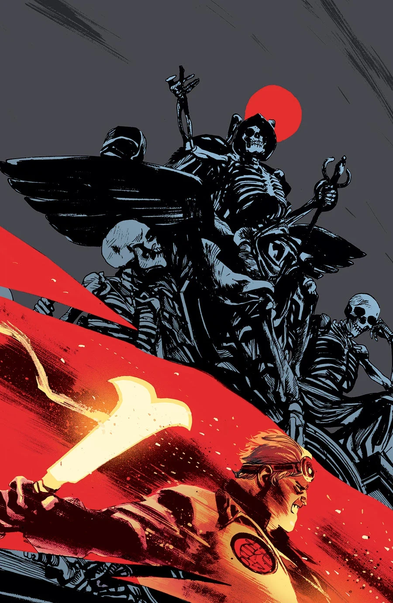
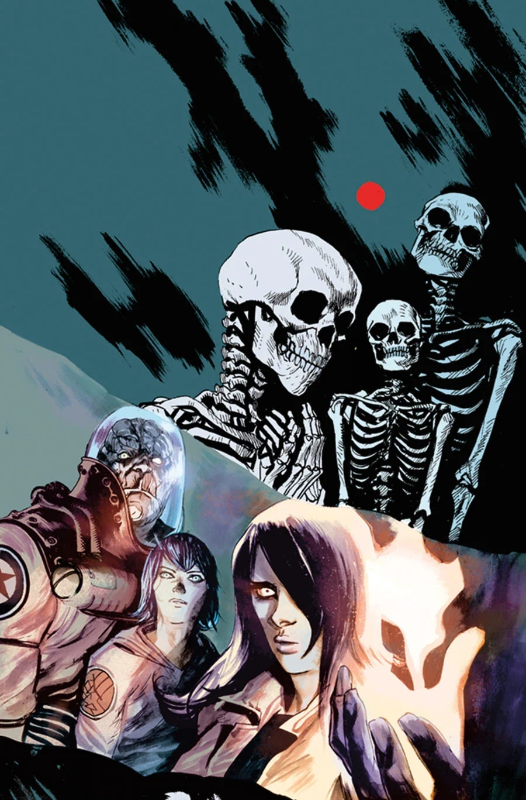
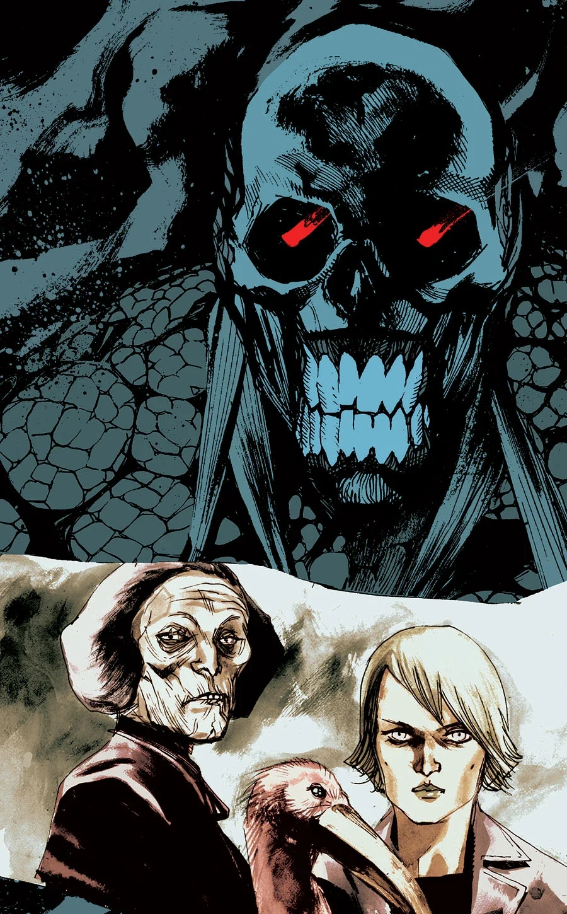
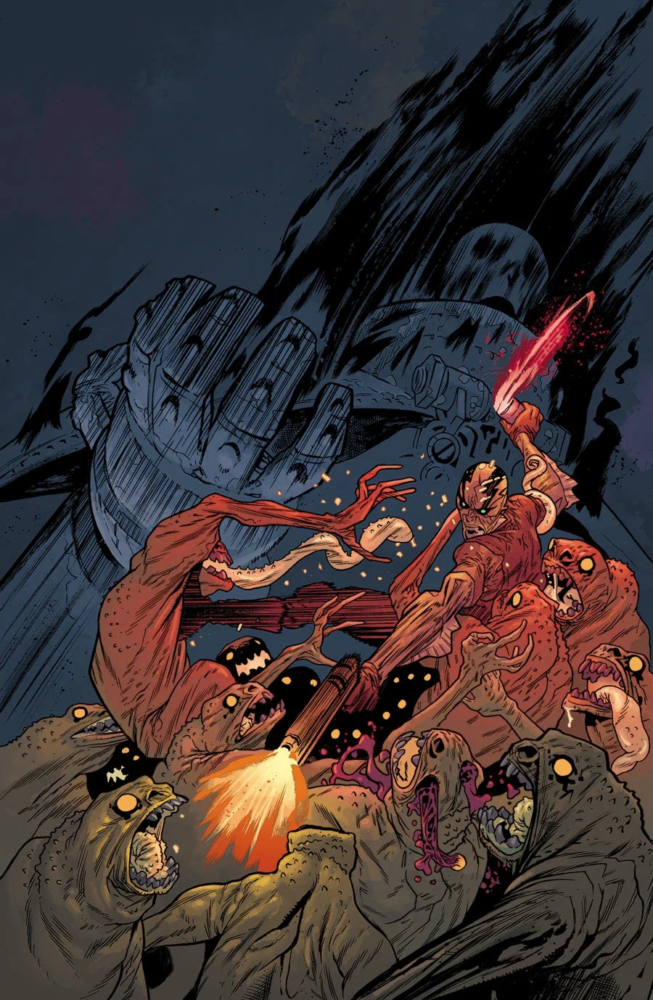
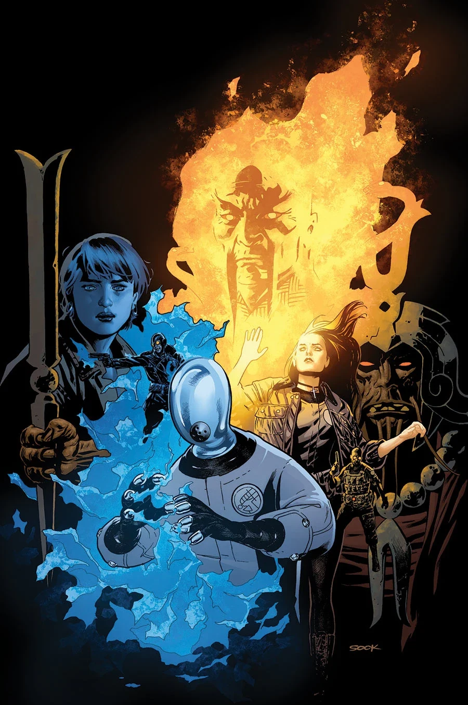

***The Reign of the Black Flame*** is a five-issue arc published from January 2014 and a direct continuation of *Lake of Fire*.

## Synopsis

### Part One

Two [B.P.R.D.](/entry/Bureau_for_Paranormal_Research_and_Defense) teams make their way through the monster-filled streets of a Manhattan wasteland in order to reach the [Black Flame’s](/entry/Black_Flame) fortress and take down his army.

### Part Two

The B.P.R.D. joins a band of resistance fighters in the ruins of Manhattan to fight the Black Flame and his evil regime of [Zinco](/entry/Zinco_Corporation) troops and monsters!

### Part Three

A defiant [Iosif](/entry/Iosif_Nichayko) launches a full-scale assault against the Zinco tower, confident that his troops can make short work of its monster security. Meanwhile, [Liz](/entry/Liz_Sherman) goes after the Black Flame. Unfortunately for her, the Flame knows it was Liz who killed him. And this time, he’s the one in control.

### Part Four

With the Russian bureau director on the brink of death, the B.P.R.D. somehow manages to stand their ground against Zinco’s forces, while Liz Sherman and the Black Flame fight fire against fire in the skies of New York, Akira style.

### Part Five

As Manhattan erupts with Lovecraftian demons, a young psychic must lead the remaining B.P.R.D. crew through the monster-packed streets of New York back to headquarters for safety, as Liz Sherman goes supernova.

## Gallery

### Regular Covers

### 20th Anniversary Variant Covers

Issue \#1 variant

Issue \#2 variant

Issue \#3 variant

Issue \#4 variant

Issue \#5 variant
