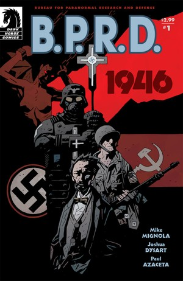
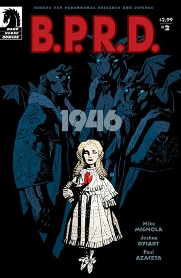
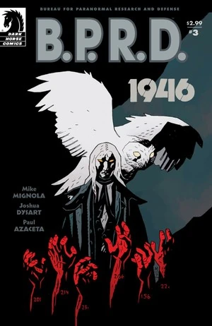
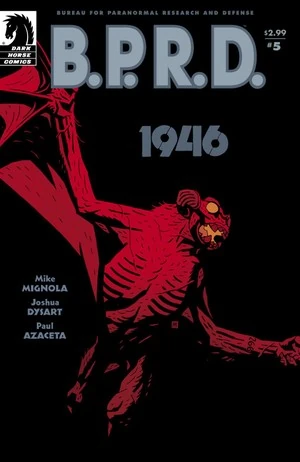

在《***1946***》中，[特雷佛·布鲁姆](/entry/Trevor_Bruttenholm)（Trevor Bruttenholm）前往战后的柏林，调查纳粹的秘术活动。他见到了俄方同行，并揭露了纳粹企图打造一支吸血鬼大军的阴谋。

## 出版历史

《1946》最初于 2008 年 1 月至 5 月作为五期限定迷你系列出版。2008 年 11 月，该故事与《[奥莱克主教的恶魔](/entry/Bishop_Olek%27s_Devil)》（Bishop Olek's Devil）一同集结收录进平装合订本《[B.P.R.D.: 1946](/entry/Trade_Collections)》。

## 剧情梗概

### 第一部分

**1944 年 12 月**：一个女人被锁链绑在一张台子上。她询问自己家人的下落。身穿白大褂的男人和纳粹士兵站在她身旁。女人露出獠牙，挣脱束缚发起攻击，但被纳粹卫兵制服。

**1946 年，柏林**：[特雷佛·布鲁姆](/entry/Trevor_Bruttenholm)和[霍华德·伊顿](/entry/Howard_Eaton)医生驾车穿过美占区。两人抵达后被引荐给当地美军指挥官。他们告诉指挥官，他们的任务是为纳粹对秘术的痴迷搜罗编目。指挥官回应说，一支苏联小队已经在审讯一名被俘的秘术师。为协助他工作，特雷佛·布鲁姆得到了一支步兵单位仅剩的人马——五个心灰意冷、一心想回家的老兵。这五人中有一人恰好在 1944 年 12 月到过东布罗姆维奇，当时[地狱男爵](/entry/Hellboy)降临人间，[1]于是他同意提供帮助。

工作了数周之后，特雷佛·布鲁姆横穿柏林去与苏联小队会面。布鲁姆被领着穿过一座堆满古董和怪异物品的大仓库。在里屋，他见到了苏联秘术小队的负责人[瓦尔瓦拉](/entry/Varvara)。瓦尔瓦拉看起来像个苍白的小女孩，言谈举止却充满威严。布鲁姆请求她共享文件。她回应说，他不过是想多了解一些「地狱男爵事件」，但还是同意与他分享关于地狱男爵的情报。

查阅档案后，特雷佛·布鲁姆发现大量液氮在 1945 年被送往一家疯人院，而官方记录显示该疯人院早在 1939 年就已关闭。布鲁姆和霍华德·伊顿前往疯人院调查。两人找到一间肮脏的手术室和一张旧蓝图。他们发现了一间地下室，便下去查看。两人走进黑暗的房间，没有注意到头顶上方正有扭曲的形体匍匐爬行。

### 第二部分

[特雷佛·布鲁姆](/entry/Trevor_Bruttenholm)和[霍华德·伊顿](/entry/Howard_Eaton)继续探索废弃的疯人院。配属给他们的步兵们找到他们，告诫他们不要单独行动。

一行人在当地的酒吧停下来喝啤酒。酒吧老板告诉他们，有一个病人逃了出去，回到了自家的家庭农场。老板同意带他们去那座农场。布鲁姆最终被放进一间谷仓，在那里见到了那个不死的孩子。那孩子一看到士兵便发起攻击，杀死了其中一人。他们刚设法把男孩重新关回谷仓，俄国人便和瓦尔瓦拉一同出现了。瓦尔瓦拉进去见那男孩，从他口中得知疯人院里有一间秘密地下室，并在此过程中杀死了那个孩子。与她谈过之后，布鲁姆意识到那些液氮一定是用来冷冻这些生物的，而它们此刻想必正在解冻。

美方与俄方小队一同返回疯人院。行车途中，瓦尔瓦拉向特雷佛·布鲁姆讲述了纳粹的[吸血鬼风暴](/entry/Vampir_Sturm)（Vampir Sturm）计划。希特勒在会见[弗拉基米尔·朱雷斯库](/entry/Vladimir_Giurescu)之后，下令杀死了这名吸血鬼和他的新娘们，但他让人先把其中一位新娘[安娜·朱雷斯库](/entry/Anna_Giurescu)的血抽干，再行处决。

布鲁姆问瓦尔瓦拉究竟是什么人。她以沙皇彼得一世「大帝」的故事作答：彼得在俄国对瑞典的大战中召唤了三个恶魔求援。三个恶魔中有两个向彼得索取了代价（他未来所有儿子的性命，以及他的心脏），但第三个恶魔决定留下，戴着人类的面孔在世间游荡。

一行人在满月之下抵达疯人院。

### 第三部分

**1945 年**：一名纳粹军官杀死了疯人院里最后一个没被送进「大缸」的人。那人跌进一个堆满尸体的敞开大坑。

**1946 年**：[特雷佛·布鲁姆](/entry/Trevor_Bruttenholm)、[瓦尔瓦拉](/entry/Varvara)以及美俄两队人马回到疯人院。根据一张蓝图，众人前去调查一处他们先前漏掉的地下室。吸血鬼们悄悄抓走队里的人。怪物发起攻击，混乱之中，特雷佛·布鲁姆和瓦尔瓦拉溜进了隐蔽的地下室，士兵们则惊慌失措地拼命逃出疯人院。

特雷佛·布鲁姆和瓦尔瓦拉走进一个排满巨大玻璃容器的房间。每个容器里都封存着一个处于休眠状态的吸血鬼。瓦尔瓦拉找到隐藏的记录，得知最终有 120 名受试者被选中并注射了吸血鬼的血液，其余的人则全部被杀。房间里只剩下 20 个容器，这意味着有 100 个已被运走。

一个自称[柯尼希男爵](/entry/Baron_Konig)的吸血鬼现身，告诉他们容器里的吸血鬼都是[朱雷斯库](/entry/Vladimir_Giurescu)的孩子。一旦获释，它们将给人类一个惨痛的教训。他说朱雷斯库是个蠢货，落得那样的下场是罪有应得，但他的妻子们——尤其是[安娜](/entry/Anna_Giurescu)——本不该遭此劫难。柯尼希男爵继续威胁特雷佛·布鲁姆，但瓦尔瓦拉喝令他住口。她显露恶魔真身，强迫那吸血鬼屈服。他说那 100 个吸血鬼在他来到疯人院之前就已被运走，他不知道它们被带去了哪里。随后，他化作一只白色猫头鹰飞走了。

两人离开疯人院，与幸存的士兵会合，许多人已经丧命，其中包括[霍华德·伊顿](/entry/Howard_Eaton)。

### 第四部分

回到苏联总部，[特雷佛·布鲁姆](/entry/Trevor_Bruttenholm)和[瓦尔瓦拉](/entry/Varvara)审讯一名被苏方关押、与疯人院有关联的男子。特雷佛说服瓦尔瓦拉让他单独和那人谈谈。此人是步兵上将[弗雷德里希·曼施泰因](/entry/Friedrich_Manstein)（Friedrich Manstein），他向布鲁姆讲述了自己的经历。

120 名病人被注射吸血鬼血液并冷冻时，他就在现场。与布鲁姆担心的相反，[吸血鬼风暴](/entry/Vampir_Sturm)并非一支新军队的核心——就连[希特勒](/entry/Adolf_Hitler)也没有疯狂到相信自己能控制一支吸血鬼大军——它实际上是一种万不得已时使用的武器。如果德国战败，他就要把这些吸血鬼放到世间。1945 年 4 月 30 日（他自杀的当天），希特勒向曼施泰因下达了释放吸血鬼的命令。但曼施泰因没有服从，而是返回疯人院，杀死了自己的同僚军官，并把那间房间砌墙封死。

布鲁姆向曼施泰因询问那 100 个失踪容器的下落。曼施泰因回答说，只有柏林地下的一座隐蔽掩体才有足够的空间和持续供电，来维持吸血鬼的冷冻状态。美俄两队人马火速赶往那座隐蔽掩体。他们在里面发现了形形色色的怪异机器。

在俄国总部，一只巨大的白色猫头鹰——吸血鬼[柯尼希男爵](/entry/Baron_Konig)——飞了进来，杀死了曼施泰因。

正当两队人马在掩体中探查时，[赫尔曼·冯·卡朗普特](/entry/Herman_von_Klempt)发现了他们，并派出他的[战猿](/entry/Kriegaffe)（Kreigaffen）要将他们斩尽杀绝。

### 第五部分

美俄两队人马朝着两头[战猿](/entry/Kriegaffe)疯狂射击，[赫尔曼·冯·卡朗普特](/entry/Herman_von_Klempt)则仓皇逃走。[特雷佛·布鲁姆](/entry/Trevor_Bruttenholm)追了上去，找到了那些失踪的吸血鬼，它们被安置在一个圆形房间的内壁上。布鲁姆被发现了，一头战猿将他制住。

冯·卡朗普特告诉布鲁姆，他带走这些吸血鬼，是为了把它们释放到世间。与此同时，另一头战猿中计撞毁了一台发电机，整个基地断电。卡朗普特透露他们其实身处一枚火箭内部，随后启动发射，把自己、布鲁姆、美军中士和那些吸血鬼一起送上了飞往美国的航程。引擎轰鸣，布鲁姆和中士谁也听不见对方的声音，但他们仍竭力交流。中士把唯一的降落伞交给布鲁姆，叫他跳下去，自己则留下来确保火箭坠毁。布鲁姆恳求说一定还有别的办法，但中士把他推出敞开的舱门，说已经没有时间争执了；如果说吸血鬼风暴预示了未来的战斗，那么美国更需要布鲁姆活着，而不是他这个中士。

布鲁姆打开降落伞，安全滑降回地面，火箭在他头顶爆炸，所有吸血鬼都被炸死。

布鲁姆降落在法国南部，在一家医院里养伤。瓦尔瓦拉前来探望。她问起冯·卡朗普特，布鲁姆说他想必已经死于爆炸。他问她对[拉格纳洛克计划](/entry/Project_Ragna_Rok)了解多少，她告诉他是[格里高利·拉斯普廷](/entry/Grigori_Rasputin)主导了这一切。她警告说[地狱男爵](/entry/Hellboy)很危险，但特雷佛说他在那孩子身上看到了善。

瓦尔瓦拉临走时告诉布鲁姆，他是她最喜欢的人类。布鲁姆压低声音咕哝了一句：*「我可真走运。」*

## 画廊

封面作者 [Mike Mignola](/entry/Mike_Mignola)。

 \#1

 \#2

 \#3

 \#4

 \#5

## 注释

<references />

[1] 见《[毁灭之芽](/entry/Seed_of_Destruction)》（Seed of Destruction）\#1
