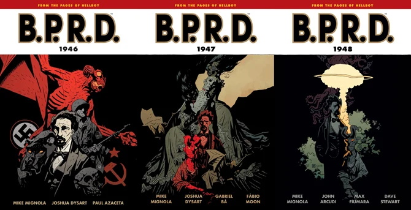
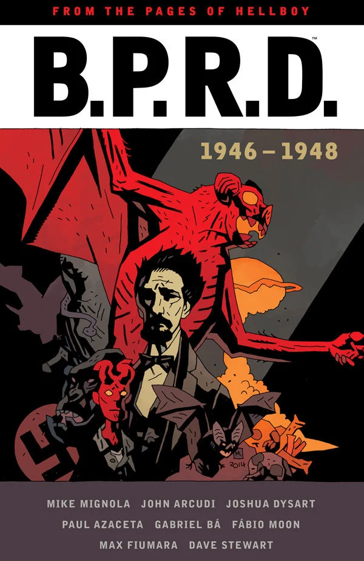

***《1946–1948》***是一个回忆故事循环，讲述 [B.P.R.D.](/entry/Bureau_for_Paranormal_Research_and_Defense) 在 20 世纪 40 年代末的起源。（英文原标题 *1946–1948*，本条目为故事循环（story cycle），与单部作品相区别。）

*[1946](/entry/1946)* 和 *[1947](/entry/1947)* 由 [迈克·米格诺拉](/entry/Mike_Mignola) 和 [约书亚·戴萨特](/entry/Joshua_Dysart) 联合编剧，戴萨特原本将成为 [*B.P.R.D.*](/entry/B.P.R.D._%28series%29) 回忆故事的固定编剧，而 [约翰·阿库迪](/entry/John_Arcudi) 负责编写当代故事。然而，在 *[1948](/entry/1948)* 发行时，官方透露阿库迪将编写 40 年代最后一部 *B.P.R.D.* 故事，以便他将其与常规系列衔接起来。该三部曲一度被黑马的营销团队称为"秘密起源三部曲"（The Secret Origins Trilogy），但这个标题从未被正式使用。

## 已出版故事

- *[1946](/entry/1946)* #1–5（2008 年 1 月–5 月）
- *[《奥莱克主教的魔鬼》（Bishop Olek's Devil）](/entry/Bishop_Olek%27s_Devil)*（2008 年 5 月）
- *[《我在那里会找到什么？》（And What Shall I Find There?）](/entry/And_What_Shall_I_Find_There)*（2009 年 6 月）
- *[1947](/entry/1947)* #1–5（2009 年 7 月–11 月）
- *[1948](/entry/1948)* #1–5（2012 年 10 月 – 2013 年 2 月）

## 合订本

*1946–1948* 最初与其他 B.P.R.D. 故事一起被收录进[平装合订本](/entry/TPB)，但当时未使用该故事循环的标题。

三本 <em>B.P.R.D.</em> 40 年代平装合订本。

该系列于 2015 年 6 月被收录进一部[合集版（omnibus edition）](/entry/Omnibus_Editions)。

合集版。
