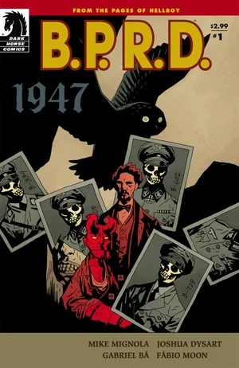
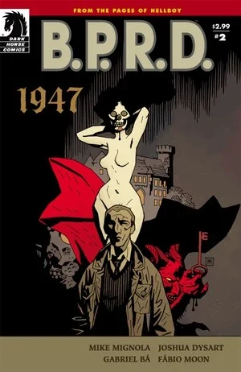
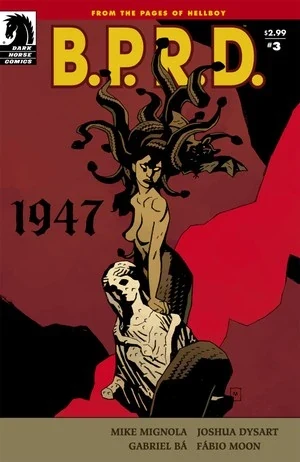
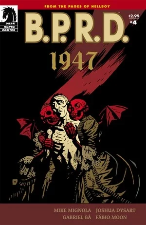
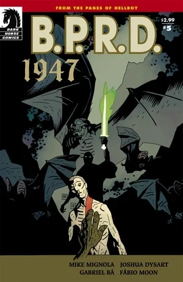

《**1947**》最初于 2009 年 7 月至 11 月作为一部五期满载的迷你系列出版。这是绘者 [Gabriel Bá](/entry/Gabriel_B%C3%A1) 与 [Fábio Moon](/entry/F%C3%A1bio_Moon) 在地狱男爵宇宙中的首秀。

## 剧情梗概

### 第一部分

1946 年，纳粹神秘学部门的“吸血鬼风暴计划”（Project Vampir Sturm）险些摧毁第二次世界大战结束后脆弱的和平。一年之后，B.P.R.D. 得知世上还存在着比纳粹造物远为古老、也远为危险的生物：一位孤身一人的吸血鬼贵族，正冷酷无情地猎杀第三帝国的幸存者。

### 第二部分

当队伍的其余成员四处搜寻失踪的同伴时，一名孤身探员追随他那神秘的女资助人，进一步深入她世界的黑暗深处。

### 第三部分

B.P.R.D. 最新的成员们在一座破败古堡的最深处搜寻失踪的战友，却被径直送进了一群令人作呕的吸血鬼的利齿之间。

### 第四部分

调查局对那个复仇吸血鬼的追查迎来高潮！在奥地利一个古怪的村庄里，数百年前曾举行过一场恐怖的聚会，而当年的与会者尚有残存至今者。与此同时，在美国，年幼的地狱男爵正梦想着冒险。

### 第五部分

双方都伤亡惨重，与吸血鬼的战斗终于结束。如今布鲁姆（Broom）必须请一位老友出马，进行一场离奇的驱魔仪式，以拯救其中一名士兵的灵魂。但这位驱魔人本人对布鲁姆收养的那个小恶魔颇为不满，他要就如何与黑暗势力作战给布鲁姆上一课。

## 画廊

封面作者 [Mike Mignola](/entry/Mike_Mignola)。

 \#1

 \#2

 \#3

 \#4

 \#5
