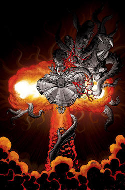
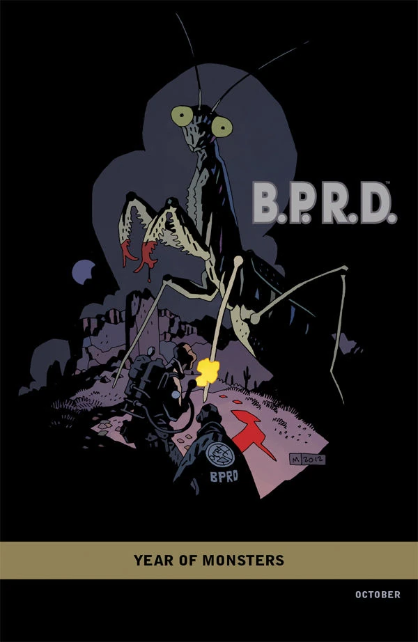
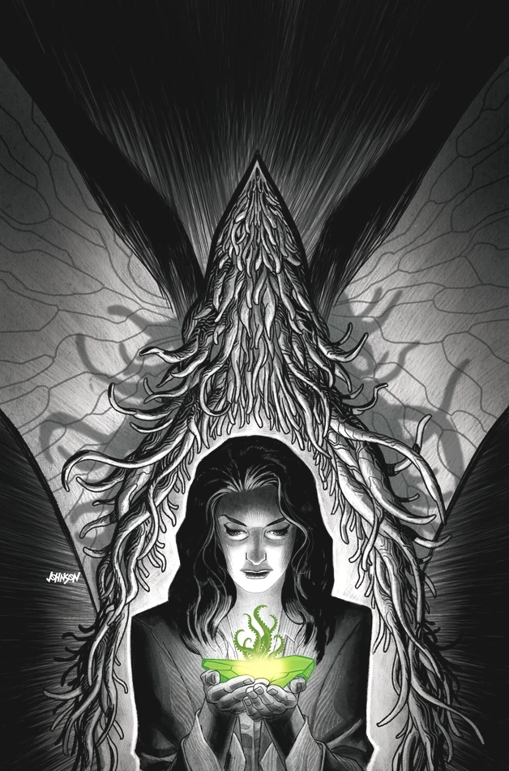
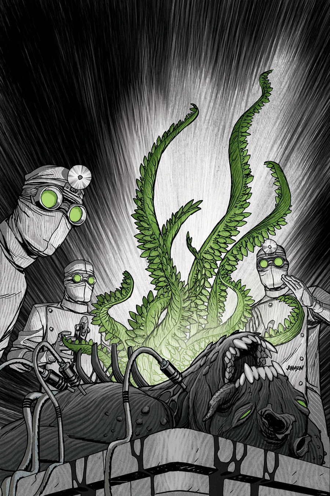
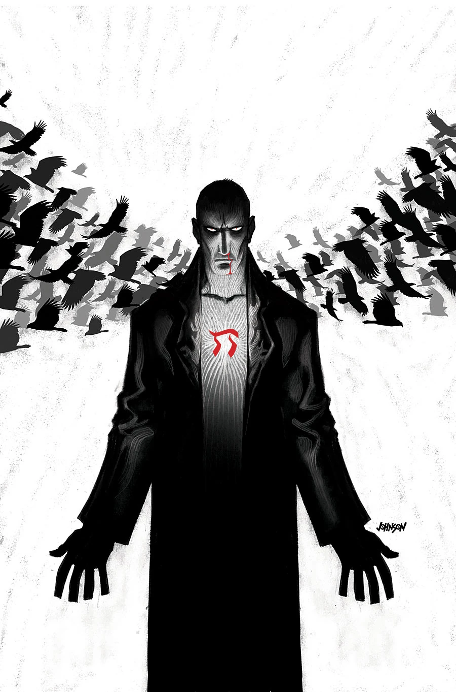

《**1948**》是一部五期限定迷你系列，自 2012 年 10 月起出版，由 [Max Fiumara](/entry/Max_Fiumara) 作画。

## 出版历史

各期封面由 Dave Johnson 绘制，首期另有一个「[怪兽之年](/entry/Year_of_Monsters)」变体封面，由 [Mike Mignola](/entry/Mike_Mignola) 绘制。这是第一部被排除在[内部编号体系](/entry/B.P.R.D._%28series%29)之外的《[B.P.R.D.](/entry/B.P.R.D._%28series%29)》迷你系列。

## 剧情概要

### 第一部分

[纳粹秘术局](/entry/Sonnenrad_Society)曾威胁要摧毁第二次世界大战结束后到来的和平。战后一年，[布鲁姆教授](/entry/Trevor_Bruttenholm)——幼年[地狱男爵](/entry/Hellboy_%28character%29)的监护人——召集了一支特别特遣队，要把一连串屠杀与一名疯狂的吸血鬼贵族之间的线索串联起来。如今，[超自然调查防御署](/entry/Bureau_for_Paranormal_Research_and_Defense)（B.P.R.D.）对一项以原子能驱动的太空旅行实验展开调查——该实验显然已在犹他州沙漠中放出了骇人的怪物。

### 第二部分

原子催生的怪物与 B.P.R.D. 之间的战斗在犹他州沙漠中激烈进行，布鲁姆教授与众探员成功杀死了其中一头怪物并进行尸检，结果令人毛骨悚然。

### 第三部分

怪物正在犹他州沙漠中杀害平民，这让布鲁姆教授回想起上一次政府行动撕裂现实、从另一个世界放出某种东西的事件：[拉格纳洛克计划](/entry/Project_Ragna_Rok)。

### 第四部分

种种迹象都指向沙漠中发现的那种神秘元素，认为它正是进入我们世界的骇人怪物的源头；与此同时，调查防御署探员们正在追猎引发这场混乱的那头怪物。

### 第五部分

偏执的情绪折磨着队员们：一名科学家开始怀疑，调查防御署的成员正被来自另一个宇宙的存在所顶替。

## 画廊

除另有说明外，封面均由 [Dave Johnson](/entry/Dave_Johnson) 绘制。

 \#1

 \#1 "[怪兽之年](/entry/Year_of_Monsters)" variant
by [Mike Mignola](/entry/Mike_Mignola)

 \#2

 \#3

 \#4

 \#5
