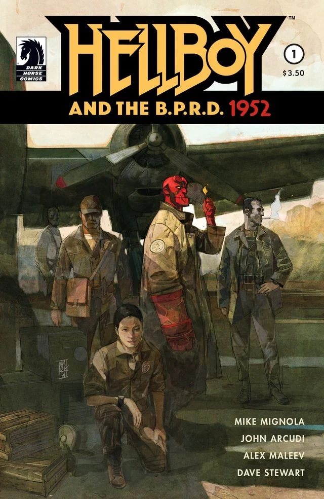
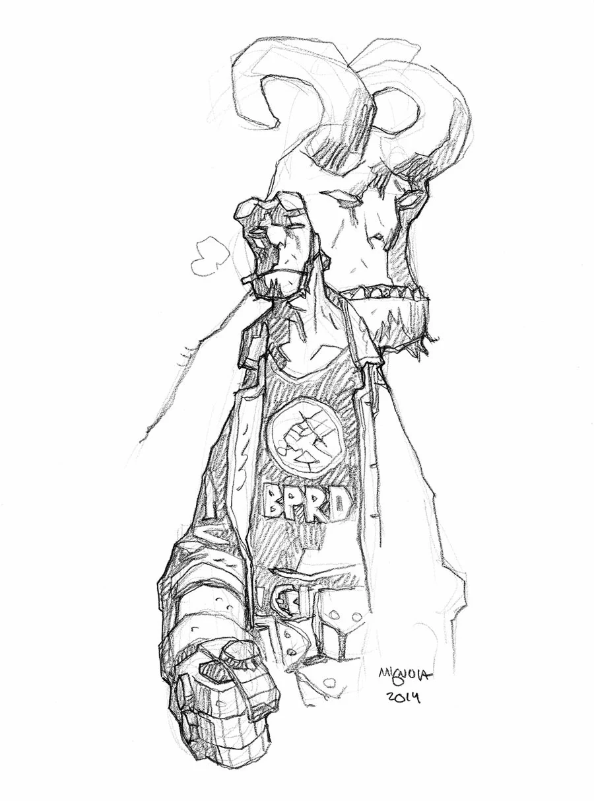
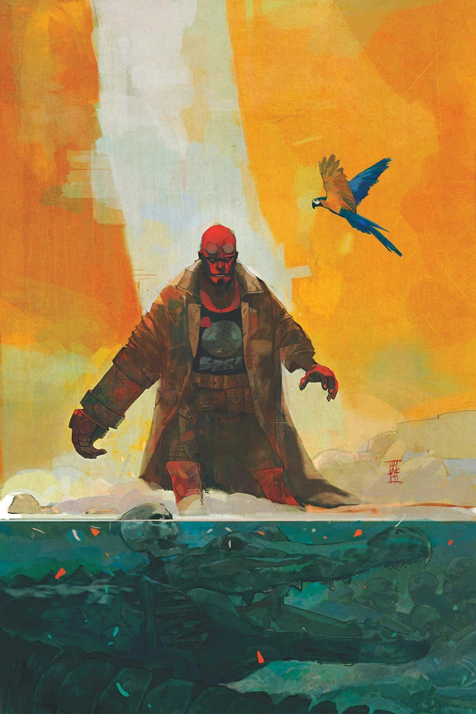
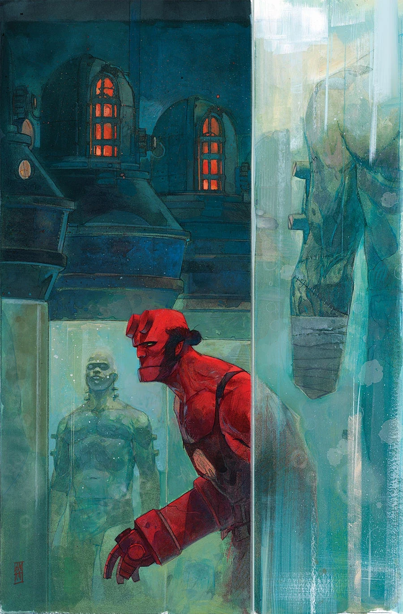
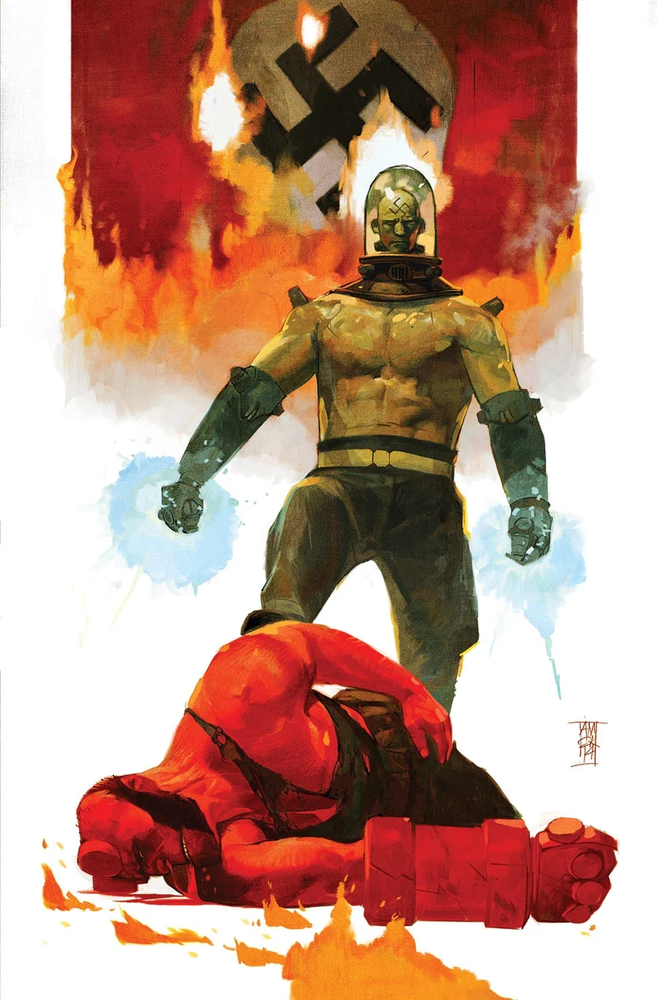

《**Hellboy and the B.P.R.D.：1952**》是一部五期满完的迷你系列，由 Alexander Maleev 作画，故事设定在 1952 年，讲述[地狱男爵](/entry/Hellboy_%28character%29)的第一次任务。

## 出版历史

该项目在 2014 年圣迭戈动漫展（San Diego Comic Con）开幕前几周才刚刚公布。Alexander Maleev 同时绘制了该系列的各期封面。

## 剧情简介

### 第一部分

一连串诡异的谋杀案，以及关于某种更可怕之物的传闻，促使[布鲁姆教授](/entry/Trevor_Bruttenholm)把年轻的[地狱男爵](/entry/Hellboy_%28character%29)派往巴西的一座村庄，执行他的第一次任务。地狱男爵与一小队特工在一座十六世纪葡萄牙要塞的阴影中，发掘出了某种可怕的东西……

### 第二部分

在巴西，地狱男爵与一小队 [B.P.R.D.](/entry/B.P.R.D.) 特工调查着发生在一座十六世纪葡萄牙要塞阴影中的恐怖而诡异的谋杀案，而他们发掘出的真相比想象中更加骇人。

### 第三部分

地狱男爵的第一次任务急转直下：队伍中的一名成员倒戈相向。地狱男爵能否在 B.P.R.D. 内部的袭击，以及潜伏在上方古老要塞中的重重恐怖攻势下幸存？

### 第四部分

一场爆炸把地狱男爵送进下水道，他发现自己迷失在一座葡萄牙要塞的地下。但当他找到出路时，却撞上了某种更加凶险的东西。

### 第五部分

地狱男爵发现了这座葡萄牙要塞、村庄里的谋杀案，以及幕后主使之人的可怕真相。但他能否把同伴们从怪物与疯子手中救出来？

## 画廊

除特别注明外，封面均由 [Alex Maleev](/entry/Alex_Maleev) 绘制。

 \#1

 \#1 sketch variant
by [Mike Mignola](/entry/Mike_Mignola)

 \#2

 \#3

 \#4

 \#5
