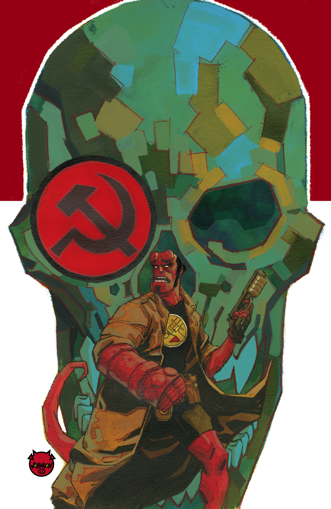
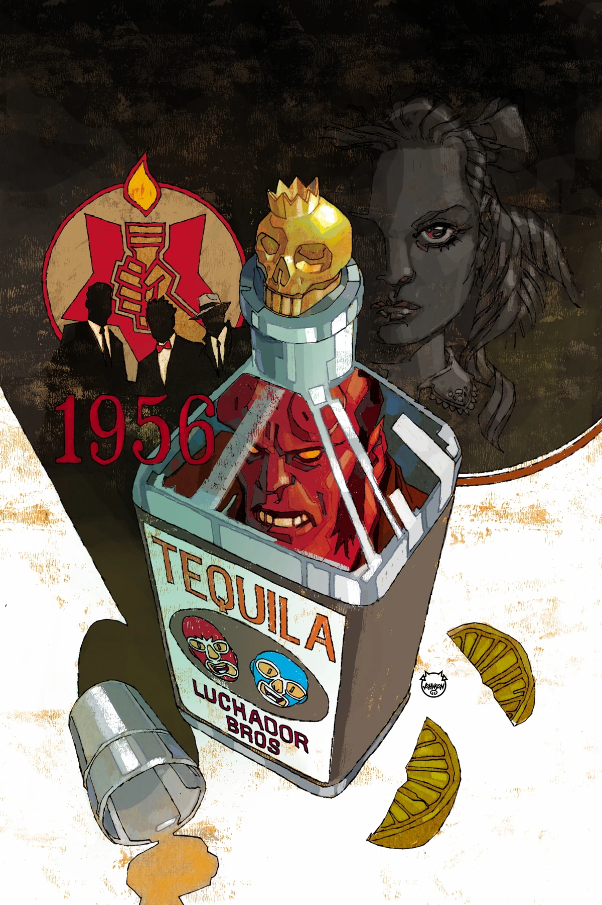
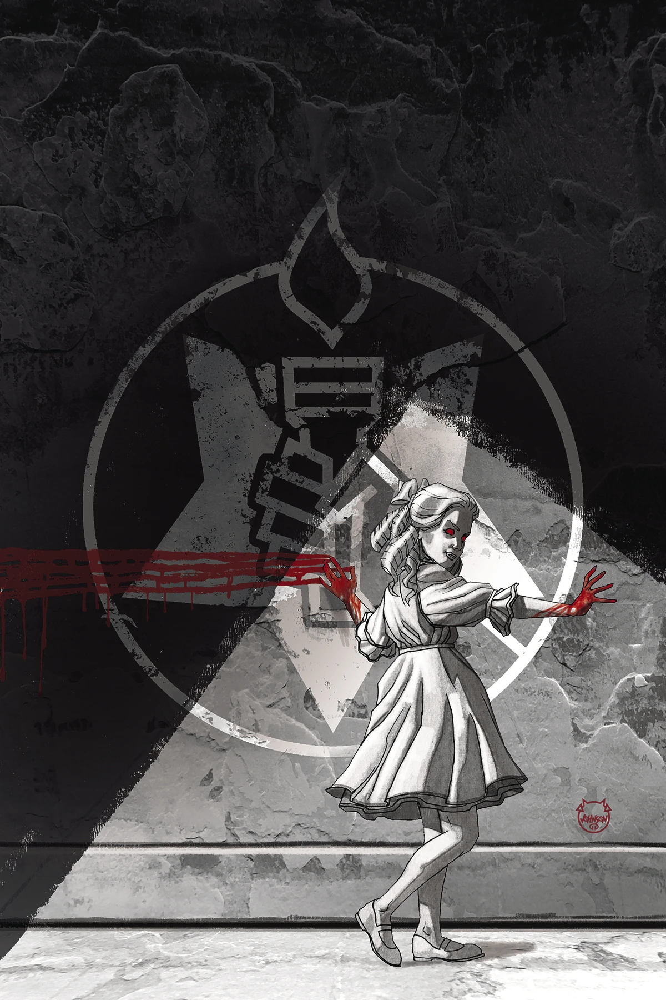
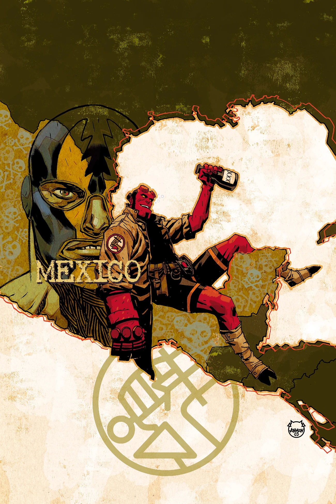

《**地狱男爵与 B.P.R.D.：1956**》（Hellboy and the B.P.R.D.: 1956）是一部由多位画师共同绘制的五期限定迷你系列。

## 出版史

《1956》于 2018 年圣迭戈国际动漫展（San Diego Comic-Con）上正式公布。

## 剧情梗概

### 第一部分

防御署内部急于查明苏联人的秘密计划，而一场可疑的掩盖行动让一名探员脱离监控、独自追寻真相。与此同时，苏联方面魔道领袖瓦尔瓦拉（Varvara）驱使手下团队为她一己的兴致效力；地狱男爵则被派去执行一项任务，这项任务最终引出了他在墨西哥那场声名狼藉的荒唐冒险。然而还有更隐秘的阴谋正在运作——B.P.R.D. 内外皆是如此。三条不同的故事线在这部谍战传奇中交织在一起。

### 第二部分

布鲁姆教授派出两名探员，沿相反方向执行不入账的秘密任务；与此同时，B.P.R.D. 失去了地狱男爵的行踪，他正在墨西哥境内四处游荡；而瓦尔瓦拉那些心爱的计划，在她手下的秘术科学家团队中激起了不满。

### 第三部分

特雷佛·布鲁姆博士在他那不入账的秘密调查中越陷越深，B.P.R.D. 不得不苦苦支撑，只求在与苏联对手的较量中领先一步。与此同时，苏联秘术团队内部的冲突持续升级，团队领袖瓦尔瓦拉与下属之间的紧张关系终于摊牌。

### 第四部分

布鲁姆的秘密调查突然以悲剧收场；地狱男爵迟迟不归，迫使他派出 B.P.R.D. 探员前往墨西哥搜寻。与此同时，苏联秘术团队领袖瓦尔瓦拉与下属之间的冲突彻底爆发！

### 第五部分

墨西哥对地狱男爵并不友好，但 B.P.R.D. 能否说服他返回总部、面对等待着他的那场痛苦重逢？与此同时，布鲁姆也不得不直面关于他自己、以及防御署未来的真相。

## 画廊

封面由 [Dave Johnson](/entry/Dave_Johnson) 绘制。

