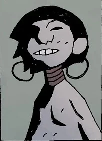
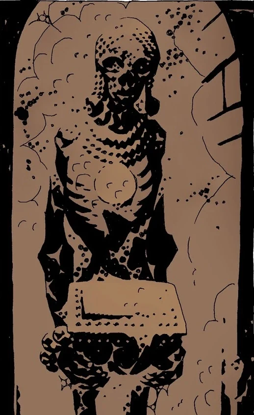
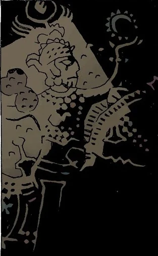

*本条目仍是一个小作品（stub）。你可以帮助地狱男爵维基扩充它。*

**阿布·贡（Abu Gung）**，又称“伟大的贡”，是短篇故事 *[《阿布·贡与豆茎》](/entry/Abu_Gung_and_the_Beanstalk)* 中的英雄与主人公的名字。据说他出身于姆大陆土地上的贡谷。

## 历史

### *[《神奇螺丝头》](/entry/The_Amazing_Screw-On_Head)*

阿布·贡短暂登场，是阿斯旺谷地一座神庙中一具会说话的尸体。他手中捧着卡拉基斯坦残片，据说残片上详细记载了他的生平，以及他在公元前 9632 年如何险些征服整个世界的经过。僵尸皇帝一心想知道贡是如何完成征服的，他拒绝听从贡死后留下的警告，从他遭亵渎的尸体手中夺走了卡拉基斯坦残片。
