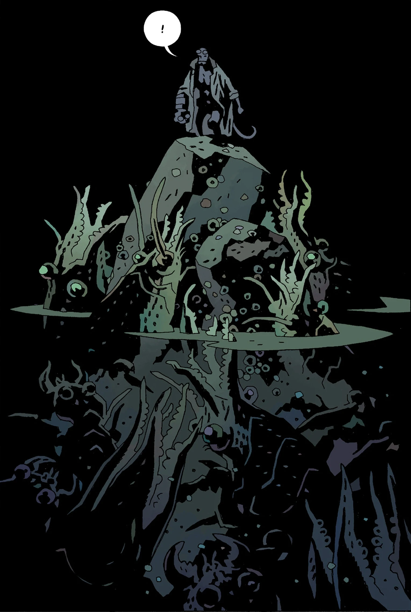
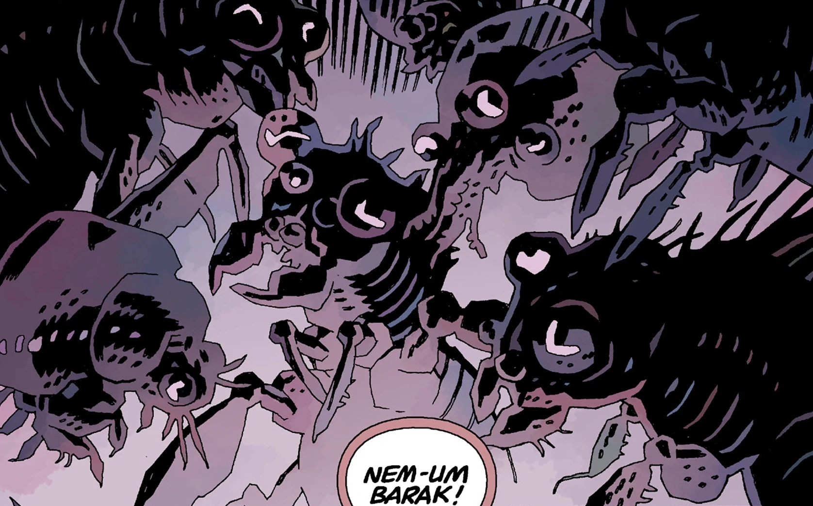

**深渊**（Abyss）是与[地狱](/entry/Hell)接壤的一个界域。

## 描述

爱德华·格雷爵士描述道，深渊是一道外缘，与混沌无底的深渊相毗邻。

这个界域栖息着许多形似水母和头足类动物的奇异生物。[普鲁托](/entry/Pluto)是[地狱](/entry/Hell)的第一位统治者，在他和他的[守望者](/entry/Watchers)们被[撒旦](/entry/Satan)及其追随者击败之后，他也栖身于此。

爱德华·格雷将其称为**塔耳塔洛斯**（Tartarus），称它低于地狱的程度，恰如天堂高于尘世。

尽管常有人说[奥古·桀哈](/entry/Ogdru_Jahad)居于深渊，但这实际上是对深邃太空的诗化描述，并非指与地狱接壤的那些区域。

## 居民

- [普鲁托](/entry/Pluto)
- 未命名的奇异生物

## 画廊

深渊中的生物。

同上。

栖身于深渊中的普鲁托。

|Creatures in the Abyss.

|Ditto.
