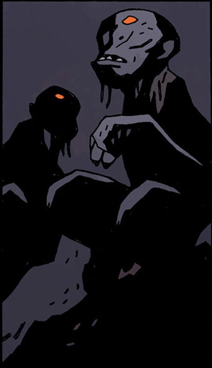

**阿刻戎河（Acheron）**是[地狱](/entry/Hell)诸河之一，被描述为“*承载哀愁的阿刻戎，漆黑而幽深*”。[爱德华·格雷](/entry/Edward_Grey)爵士被[恶魔](/entry/Demon)[阿姆杜西亚斯](/entry/Amdusias)拖入水中后，登上了这条河的河岸。

过去曾有未知的生物栖居于此，它们收集并缝合了爱德华·格雷爵士身体的各个部分。

[诸神黄昏](/entry/Ragna_Rok_(event))之后，格雷与[埃利戈斯](/entry/Eligos)交战，后者得到了[普鲁托](/entry/Pluto)赐予的力量。格雷用他的魔法将两人一同传送到阿刻戎河。在这个他死亡与重生之地，河水正是他力量的源泉；格雷褪去了自己的人性，彻底接受自己作为地狱生物的身份，摧毁了埃利戈斯，以阻止这位恶魔骑士毁掉地狱男爵创造的新世界。此后，爱德华·格雷化身为阿刻戎河本身，并与他的兄弟姐妹——地狱的另外四条河——汇合。

