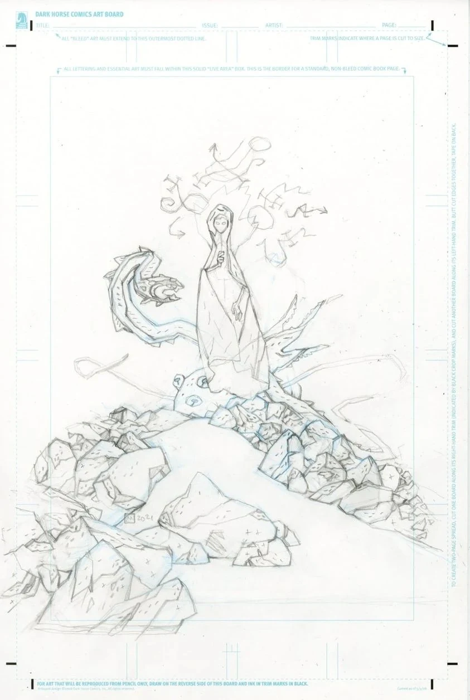
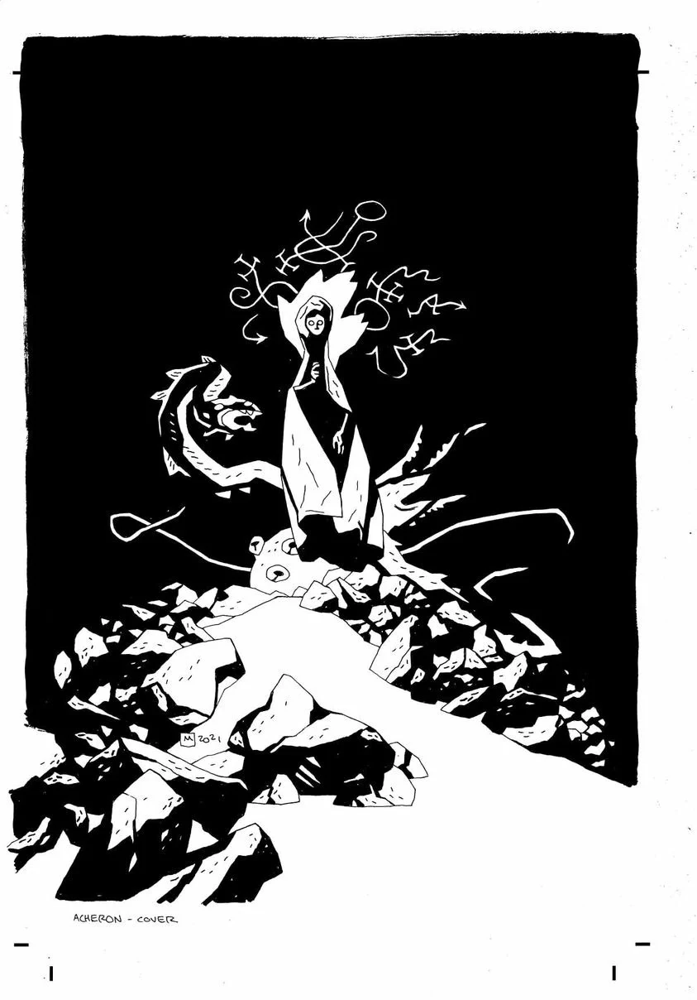
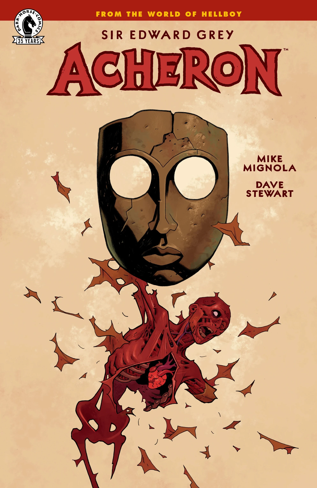

***《爱德华·格雷爵士：阿刻戎》（Sir Edward Grey: Acheron）***是一部 2021 年的单篇漫画，由 [迈克·米格诺拉](/entry/Mike_Mignola) 自编自绘，也是他自 2016 年的[*《地狱男爵：在地狱》*第 \#10 期](/entry/For_Whom_the_Bell_Tolls)以来第一部完整漫画。故事设定在 *[《B.P.R.D.：魔鬼旧相识——拉格纳洛克》](/entry/Ragna_Rok_(story_arc))* 的事件之后。

## 剧情简介

[地狱男爵](/entry/Hellboy_(character))已经离去，[超自然调查防御署](/entry/Bureau_for_Paranormal_Research_and_Defense)设法抵挡住了地球上的怪物，为人类勉强争取到逃入地下的时间；但[爱德华·格雷](/entry/Edward_Grey)必须重返[地狱](/entry/Hell)，去面对一位老对手，并完成真正拯救世界所必须了结的事。

## 画廊

*《爱德华·格雷爵士：阿刻戎》*  
迈克·米格诺拉与戴夫·斯图尔特绘制封面

*《爱德华·格雷爵士：阿刻戎》*  
迈克·米格诺拉的铅笔稿

*《爱德华·格雷爵士：阿刻戎》*  
迈克·米格诺拉的墨线稿

*《爱德华·格雷爵士：阿刻戎》*  
[Ben Stenbeck](/entry/Ben_Stenbeck) 绘制封面

|Sir Edward Grey: Acheron Mike Mignola's pencils

|Sir Edward Grey: Acheron Mike Mignola's inks

|Sir Edward Grey: Acheron cover by Ben Stenbeck
## 内容

### 角色

- 人类
  - [爱德华·格雷](/entry/Edward_Grey)
  - 迪恩先生（Mr. Dean）
  - 詹克斯先生（Mr. Jenks）
  - 阿梅莉亚·邓恩（Amelia Dunn）
  - [安格斯·韦尔](/entry/Angus_Weir)（Angus Weir）（闪回）
  - [莫赫洛米](/entry/Mohlomi)（Mohlomi）（闪回）
  - [伊扎尔·霍夫曼](/entry/Izar_Hoffman)（Izar Hoffman）（闪回）
  - [格里高利·拉斯普廷](/entry/Grigori_Rasputin)（闪回）
- 恶魔
  - [埃利戈斯](/entry/Eligos)
  - [地狱男爵](/entry/Hellboy_(character))（闪回）
  - [别西卜](/entry/Beelzebub)（闪回）
  - [撒旦](/entry/Satan)（闪回）
- [奥古·桀哈](/entry/Ogdru_Jahad)
- [普鲁托](/entry/Pluto)
- 人格化的地狱诸河
  - [斯堤克斯](/entry/Styx)
  - [科赛特斯](/entry/Cocytus)
  - [勒忒](/entry/Lethe)
  - [佛勒革同](/entry/Phlegethon)

### 地点

- [地狱](/entry/Hell)
  - [深渊](/entry/Abyss)
  - [塔耳塔洛斯](/entry/Tartarus)
