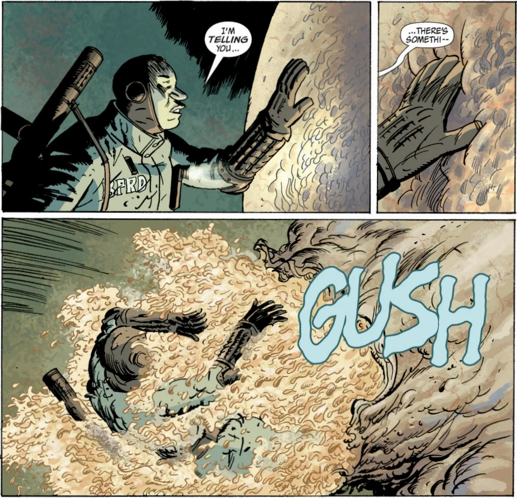

> "*老天*，纳瓦罗，你*到底*能不能不抱怨了？"——[本·达米奥](/entry/Benjamin_Daimio)

探员**纳瓦罗**是超自然调查防御署故事线中的一个角色，在 [《黑焰》](/entry/The_Black_Flame) 中以超自然调查防御署探员身份登场。他是一支由本·达米奥率领的清剿小队成员，任务是从一座污水处理厂清除 [青蛙怪物](/entry/Frog_monster)。

## 经历

纳瓦罗是超自然调查防御署的探员，大多数出场中都与本·达米奥和 [罗杰](/entry/Roger) 一起执行清剿任务——这些任务主要是搜寻青蛙怪物的巢穴与藏身处，用重火力枪械、火焰喷射器、榴弹发射器及其他武器尽可能多地消灭它们。纳瓦罗出场时主要手持枪械，从未见他脱下制服的样子。

在安大略省雷斯（Raith）郊外执行任务时，纳瓦罗与罗杰在一起，[黑焰](/entry/The_Black_Flame_(character)) 突然降临，将建筑物及周围区域焚毁殆尽，杀死了所有探员，并烧焦了罗杰的身体。

## 性格

纳瓦罗探员在战场上十分直言不讳，敢于抱怨或评论自己所处的境况。尽管如此，他从不会在任务面前退缩，而是满怀热忱、忠心耿耿地为超自然调查防御署效力。纳瓦罗天性好奇，有时好奇心甚至压过了谨慎。

在污水处理厂执行任务时，纳瓦罗不顾达米奥的警告，走近并触碰了一个青蛙怪物的孵育器；结果孵育器在他触碰下破裂，他被黏液和蝌蚪浇了一身。

纳瓦罗生性爱就任何话题搭话聊天，可以说嘴上毫无遮拦。

1.  [↑](#cite_ref-1) [《黑焰》（故事）](/entry/The_Black_Flame_(story))
