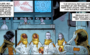

 **阿科量子系统（Ako Quantum Systems）**是一家由日本政府资助的最高机密封量子研究所。

## 历史

### [*B.P.R.D.：人间地狱——破碎的方程*](/entry/The_Broken_Equation)

1979 年，阿科量子系统在日本政府的联邦管辖范围之外运作，以便保留合理推诿的余地。

该组织致力于研究久京舜教授那套颇具争议的「凝聚能量系统方程」，该方程提出平行现实不仅存在，而且是可以抵达的。

组织在日本埼玉地下的一座掩体中进行实验。他们成功打开了一道裂口，由久京教授率领的一队科学家跨过了门槛。然而进入后不久，一头怪物钻了出来，在实验室里屠杀了科学家们。阿塔马博士设法电击了那只生物，是唯一的幸存者。这场灾难性事故之后，设施被拆除，其存在也被彻底抹去。

关停六个月后，那座废弃实验室里探测到一处异常：已成植物人的久京教授躺在那里等待着，他身后是一扇敞开的、通往另一现实的大门。科学家们发现久京的大脑正在接收来自大门另一侧的信息。三十年来，该组织一直在监测教授的状况，并设法与他建立起初步的沟通——教授会写下大量详尽而复杂的方程。

2011 年，久京停止了书写方程，开始画一只巨型怪物的图像；与此同时，两只[奥古·赫姆](/entry/Ogdru_Hem)开始在埼玉肆虐。看到这一令人不安的变化，日本科学家联系了正在该地区行动的 [B.P.R.D.](/entry/Bureau_for_Paranormal_Research_and_Defense) 特遣队，称他们或许有办法对付这些生物。还没等他们进一步说明，久京突发精神崩溃，导致维持大门的机器发生波动并爆炸。一只来自另一个世界的巨型生物现身，开始与奥古·赫姆交战并将其击败，B.P.R.D. 和阿科系统幸存的科学家们则满怀敬畏地在一旁观看。
